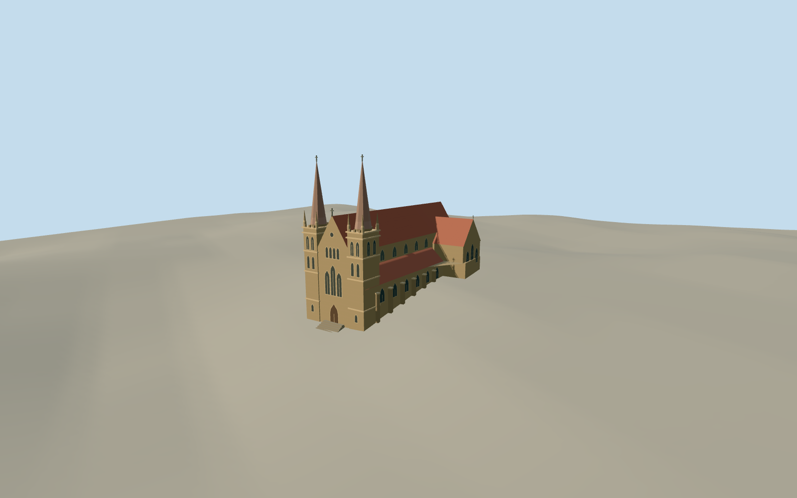

# Saint Patrick's Cathedral, Karachi

Sandstone Gothic Revival cathedral with paired needle spires, a tall three-lancet arrival, red roofs, projecting transepts and side buttresses.

Authoring state: **review-in-qa.json**. Current completion evidence is in [qa.json](qa.json) and the [completion ledger](../../../../qualla-structures/batches/qualla-003.PROGRESS.md).

- [Saint Patrick's Cathedral, Karachi](https://qualla.com/saint-patrick-s-cathedral-karachi/)

Tower heights, spire dimensions, chancel fenestration and roof join positions are estimates. Native mapping controls the lower body, while the central front and paired spires are proportioned from the cleared original.

The model covers the cathedral. The independently mapped Christ the King Monument, schools and trees of the precinct are outside this model.

Build: `node content/worldgen/source/places/tk/tkr/saint_patrick_s_cathedral_karachi/models/generate-saint-patrick-s-cathedral-karachi.mjs`. Add `--check` to verify exact regeneration. 2473 triangles; 4 materials; no embedded photographs.
