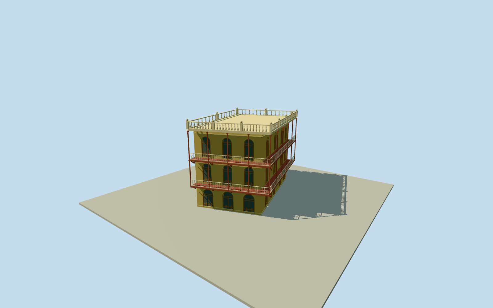

# Wazir Mansion

Whole surviving Wazir Mansion/Jinnah birthplace museum exterior on actual named buildingway692307507/allfive unique native controls, not a neighboring house or unrelatedFaizMahal: three-storey yellow ochre masonry shell, complete three-bay round-headed front openings, both full red projecting wraparound verandas/true open soffits/slender posts/diagonal brackets/cream original geometric rails, cream open roof balustrade/post-ball finials/flat roof and bounded hidden side/rear finish/openings. Native whole parcel/body retained, no facade-only panel or sealed balcony box. Exclude attached unrelated buildings/whole streets/police barriers/people/wires/signs/lettering/temporary rooftop tarp/private museum interiors; unseen current sections/census bounded original estimates.

Authoring state: **review-in-qa.json**. Current completion evidence is in [qa.json](qa.json) and the [completion ledger](../../../../qualla-structures/batches/qualla-002.PROGRESS.md).

- [Wazir Mansion](https://qualla.com/wazir-mansion/)

Whole named museumway692307507/Q7976938/allfive native controls. Fullthree-storey body/three front round-headed bays eachlevel/two openL verandas/slenderredposts/diagonalbrackets/cream original geometric rails/flat roof/open turnedbaluster parapet and ball finials. Western partywall/rear and hidden street-return opening census bounded estimates, no facade-only box/neighborhouse/private interiors.

Qualla-first29families/0conflicts. SolePDlabelledFaizMahal depicts unrelatedKhairpurpalace excluded without pixels; exact24-fileWazir category yielded Miansari66 Own/self|cc-zero2016-12-12 whole4896x3672 original/nativeSHA1matched/terminalexact1file rights and individually inspected. Only clearCC0original used. No protected plans/pixels/signs/artwork/borrowed mesh/generatedbitmap/policy changes.

After independent ground frozen: original bounded floor+.18/three4.05m storeys/roof12.35/slab.24/two1.55m projectingL verandas/.22m slabs/slenderposts/1m geometric creamrails/1.05m open roof balustrade. Skyline coarsens arches/roofbalusters, omits returnwindows/brackets/fineframing but preserves open verandas/nativebody/three-storey front. Hidden sections/census/current finish unsurveyed; temporary rooftop tarp/people/policebarriers/neighbors/signs/wires excluded.

Independent400m129x12916641-value sourcefield/one rawtile/PNG frozen before floor/wall/roof/veranda choices unchanged. Public urban relief not construction-grade, possible building/canopy artifacts; exact source/host footing/threshold contact unresolved/replacementfalse. Flat appearance separate; no terrain fitting/flattening/reacquisition or whole-sitepad.

Build: `node packages/worldgen/scripts/generate-authored-places.mjs --ids=wazir_mansion`. Add `--check` to verify exact regeneration. 25591 triangles; 6 materials; no embedded photographs.
