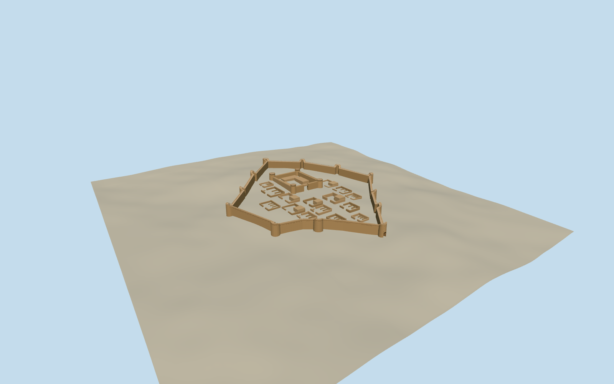

# Rayen Castle

The complete adobe ramparts of Rayen Castle, with rounded wall towers, an arched eastern entrance, lower ruins and the elevated inner citadel.

Authoring state: **review-in-qa.json**. Current completion evidence is in [qa.json](qa.json) and the [completion ledger](../../../../qualla-structures/batches/qualla-003.PROGRESS.md).

- [Rayen Castle](https://qualla.com/rayen-castle/)

The outer outline and tower arcs are mapped. Gateway station, wall thicknesses, sectional heights and position of interior groups are estimates.

The lower ruin courts and raised inner citadel are representative exterior geometry. Roof loss, room-level archaeological accuracy and unseen interior details are outside scope.

Modern terrain is preserved. Relative terrace heights and present foundation conditions remain approximate.

Build: `node content/worldgen/source/places/tm/tm2/rayen_castle/models/generate-rayen-castle.mjs`. Add `--check` to verify exact regeneration. 19140 triangles; 4 materials; no embedded photographs.
