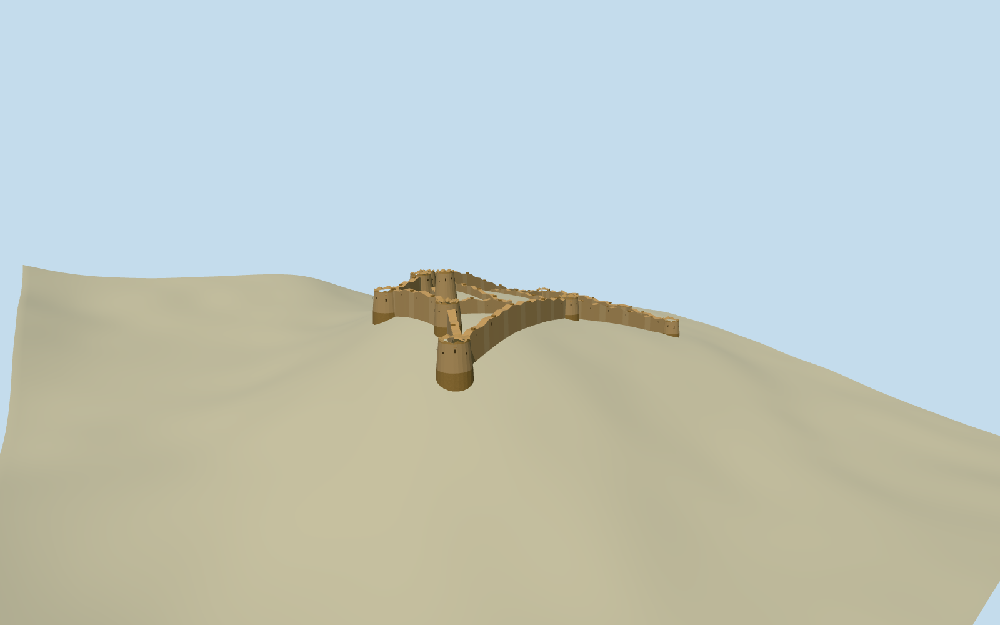

# Furg Citadel

Forg’s ridge-top citadel, with an uneven earthen perimeter, round battered towers, the higher western compound, and the lower eastern gate.

Authoring state: **review-in-qa.json**. Current completion evidence is in [qa.json](qa.json) and the [completion ledger](../../../../qualla-structures/batches/qualla-004.PROGRESS.md).

- [Furg Citadel](https://qualla.com/furg-citadel/)

The model represents the hilltop structure’s present exterior character. Internal rooms, underground features and exact individual interior ruins have no verified geometric record here.

Overall plan and terrain follow the native map and elevation. Tower positions between vertices, wall heights, unseen exterior detail and repair phases use conservative estimates.

Build: `node content/worldgen/source/places/tm/tmf/furg_citadel/models/generate-furg-citadel.mjs`. Add `--check` to verify exact regeneration. 5082 triangles; 4 materials; no embedded photographs.
