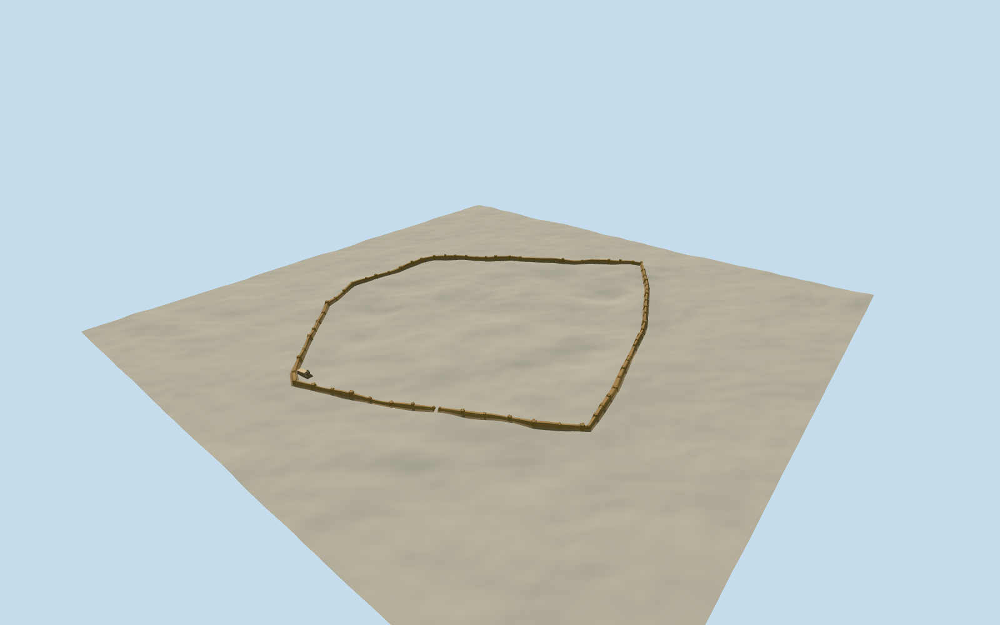

# Farah Citadel

Farah’s eroded earthen walls and round bastions, the southeast gate passage and the surviving pale columned portico.

Authoring state: **review-in-qa.json**. Current completion evidence is in [qa.json](qa.json) and the [completion ledger](../../../../qualla-structures/batches/qualla-003.PROGRESS.md).

- [Farah Citadel](https://qualla.com/farah-citadel/)

The wall and bastion positions follow the named mapped circuit. The surfaces and top heights represent weathered 2004 ruins, with erosion, wall widths and gateway profile estimated.

The two cleared photographs record the portico and ruined attached wing. The model places them on the nearby rising ground from the approximate common photo position. Portico scale, placement and rear construction are estimated.

Original independent elevations are preserved. The model covers the visible fortified perimeter and photographed portico. Exact subsurface features and lost interior structures remain outside the reconstruction.

Build: `node content/worldgen/source/places/tm/tmu/farah_citadel/models/generate-farah-citadel.mjs`. Add `--check` to verify exact regeneration. 9852 triangles; 5 materials; no embedded photographs.
