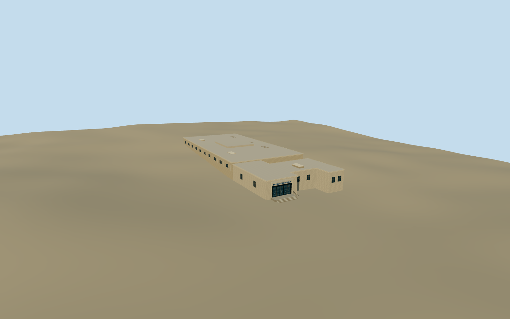

# Sulaymaniyah Museum

The purpose-built Slemani Museum on Salim Street, with a low long gallery block and stepped street-facing entrance range.

Authoring state: **review-in-qa.json**. Current completion evidence is in [qa.json](qa.json) and the [completion ledger](../../../../qualla-structures/batches/qualla-003.PROGRESS.md).

- [Sulaymaniyah Museum](https://qualla.com/sulaymaniyah-museum/)

The documented site area of about 6,000 square metres includes outdoor grounds. The building uses the two exact native roof polygons instead.

The sign is a plain identification label. Exact cladding, relief artwork, doors, parapet height, glazing and window spacing are approximate. The exterior is based on written, non-photographic facts.

The related story’s only CC0 photograph shows a different museum. That photo, restricted exterior photography, interiors and museum exhibits were excluded.

Build: `node content/worldgen/source/places/tn/tn2/sulaymaniyah_museum/models/generate-sulaymaniyah-museum.mjs`. Add `--check` to verify exact regeneration. 2029 triangles; 5 materials; no embedded photographs.
