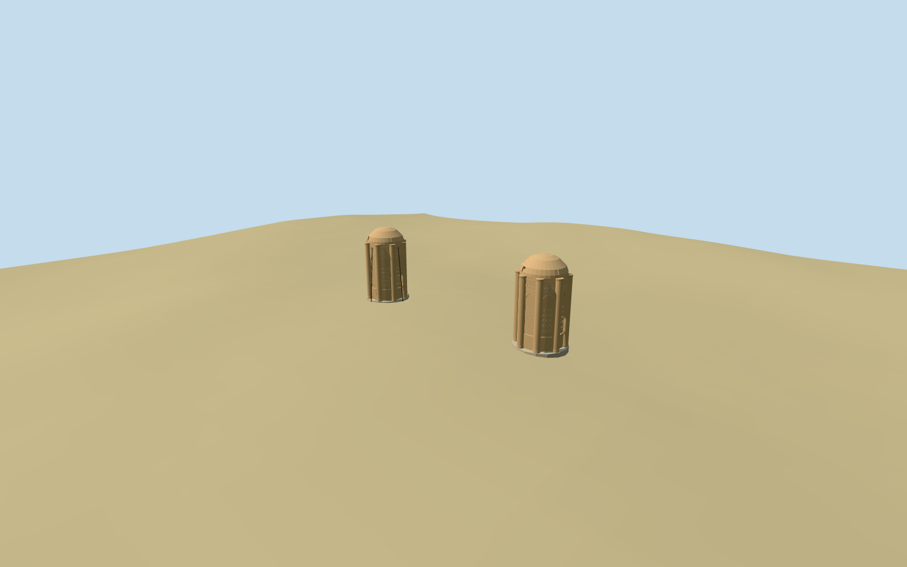

# Kharaqan Towers

Specific paired Kharaqan mausoleums at one archaeological site: two separate mapped octagonal brick masses/rounded corner shafts, tall recessed pointed fields, original broad geometric brick relief and upper friezes, shallow curved brick caps with real lower slots. Distinguish the more ornate eastern panels from the western panels and restrained stabilizing struts. Small separate grade-seated brick footings; no platform across the gap or entire archaeological-site replacement. No copied inscriptions, image atlas, furnished tomb chambers or restored perfect sealed roofs.

## Evidence and reconstruction

Published dimensions and reconstructed details are separated in spec.json. Primary references:

- [Reference](https://commons.wikimedia.org/wiki/File:Kharaghan_Twin_Towers.jpg)
- [Reference](https://commons.wikimedia.org/wiki/File:01_sharaghan_(22).jpg)
- [Reference](https://commons.wikimedia.org/wiki/File:Kharraqan_Towers_Qazvin_(Eastern_Tower).jpg)

Specific paired Kharaqan mausoleums at one archaeological site: two separate mapped octagonal brick masses/rounded corner shafts, tall recessed pointed fields, original broad geometric brick relief and upper friezes, shallow curved brick caps with real lower slots. Distinguish the more ornate eastern panels from the western panels and restrained stabilizing struts. Small separate grade-seated brick footings; no platform across the gap or entire archaeological-site replacement. No copied inscriptions, image atlas, furnished tomb chambers or restored perfect sealed roofs.

## Model and axes

11,484 triangles; 34,452 vertices; 4 material groups; 1,381,016 bytes. Native bounds: -20.852, -1.230, -4.291 to 27.265, 15.205, 6.915. Source hash: `sha256:4d37db85bcc59b9badbab39bc56836325f5aa557a86aedc272b7ab9f02e74f45`.

{"x":"east","y":"up","z":"south"}

The geographic proposal uses exact-QID OpenStreetMap evidence. Map-derived orientation and estimated architectural details require real-site visual review; preview eligibility is distinct from geographic/fidelity approval. Map attribution: © OpenStreetMap contributors, ODbL-1.0.

## Reproduce

Run `node packages/worldgen/scripts/generate-additional-landmarks.mjs --ids=kharaqan_towers` (or add `--check`). The generator preserves manually edited masters by checking their baseline hashes. Import through the standard authored-model workflow with optimization disabled; then capture all QA cameras, including shared-surface views.

## Pending work

- Specific paired Kharaqan mausoleums at one archaeological site: two separate mapped octagonal brick masses/rounded corner shafts, tall recessed pointed fields, original broad geometric brick relief and upper friezes, shallow curved brick caps with real lower slots. Distinguish the more ornate eastern panels from the western panels and restrained stabilizing struts. Small separate grade-seated brick footings; no platform across the gap or entire archaeological-site replacement. No copied inscriptions, image atlas, furnished tomb chambers or restored perfect sealed roofs.
- Exact-QID OSMway523609290 is the broad archaeological site, not either tower footprint. Two standard PMTiles15m-high rounded footprints35184977138948/949 inside it control the west/east tower centers and diameter. Named Kharraqan attraction35184895698122 lies about100m north and is not used as a tower anchor. Retain candidate reference anchor49.009027777,35.840055555 with heading0/native east-south axes; separate centers are [{"name":"west","center":[-16.069042296394127,0.4925113516983215],"radius":4.466394197736715},{"name":"east","center":[22.658479209529048,2.3078642712985524],"radius":4.486896107087301}]. The mapped pair spacing is 38.77004550183612m. Circular quantization does not establish directed facades. Whole photographs show the eastern foreground tower and western tower behind/right; approximate northeast entry/panel phase is inferred from that relation, with45degree uncertainty and2m plan uncertainty, not a surveyed azimuth.
- Each native map shell reports15m height without a measured-point qualifier. Use nominal12m wall/corner-shaft height and3m curved cap rise. Relative frieze/panel/portal heights, shaft radii, outer cap slots, decorative schedule and west stabilizing-member assignment are picture-led visualization estimates. Preserve the documented roof openings; no perfect historical dome restoration or literal inscription inventory.
- Original6m standard Mapzen grid, native paths/water and the one independent mapped utility/visitor building remain unchanged. Each tower has its own level floor just above the highest sampled occupied rim and a bounded buried footing below the lowest rim. No connecting precinct slab, ground/water cutout or flattened terrain. Coarse DEM/contact/plinth levels are visualization estimates, not surveyed archaeology or foundation engineering.
- Two ordinary whole photographs (2017/2024) plus one2011 western brick detail carried through construction. Upper slot geometry, relief inventory, architectural phase/entrance facing, repair condition and stabilizer allocation remain explicit approximations. No literal inscription, photograph atlas, historic perfect restoration or furnished chamber.

This bundle follows the medium-fi standard. Medium-fi appearance and geographic fit are reviewed separately. Hash-bound visual acceptance is recorded separately after capture inspection.
