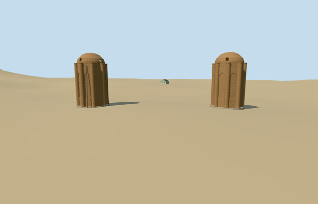

# N0597 — Kharaqan Towers

Reviewed 2026-10-20 in one continuous author/build/inspect/fix round.

## Appearance

Inspected51 final current source/shared/context/native views. Specific twin octagonal brick mausoleums keep their mapped separation, eight rounded corner shafts each, deep pointed blind panels, original broad brick basket/chevron/diamond relief, upper string courses and shallow curved hollow caps with four actual lower slots per tower. Western stabilizers and panel schedule distinguish the western tower. Fixed curved pointed frames, inward slot reveals/collapsed inner-cap winding and western struts obstructing the entrance during construction; widened the ground-gap camera for the square shared viewport. No traced inscriptions or image atlas, perfect sealed historical dome, furnished tomb interior or connecting precinct platform.

## Shared materials and browser levels

Three existing256-square graphs (brick, stone_sandstone_raw and metal_painted) supply four merged surface groups. Brick is shared by wall and relief slots; metric repeats/linear tints, no embedded images. At most four runtime draws; skyline one flat merged draw with baked graph means. Source11484triangles/1381016bytes. Runtime streams are separate, CPU/GPU byte counts agree, graph reads occur once and eviction releases all model geometry.

| Level | Triangles | Bytes | Draws |
| --- | ---: | ---: | ---: |
| skyline | 876 | 94316 | 1 |
| district | 3260 | 305032 | 4 |
| street | 8300 | 785644 | 4 |
| closeup | 11484 | 1091108 | 4 |

Inspected street/block/skyline at noon and late afternoon in Economy/High, texture-free silhouette, close details and all four transitions. Four levels remain under1000/4000/16000/64000 triangles; skyline+district total399348bytes, below3MB phone/6MB laptop targets. Small relief and thin stabilizers drop at distance while both octagons, rounded shafts and open segmented caps survive. Synthetic context terrain-tile edges are fixture boundaries; native-site captures establish actual fit. Physical-device/dense-city timing remains pending.

## Approximate map fit

Exact-QID OSMway523609290 is the broad archaeological site, not either tower footprint. Two standard PMTiles15m-high rounded footprints35184977138948/949 inside it control the west/east tower centers and diameter. Named Kharraqan attraction35184895698122 lies about100m north and is not used as a tower anchor. Retain candidate reference anchor49.009027777,35.840055555 with heading0/native east-south axes; separate centers are [{"name":"west","center":[-16.069042296394127,0.4925113516983215],"radius":4.466394197736715},{"name":"east","center":[22.658479209529048,2.3078642712985524],"radius":4.486896107087301}]. The mapped pair spacing is 38.77004550183612m. Circular quantization does not establish directed facades. Whole photographs show the eastern foreground tower and western tower behind/right; approximate northeast entry/panel phase is inferred from that relation, with45degree uncertainty and2m plan uncertainty, not a surveyed azimuth. Original6m standard Mapzen grid, native paths/water and the one independent mapped utility/visitor building remain unchanged. Each tower has its own level floor just above the highest sampled occupied rim and a bounded buried footing below the lowest rim. No connecting precinct slab, ground/water cutout or flattened terrain. Coarse DEM/contact/plinth levels are visualization estimates, not surveyed archaeology or foundation engineering. All four loaded levels replace only native building35184977138948 and35184977138949 with zero residual shells. The one independent building, original6m terrain/paths and zero-water condition remain unchanged. Failed loading preserves all3 originals; eviction restores ground/water and releases geometry. Separate grade-seated footings retain clear native ground across the39m pair gap. Architectural phase and signed door orientation remain picture-led45degree approximations; no survey accuracy is claimed.

## Limits

Each native map shell reports15m height without a measured-point qualifier. Use nominal12m wall/corner-shaft height and3m curved cap rise. Relative frieze/panel/portal heights, shaft radii, outer cap slots, decorative schedule and west stabilizing-member assignment are picture-led visualization estimates. Preserve the documented roof openings; no perfect historical dome restoration or literal inscription inventory. Two useful whole2017/2024 ordinary photographs plus one2011 western masonry detail carried through this single construction pass. The rendered exterior preserves that visible condition; later repairs, exact inscriptions, all stabilizer allocations and fine masonry inventory remain unverified. Small separate buried footings are coarse-DEM visualization aids, not measured foundations.

## Selected checks

Six Khronos files: zero errors/warnings.210 actual mesh/material/contact checks; 51 current inspected views. Scene validation/sim30 and strict selected medium-fi audit pass. Source/runtime/LOD hashes and material bindings verified.

Rebuild: node packages/worldgen/scripts/generate-additional-landmarks.mjs --ids=N0597; node packages/worldgen/scripts/import-next-1000-models.mjs --ids=N0597; node packages/tooling/scripts/generate-landmark-lods.mjs --ids=N0597 --force.

Source: sha256:4d37db85bcc59b9badbab39bc56836325f5aa557a86aedc272b7ab9f02e74f45

Runtime: sha256:33230b16697ab25c6f9db0f4288470d207f4a25f220787e0ce7daa543e7e1e0a

Input: sha256:d080b28b056f97dd18ef3e8113eeb2e1e7003363f5d17d98f7cccbd5548b5305

## Viewed ordinary pictures

https://commons.wikimedia.org/wiki/File:Kharaghan_Twin_Towers.jpg — AlChtzn; CC-BY-SA-4.0. Viewed only; no pixels copied.

https://commons.wikimedia.org/wiki/File:01_sharaghan_(22).jpg — Moosavipour140; CC-BY-SA-4.0. Viewed only; no pixels copied.

https://commons.wikimedia.org/wiki/File:Kharraqan_Towers_Qazvin_(Eastern_Tower).jpg — Soroush R1998; CC-BY-4.0. Viewed only; no pixels copied.
