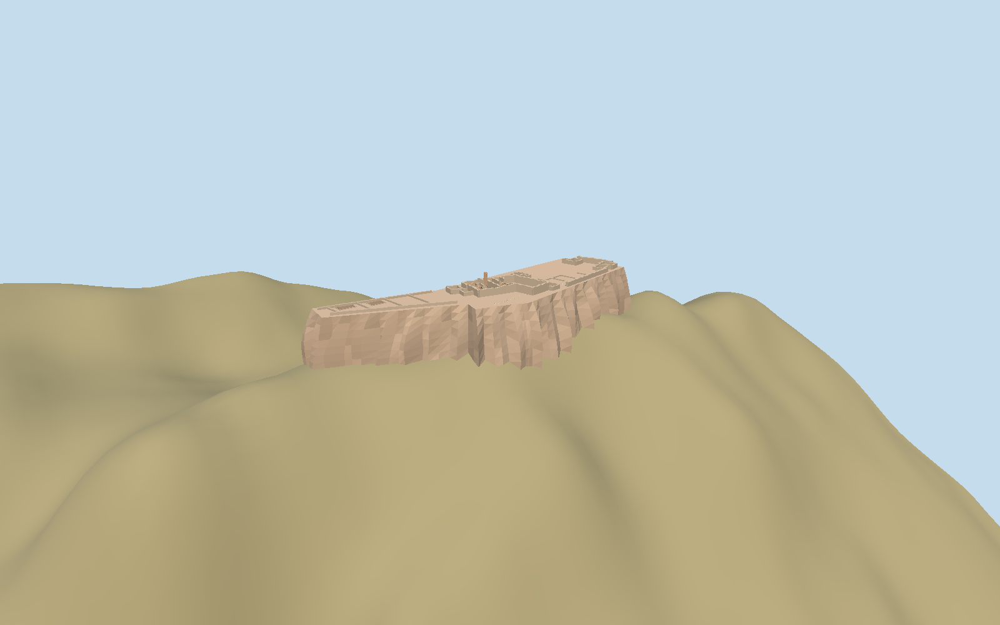

# Alamut Castle

Roofless Alamut upper-castle ruins on a narrow fluted rock ridge, with ten mapped ruin groups, northwest cells, open rock-cut reservoirs, brick arch remnants, broken stone walls and eastern approach stairs.

## Evidence and reconstruction

Published dimensions and reconstructed details are separated in spec.json. Primary references:

- [Reference](https://whc.unesco.org/en/list/1770/)
- [Reference](https://whc.unesco.org/en/documents/220797)
- [Reference](https://whc.unesco.org/en/documents/220798)
- [Reference](https://www.openstreetmap.org/way/590499418)
- [Reference](https://www.burgenwelt.org/iran/alamut/object.php)

No third-party geometry, photograph or bitmap texture is embedded. Shared surface graphs come from the central library; vertex tints carry model colors. Glazing uses PBR materials; transparent surfaces are declared per model.

## Model and axes

8,275 triangles; 19,803 vertices; 7 material groups; 816,568 bytes. Native bounds: -94.818, -46.720, -33.289 to 95.875, 21.559, 33.916. Source hash: `sha256:95d3e22eb0f33e1af63b25a59bfd35a5f8ddfc2eccceff412b6554c6521cdbc5`.

{"up":"+Y","longitudinal":"+X southeast, 45.63 degrees south of east","front":"+Z southwest","origin":"Retained signed upper-castle anchor; Y0 decoded 2098.7457 m numeric working datum."}

Fresh exact-Q4706020 way 590499418 v3 and all retained component/stair/ruin coordinates match within 0.662 mm. Native +X points southeast at 135.629 degrees and +Z southwest at 225.629 degrees. Northwest cistern/cell ridge, southeast excavation/gate and approach plus Willey north arrow sign the direction. Retained public Terrarium numeric heights form a 16641-value 4 m native grid over a 512 m window. Y0 is decoded 2098.7457 m anchor working datum, not a surveyed regional/ellipsoidal datum. Architectural bodies receive one rigid -25.47 m shift; retained sloping plateau intercept becomes 12.53 m above anchor. This translation is constrained by retained terrain at ruin bases, cut-reservoir floors and interpreted incoming stair route with 0.25 m allowance. It is not an archaeological elevation survey. Local cliff shell and occupied ledge feet extend 4 m below sampled terrain; all five reservoir floors remain above the retained host ground. No whole-precinct terrain cutout/replacement. The host supplies the rest of the mountain.

## Reproduce

Run `node packages/worldgen/scripts/generate-signature-towers.mjs --ids=alamut_castle` (or add `--check`). The generator preserves manually edited masters by checking their baseline hashes. Import through the standard authored-model workflow with optimization disabled; then capture all QA cameras, including shared-surface views.

## Pending work

- Original 271061-triangle / 26756940-byte source remains preserved and exactly reproducible at sha256:9b4f6d2f2a9967113c0bd7b502235807b944b8a44fe682a1a7fd30d4bf9bd588 from alamut-castle-model.mjs#alamutStudy.build.
- Fresh exact-Q4706020 way 590499418 v3 and all retained component/stair/ruin coordinates match within 0.662 mm. Native +X points southeast at 135.629 degrees and +Z southwest at 225.629 degrees. Northwest cistern/cell ridge, southeast excavation/gate and approach plus Willey north arrow sign the direction. Retained public Terrarium numeric heights form a 16641-value 4 m native grid over a 512 m window. Y0 is decoded 2098.7457 m anchor working datum, not a surveyed regional/ellipsoidal datum. Architectural bodies receive one rigid -25.47 m shift; retained sloping plateau intercept becomes 12.53 m above anchor. This translation is constrained by retained terrain at ruin bases, cut-reservoir floors and interpreted incoming stair route with 0.25 m allowance. It is not an archaeological elevation survey. Local cliff shell and occupied ledge feet extend 4 m below sampled terrain; all five reservoir floors remain above the retained host ground. No whole-precinct terrain cutout/replacement. The host supplies the rest of the mountain.
- Numeric Terrarium tile spacing and 4 m review grid do not establish native DEM resolution or vertical accuracy. Small rocky crest, caves and archaeological cuts are smoothed.
- A rigid architectural translation is chosen to clear retained terrain at mapped ruin bases, cut-reservoir floors and the interpreted approach route. This is not a measured archaeological floor datum.
- The retained sloping plateau and local cliff shell belong to this exterior reconstruction. Cliff bottoms extend below sampled host terrain, without including the full mountain.
- All five cut-reservoir floors remain above retained host heights, avoiding a whole-precinct terrain cutout. Compatibility with other terrain vintages/products remains unverified.
- Exact geological flutes, broken-wall profiles, reservoir depths and positions, cave passages and modern route elevations require a surveyed archaeological model.
- Accepted exterior scope is mapped upper castle only. Lower/onion castle, passing zone and complete mountain are host terrain or outside this source coverage. Temporary excavation shelters/scaffolding are omitted from the 2024 interpretation. Interior caves and tunnel network are not supplied.
- Six shared rubble masonry, weathered stone, brick, plaster, timber and painted-metal graphs. Bedrock and dark reservoir floors share tinted weathered stone; no embedded photographs or per-model bitmap copies. Regular sandstone masonry joints and floating relief chips are removed from bedrock and ruined walls. Exact geological ribs and archaeological floor details are simplified.
- Broken walls, arch positions, subdivisions, reservoir depths and approach elevations are plan/photo interpretations, not measured archaeology. Physical phone/laptop timings remain unmeasured.

This bundle follows the medium-fi standard. Medium-fi appearance and geographic fit are reviewed separately. Hash-bound visual acceptance is recorded separately after capture inspection.

## Additional geographic data

Map geometry © OpenStreetMap contributors, ODbL-1.0. UNESCO/ACHB photographs and published plan are references only; no pixels or third-party mesh copied.
