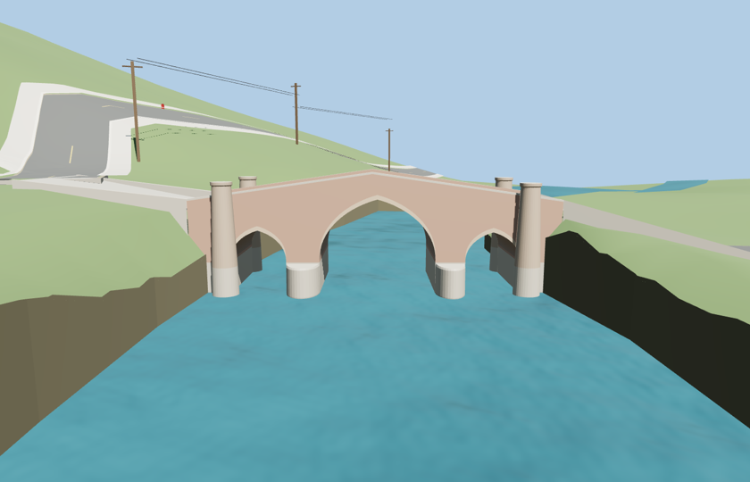

# Mameyand Bridge

The 23 m historic span has three pointed vaults, squared downstream faces, rounded upstream pier noses, four marker towers and masonry approaches. Brick, stone ashlar and rough stone use the existing shared material library.

The November 18 Protomaps multi-line feature contains two crossing segments. The north-up photo trace and September 2026 aerial photo identify the short eastern masonry crossing and its signed axis. The placement replaces only that segment. The western crossing retains its geometry, and model failure restores the eastern procedural crossing. The local grade and fixed water stage preserve three open vaults and both approach joints.

Stone courses, tower proportions and approach slopes follow photographs. The terrain-derived water stage is approximate and will vary in the real river. The viewer uses generalized terrain and waterway ribbons beyond the bridge site.

The six GLBs validate without warnings and use no embedded textures. Skyline and district total 125,204 bytes. The local viewer checked four detail tiers and the procedural fallback.

Rebuild from source with `node packages/worldgen/scripts/generate-mameyand-bridge.mjs --ids=mameyand`. Use `--check` to verify exact bytes. The model uses generated GLBs and the standard shared materials.

[September 2026 aerial photo](https://t.me/Furudabad_news/41302) · [Earlier river elevation](https://commons.wikimedia.org/wiki/File:%D9%85%D9%85%DB%8C%D9%86%D8%AF.jpg) · [Placement report](placement-report.json) · [QA](qa.json)
