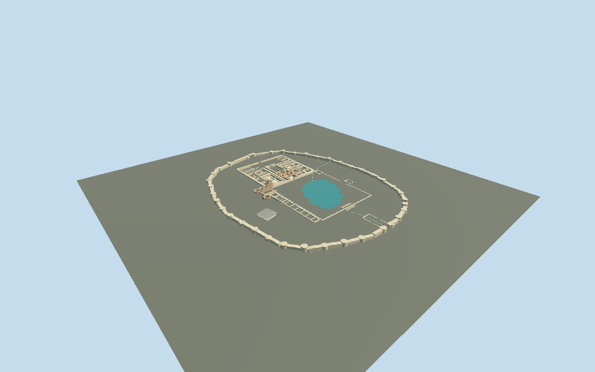

# Takht-e Soleyman

Oval stone enclosure with 38 bastions, mapped spring lake, roofless fire sanctuaries, columned western halls, tall broken west-iwan spine, octagonal foundations and the oblique four-column red-stone hall. Includes the documented modern protective canopy over the red-stone hall.

## Evidence and reconstruction

Published dimensions and reconstructed details are separated in spec.json. Primary references:

- [Reference](https://www.openstreetmap.org/way/203537193)
- [Reference](https://www.openstreetmap.org/way/314769016)
- [Reference](https://whc.unesco.org/en/list/1077)
- [Reference](https://whc.unesco.org/uploads/nominations/1077.pdf)
- [Reference](https://www.iranicaonline.org/articles/takt-e-solayman/)
- [Reference](https://www.iranicaonline.org/uploads/files/takht_solayman_fig_1.jpg)
- [Reference](https://www.iranicaonline.org/uploads/files/takht_solayman_fig_4.jpg)
- [Reference](https://commons.wikimedia.org/wiki/File:Takht-i-Suleiman_20170812_18.jpg)
- [Reference](https://commons.wikimedia.org/wiki/File:Takht-e_Soleymān_overview.jpg)

No third-party geometry, photograph or bitmap texture is embedded. Shared surface graphs come from the central library; vertex tints carry model colors. Glazing uses PBR materials; transparent surfaces are declared per model.

## Model and axes

62,331 triangles; 128,587 vertices; 6 material groups; 5,380,860 bytes. Native bounds: -205.014, -4.800, -162.005 to 203.840, 22.000, 163.061. Source hash: `sha256:426db508128de79e7b0959e9c4e2dea554603424c51a9ac0e82d3313c026300e`.

{"up":"+Y","longitudinal":"+X north","front":"+Z east","origin":"Fresh mapped enclosure frame;Y0 relative local plateau floor."}

Fresh named OSM way/203537193 v7 retains UNESCO ref1077 and English Wikipedia identity; the enclosing way and mapped lake way/314769016 agree with retained geometry within1mm. Native +X is true north and +Z true east, heading π/2. Northern fire sanctuary, west iwan and southern lake establish the signed layout. The nomination explicitly distinguishes old southeast Sasanian and new south Ilkhanid entrances; the southwest marks in Huff’s phase plans are other excavated remains, not a reason to mirror the site. Gate stations, all internal ruins and 38 tower stations remain proportional reconstructions. Model Y0 is the local plateau floor. Occupied wall feet extend4.8m below it. Only the mapped lake has a flat local opaque water surface atY+.025m; no land slab or whole-precinct replacement is used. The host supplies geological terrain; no measured Iranian elevation datum, bathymetry or continuous hydrologic integration is asserted.

## Reproduce

Run `node packages/worldgen/scripts/generate-signature-towers.mjs --ids=takht_e_soleyman` (or add `--check`). The generator preserves manually edited masters by checking their baseline hashes. Import through the standard authored-model workflow with optimization disabled; then capture all QA cameras, including shared-surface views.

## Pending work

- Original detailed817410-triangle/68898992-byte master remains exactly reproducible atsha256:41b6f6084c0178b38b404cefe961b44af4931cfea734ba1b0ac5c6ea266f5901 from takht-e-soleyman-model.mjs#takhtStudy.build. Reviewed geometry is a separate medium-fi ruin reconstruction with no filled land plinth.
- Fresh named OSM way/203537193 v7 retains UNESCO ref1077 and English Wikipedia identity; the enclosing way and mapped lake way/314769016 agree with retained geometry within1mm. Native +X is true north and +Z true east, heading π/2. Northern fire sanctuary, west iwan and southern lake establish the signed layout. The nomination explicitly distinguishes old southeast Sasanian and new south Ilkhanid entrances; the southwest marks in Huff’s phase plans are other excavated remains, not a reason to mirror the site. Gate stations, all internal ruins and 38 tower stations remain proportional reconstructions. Model Y0 is the local plateau floor. Occupied wall feet extend4.8m below it. Only the mapped lake has a flat local opaque water surface atY+.025m; no land slab or whole-precinct replacement is used. The host supplies geological terrain; no measured Iranian elevation datum, bathymetry or continuous hydrologic integration is asserted.
- The large northern court, two distinct fire-temple groups, rectangular and circular hall pillars, cross-shaped cells, tall broken north spine of the western iwan and two octagonal foundations are retained. Published archaeological phase plans guide relative positions; no exact internal survey, modern erosion profile or phase-complete reconstruction is claimed.
- The iwan peak is a22m proportional estimate above the local plateau; surviving temple-wall heights, all tower heights and gate dimensions are approximate. Ruins remain roofless except interpreted restoration arches and vault springing. Scaffolding, protective railings and temporary covers are omitted.
- The red-stone four-column hall retains its20.5m side and oblique plan. A modern metal protective canopy is included from the nomination slide list and Stefan Bschorer’s2014 photograph; its26.4m span,5.5m ridge and post positions are estimates, and its exact current condition is not verified.
- Five common material graphs provide limestone, travertine, brick, sandstone and painted metal, plus opaque locally colored water. Carved stone and dark recesses share limestone with vertex tints. No embedded photos, individual stone geometry at every course, ancient decoration or hand-copied bitmap textures.
- Geological plateau and terrain slopes, absolute elevation datum, lake bathymetry, springs and channel water continuity are host-layer responsibilities. No numeric site DTM or real-terrain-fit capture was obtained. Synthetic review stages prove local geometry/contact only. Surrounding town,Zendan/Belqeis and modern ticket buildings are outside scope. Physical phone/laptop measurements remain pending.

This bundle follows the medium-fi standard. Medium-fi appearance and geographic fit are reviewed separately. Hash-bound visual acceptance is recorded separately after capture inspection.

## Additional geographic data

Map geometry © OpenStreetMap contributors, ODbL-1.0. Publications and photographs used as architectural references; no third-party mesh or image pixels distributed.
