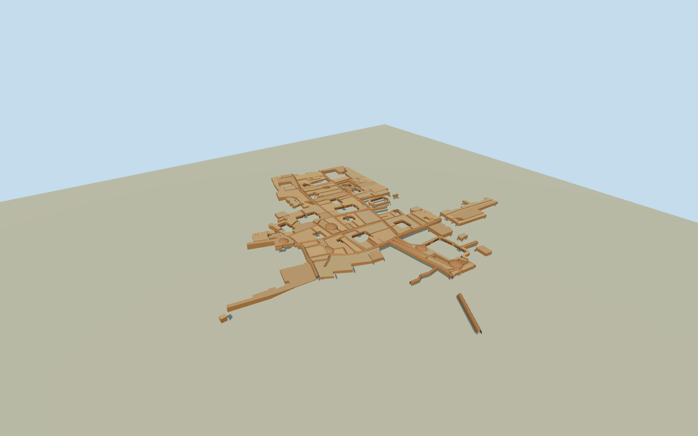

# Bazaar of Tabriz

Tabriz’s historic roofscape of square brick blocks, long pointed vaults, domed carpet and gold halls, and open caravanserai courts.

Authoring state: **review-in-qa.json**. Current completion evidence is in [qa.json](qa.json) and the [completion ledger](../../../../qualla-structures/batches/qualla-003.PROGRESS.md).

- [Bazaar of Tabriz](https://qualla.com/bazaar-of-tabriz/)

The connected market center is the scope. Separately listed Blue Mosque and Sorkhab components and unrelated buildings outside it are excluded.

Precise vault details are represented from standing documented types with a limited set of named hall anchors. Unsurveyed roof and column heights, fittings, roof forms and individual shop layouts are estimated.

Exterior roof blocks and the covered circulation are represented. Interior fabrics, exhibits and many minor secondary shops are simplified.

Additional shop wings around the surveyed open courtyards use inferred outlines. Their roof heights follow the nomination’s descriptions of the standing ensembles.

Build: `node content/worldgen/source/places/tn/tnb/bazaar_of_tabriz/models/generate-bazaar-of-tabriz.mjs`. Add `--check` to verify exact regeneration. 49667 triangles; 6 materials; no embedded photographs.
