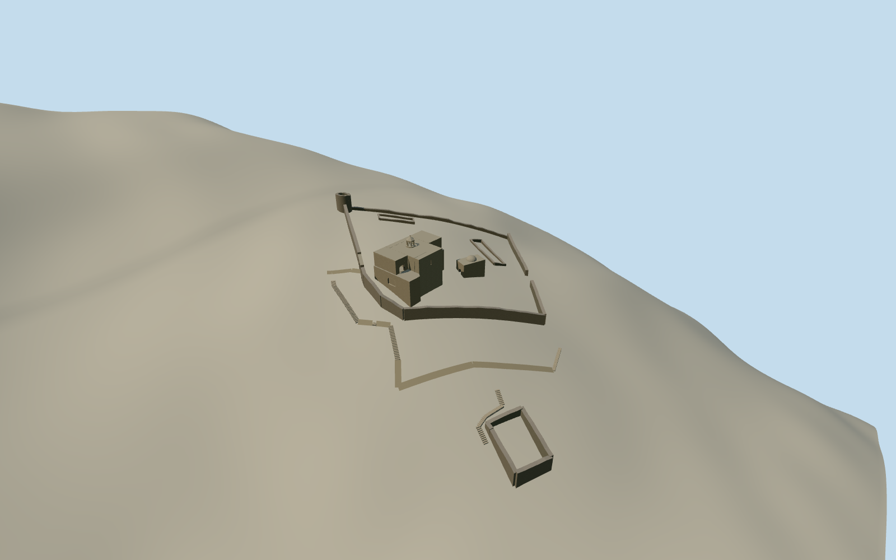

# Halidzor Fortress

The partly restored Halidzor Fortress on the steep Voghji hillside, with rough basalt curtains, the open south portal, a round tower and the fortified Holy Mother of God church.

Authoring state: **review-in-qa.json**. Current completion evidence is in [qa.json](qa.json) and the [completion ledger](../../../../qualla-structures/batches/qualla-003.PROGRESS.md).

- [Halidzor Fortress](https://qualla.com/halidzor-fortress/)

The named node, two wall ways, three building polygons and mapped steps fix the site. The southern gateway occupies the mapped southwest approach gap. Tower height, belfry design, and roof divisions and heights are estimates.

The photographed material is excluded. The measured 5 m tower diameter, approximately 1 m curtain thickness, 1.6 m church wall thickness and a more than 6 m hall span inform the scaled exterior. A documented 2 m circular opening informs the bell stage.

The north tomb and village church are assigned to the two mapped polygons that fit the register positions. The refectory and western cells are marked by low traces in approximate positions. Standing wall crests vary to represent the partly restored condition.

The original terrain is unchanged. Local exterior grade is an approximate registration against the Terrarium field, especially along the walls and foundations on the east descent.

Build: `node content/worldgen/source/places/tn/tnb/halidzor_fortress/models/generate-halidzor-fortress.mjs`. Add `--check` to verify exact regeneration. 5022 triangles; 5 materials; no embedded photographs.
