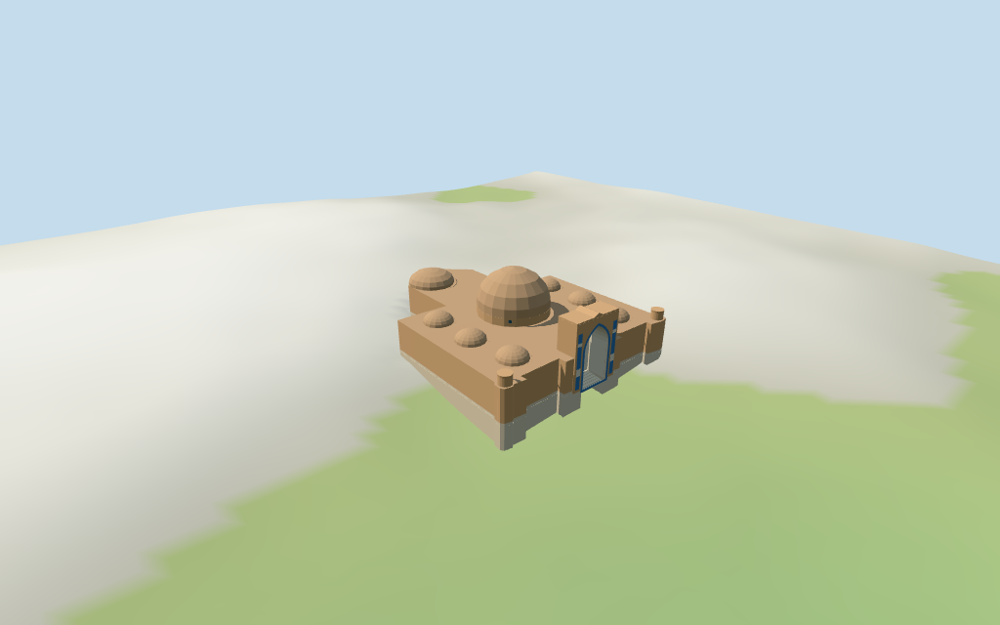

# Blue Mosque (Tabriz)

Individual present-day medium-fi Blue Mosque in Tabriz: exact30-vertex main outline and two19-vertex dome plans, broad warm-brick main dome and smaller rear dome, low brick ranges with selected roof cupolas, a tall surviving pointed entrance with blue tile remnants and pale exposed patches, short front corner tower stumps, stone plinth and estimated entry steps. Five existing shared256² graphs serve seven merged roles. Original geometry; no photo textures, invented inscriptions, reconstructed tall minarets or furnished interiors. Horizontal fit is map-led; all vertical dimensions are explicit visualization estimates overriding low map totals.

## Evidence and reconstruction

Published dimensions and reconstructed details are separated in spec.json. Primary references:

- [Reference](https://commons.wikimedia.org/wiki/File:Tabriz_Blue_Mosque,_northern_view_(entrance,_in_2023).jpg)
- [Reference](https://commons.wikimedia.org/wiki/File:Blue_Mosque_(Tabriz)_General_view.jpg)

Five existing shared256² brick, raw limestone, mosaic tile, lime plaster and plain wood graphs serve seven merged roles. Brick dome and wall share one graph with different linear vertex tints; UVs use physical metres. Blue portal remnants are coarse original geometry/tints, not copied photographs or tile artwork. Zero embedded images.

## Model and axes

2,463 triangles; 7,389 vertices; 7 material groups; 299,732 bytes. Native bounds: -28.034, -3.628, -22.369 to 28.054, 18.915, 22.277. Source hash: `sha256:a6d41b11fc9d4b2788b79d267ff7032bf590fbf5c6be0cde48ad2cdf787ed657`.

{"x":"north-northeast toward entrance","y":"up","z":"east-southeast"}

Standard viewer DEM datum 1398.3878573839456 m; working floor 0.9150159159212763 m is the median of 87 outside-perimeter samples at1 m offset plus.3 m. 211 raw footprint samples span -3.2147832339971956..1.7801090304858462 m. Adaptive footing follows the exact main outline. Preview terrain seats the mapped outline plus a small estimated threshold/step rectangle filling the mapped entrance recess, with1.5 m margin. The runtime cutout uses those same two polygons. Exact plinth, forecourt paving, step risers and current grade joins are unverified; normal DEM is a coarse fixture, not a survey.

## Reproduce

Run `node packages/worldgen/scripts/generate-additional-landmarks.mjs --ids=N0467` (or add `--check`). The generator preserves manually edited masters by checking their baseline hashes. Import through the standard authored-model workflow with optimization disabled; then capture all QA cameras, including shared-surface views.

## Pending work

- Retained Q1519733 / way495122358 anchor [46.301051853,38.073555312] and heading 1.28106383853 rad remain unchanged. Current main feature35184867211190 has30 outer vertices; separate main/rear dome parts35184836590170/171 each have19. The current named Blue Mosque POI agrees. Positive X faces north-northeast toward the entrance: the wide front and rounded corner stumps are at positive X, the narrow chamfered rear annex at negative X; this matches the inspected northern entrance picture. Positive Z runs east-southeast. The two dome plans are retained exactly. Portal, short corner stumps, side cupolas, facade fields and entry steps use picture-led estimates within the main footprint/recess. Azerbaijan Museum, bazaar, park, forecourt and other buildings stay host content.
- Current map tags are retained verbatim: main height5 m; main dome min_height5/height10 m; smaller rear dome height7 m. There are no retained independent height facts. These low totals disagree with the two pictured roof/portal proportions. For this explicitly approximate visualization, the wall eaves are8 m, main drum to9.8 m/main dome to18 m, rear dome to11.5 m, entrance portal crest15.4 m and short corner stump tops10 m. This overrides the unqualified map totals; it does not reinterpret them as measured stages. Side roof cupolas reach10.2 m and the entrance steps rise.7 m. All these vertical dimensions and profiles are estimates from pictures and footprint scale, not surveyed or published dimensions. No historic full-height minarets are restored.
- Standard viewer DEM datum 1398.3878573839456 m; working floor 0.9150159159212763 m is the median of 87 outside-perimeter samples at1 m offset plus.3 m. 211 raw footprint samples span -3.2147832339971956..1.7801090304858462 m. Adaptive footing follows the exact main outline. Preview terrain seats the mapped outline plus a small estimated threshold/step rectangle filling the mapped entrance recess, with1.5 m margin. The runtime cutout uses those same two polygons. Exact plinth, forecourt paving, step risers and current grade joins are unverified; normal DEM is a coarse fixture, not a survey.
- Two inspected pictures guide appearance. Exact tile motifs, muqarnas, epigraphy, broken-edge archaeology, temporary scaffold/snow, forecourt furniture and hidden/furnished interiors are omitted. The source image year is a file-page statement, not independent dating. No surveyed grade, engineering or physical phone/tablet/laptop performance claim.

This bundle follows the medium-fi standard. Medium-fi appearance and geographic fit are reviewed separately. Hash-bound visual acceptance is recorded separately after capture inspection.

## Additional geographic data

©OpenStreetMap contributors; Protomaps; Mapzen/USGS terrain.
