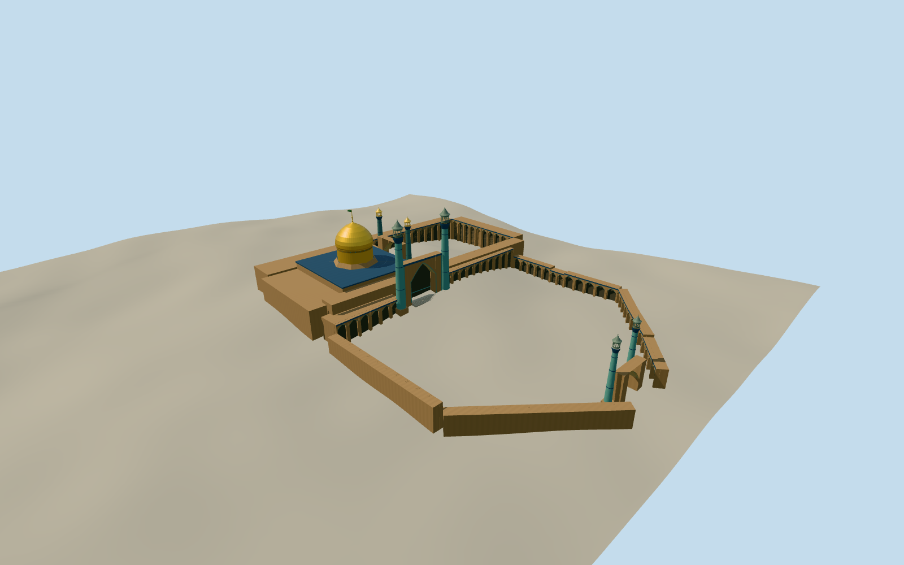

# Fatima Masumeh Shrine

The gilded mausoleum and two historic open courts at Qom, with three distinct pairs of minarets in 2009.

Authoring state: **review-in-qa.json**. Current completion evidence is in [qa.json](qa.json) and the [completion ledger](../../../../qualla-structures/batches/qualla-003.PROGRESS.md).

- [Fatima Masumeh Shrine](https://qualla.com/fatima-masumeh-shrine/)

Dome height and section, internal Atiq court alignment, iwan details and exact tower placements are visual estimates. The 2009 photographs establish the appearance and size hierarchy.

The named modern map fixes the overall footprint and the Atabaki court. Its tomb point differs from the published dome coordinate by about 22 meters, so the visible dome uses the latter.

The original 256-meter provider field remains unchanged. The relief includes probable rooftop and canopy influence, so approaches, foundation exposure and thresholds are approximate.

This is the historic shrine exterior with the two central courts. Adjacent Azam Mosque, modern outer halls and interiors are outside scope.

Build: `node content/worldgen/source/places/tn/tnh/fatima_masumeh_shrine/models/generate-shrine.mjs`. Add `--check` to verify exact regeneration. 14218 triangles; 7 materials; no embedded photographs.
