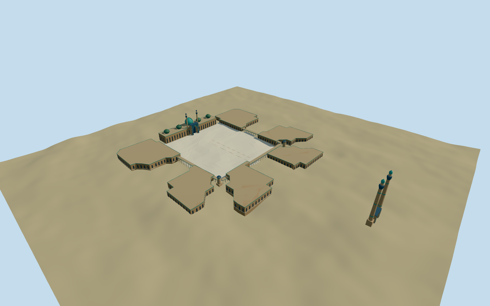

# Jamkaran Mosque

Maqam iwan, five domes, arcaded courtyard, two pairs of tall minarets, adjoining prayer halls and the principal outer gateway.

Authoring state: **review-in-qa.json**. Current completion evidence is in [qa.json](qa.json) and the [local 100 ledger](../../../../qualla-structures/batches/PROGRESS.md).

- [Jamkaran Mosque](https://qualla.com/jamkaran-mosque/)

The model covers the Maqam mosque, its external hall wings, public court and principal outer gateway. Administration, service buildings, the well pavilion and interiors are outside the scope.

The five dome footprints and mapped heights control the roofs. Placement and diameter for the two tall pairs of minarets, tile designs, arch proportions and crown ornaments are estimated.

The independent terrain gives approximate grade. Fine paving, smaller windows and temporary structures are generalized.

Build: `node content/worldgen/source/places/tn/tnh/jamkaran_mosque/models/generate-jamkaran-mosque.mjs`. Add `--check` to verify exact regeneration. 31506 triangles; 6 materials; no embedded photographs.
