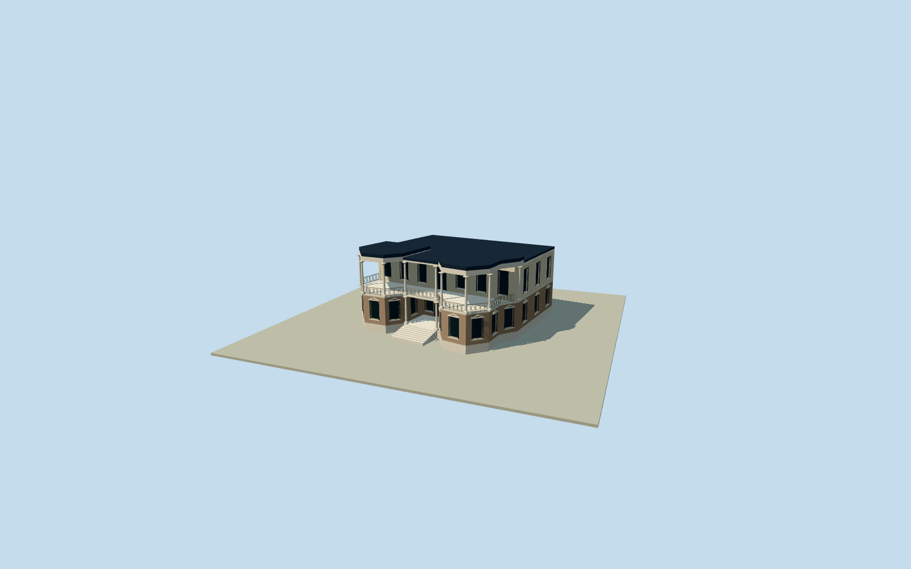

# Ahmad Shahi Pavilion

Whole AhmadShahiPavilion on actual12-control nativebuilding plan: two storeys, lowerbrick/polygonalcornerbays and insetcentralentry, pale upperbody behind openloggias, two ground/nine upperclassicalcolumns, dark recesseddoors/sash, patterned metalrailing, lowcentralroof and raisedpolygonalbayroofs, lowstoneplatform and centeredentrancesteps. ExactclearedpublishedDatabot2005PDoriginal first/only, nativecaption explicitlypavilion despiteSaabgheraniehPalace filename. Hiddenrear/currentcondition/roofdivisions/census/ornament are originalboundedestimates, notsurvey.

Authoring state: **review-in-qa.json**. Current completion evidence is in [qa.json](qa.json) and the [completion ledger](../../../../qualla-structures/batches/qualla-002.PROGRESS.md).

- [Ahmad Shahi Pavilion](https://qualla.com/ahmad-shahi-pavilion/)

Actualnamedclosed12-control AhmadShahiPavilion envelope, fixednativebboxanchor/heading0 before independentfield/floor/sections/geometry. Nativewholephysicalbuilding, not entiregarden orneighboringpalace.

Native12metricXZ controls plus soleclear2005fullprincipal-facade photograph. Two-storeysections/lowroof/cornerbay/columns/railing/stairs/openings/fineornament/hiddenfaces are original bounded estimates; set once after independentoriginalfieldfreeze. No protectedpixels embedded orneighboringpalace substituted.

Originalindependent256m129field/16641samples/2rawtiles,actualnativebboxanchor/heading0/SWdatum1651.086m frozen before once-onlyfloor11.9969m and allmainsections. Originalphoto-bounded two-storey sections: platform.8m/groundwall4.55/upperfloor4.75/upperwall-ceiling9.15/centralroof9.65/raisedpolygonalbayroofs10.2, recessedwindows.22m andwalls.34m, classicalcolumns/railing1m and8intrinsicsteps. No metricverticalsurvey/currentroofpartpolygons orrearphotos; hiddenrear/roofdivisions/census/finecapitals/ornament/currentfinish are boundedestimates. All12nativeXZ controls preserved inwholefoundation/upperfloor domain; upperfrontbody insetbehind openloggias. No later floor/mainsection/originalfield tuning.

Sole exactpublished2005Databotoriginal519x370/93243bytes, matching nativeSHA1/namedEnglishDatabotPD-user-w grant and publishedclearance. Nativecaption identifies AhmadShahiPavilion north ofSaabgheraniehPalace; the inheritedfilename is not subjectidentity. No neighboringpalace photo substituted, no external/questionablepixels, no source metadatarepair or policychange, no imagepixels embedded.

Whole actual12control building/foundation/upperfloor; lowerfrontbody insetbehind porch and upperfrontbody clippedbehindopenloggias. Cornerbay/roofsubdivisions, rearwindowcensus/currentfinish/heights/finecapitals/motifs/railpattern/stepdimensions are originalboundedestimates from a singleold lowresolutionfrontview. No measured currentrear/interior survey. Oneuppercornercolumn is engaged with upperbody.

Decorative pediments/floral motifs/capitals and oval/diagonal railing are original simplified geometry. Glass is closed opaque dark material. EntireNiavarangardens/trees/hedges/neighboringpalaces/interiors/landscape/sitepad excluded.

Originalindependent256m129field/2rawtiles/nativeframe/floor/mainsections fixed beforegeometry. Exactfoundation/street/staircontactunverified; geographicpreview/replacementfalse. Flatstage andsyntheticneighbors are reviewfixtures.

Build: `node content/worldgen/source/places/tn/tnk/ahmad_shahi_pavilion/models/generate-ahmad-shahi-pavilion.mjs`. Add `--check` to verify exact regeneration. 19167 triangles; 5 materials; no embedded photographs.
