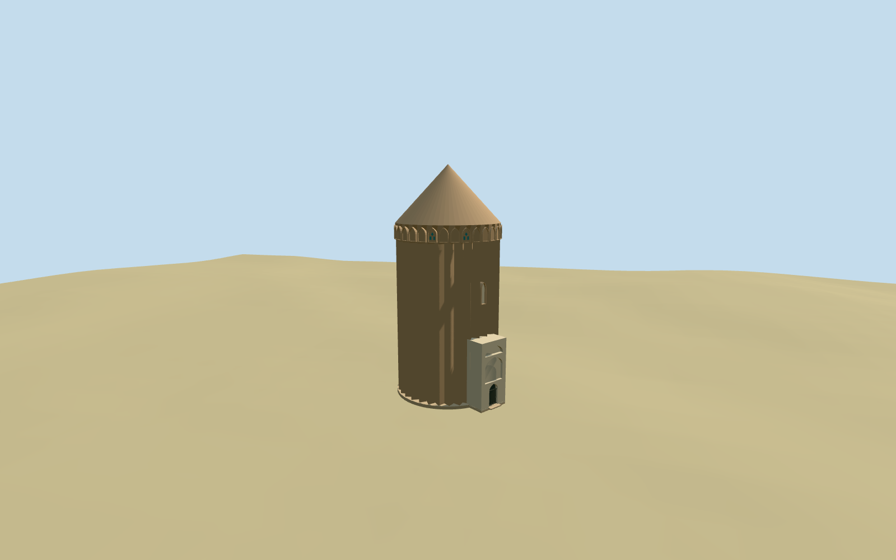
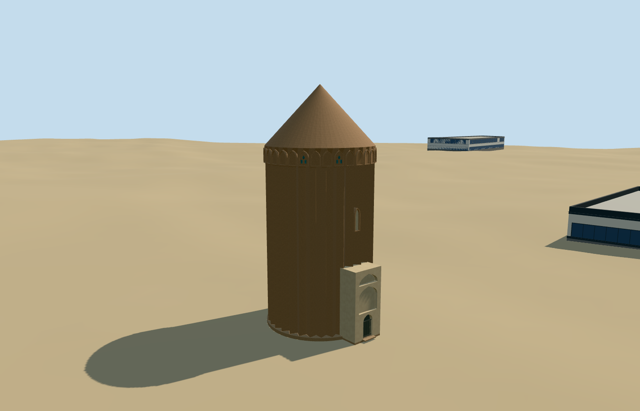

# aladdin_tower — Aladdin Tower

Reviewed 2026-10-20 in one continuous author/build/inspect/fix round.

## Appearance

Inspected all current portable and shared-material views: the tall thirty-two-fluted brick shaft, low closed conical cap, pointed upper corbel/blind-cell rhythm, sparse turquoise geometric fragments, small closed repair niche and projecting pale entrance porch remain distinct. The porch has stacked pointed blind recesses and a closed grilled door; rendered reveals face into their openings. Four turntable directions show continuous body/roof surfaces. Bounded footing and doorway threshold are seated on the retained terrain; no whole-site slab or reconstructed chamber is authored.

## Shared materials and browser levels

Four existing shared 256-square graphs: brick, stucco, tile_ceramic and metal_painted; at most five material draws. The shared-material captures show metric brick courses, quiet pale plaster, limited turquoise accents and a dark closed gate. Each graph is read once per loaded model; model geometry is disposed on eviction. No embedded image or photograph texture. Canonical surface bindings and six GLB hashes pass. Runtime LOD position/normal streams are separate and counted CPU/GPU bytes agree.

| Level | Triangles | Bytes | Draws |
| --- | ---: | ---: | ---: |
| skyline | 572 | 61280 | 1 |
| district | 2351 | 234584 | 5 |
| street | 2849 | 289884 | 5 |
| closeup | 3335 | 341040 | 5 |

Inspected 24 current medium-fi frames: street/block/skyline at noon/late afternoon, economy/high, neutral silhouette, four matched LOD views and distance transitions. The fluted cylinder/cone/porch identity holds at skyline; nearer levels add closed pointed frieze cells, grille and repair panel without moving the base. Levels have 572/2351/2849/3335 triangles and at most five draws. Skyline plus district is 295864 bytes, below the 3MB phone and 6MB laptop initial targets. Physical laptop/phone frame timings remain pending.

## Approximate map fit

Retained Q5808483/reference anchor51.645694444,35.324972222 is corroborated by the native named Tower Alaeddin memorial way352050867 and sole circular part way395656748. Their generalized circle fixes center[-2.672427311,-0.749222480]m and mean radius5.728665m; nominal flute peaks use the reported12.14m external diameter. Both generic representations are replaced, with zero residual, while all14 independent buildings among16 resident inputs remain unchanged (22 building records in the wider extract). Original6m ground, native path inputs and zero native water records remain unchanged. Failed load restores all16 original records; all four loaded levels unload with zero live geometries. Global heading0/native east-south axes; northwest porch phase-2.55rad remains a picture-led approximation with45degree/3m uncertainty, not a surveyed signed azimuth.

## Limits

Medium-fi original geometry based on three ordinary2018/2019 pictures and standard PMTiles. Overall26.71m is retained without a point-of-measurement qualifier; interior-qualified16.11m is not treated as exterior wall height. Body/frieze shoulder20.1m, cone rise6.61m, porch7.6m, flute depth, porch/repair layout, decorative inventory and footing levels remain approximate. Map2m/7m component attributes are not total tower heights. Coarse terrain and cropped ground pictures do not establish plaza/foundation engineering. No copied calligraphy, photographic atlas, furnished tomb, pristine full tile restoration or broad square slab. Surrounding city buildings are host context.

## Selected checks

Six Khronos files: zero errors/warnings.549 actual mesh/material/contact checks; 47 current inspected views. Scene validation/sim30 and strict selected medium-fi audit pass. Source/runtime/LOD hashes and material bindings verified.

Rebuild: node packages/worldgen/scripts/generate-additional-landmarks.mjs --ids=aladdin_tower; node packages/worldgen/scripts/import-structure-models.mjs --ids=aladdin_tower; node packages/tooling/scripts/generate-landmark-lods.mjs --ids=aladdin_tower --force.

Source: sha256:1088c5fa3026e2ab466464982397f9cca5de0fb218a70439c58d56ae06b9272d

Runtime: sha256:5754473994b76eb5f73c7a69b354cd851a1ee25ccbb86979d4ac70ae53131c28

Input: sha256:354cb6f23d6c0503a423c60890d928203c0914012409b958691937ca50ab25d4

## Viewed ordinary pictures

https://commons.wikimedia.org/wiki/File:Aladdin_TowerVaramin_Tehran_Province_Iran_2019.09.12_برج_علاء_الدین_ورامین_1.jpg — H Raghibi; CC-BY-SA-4.0. Viewed only; no pixels copied.

https://commons.wikimedia.org/wiki/File:Aladdin_TowerVaramin_Tehran_Province_Iran_2019.09.12_برج_علاء_الدین_ورامین_4.jpg — H Raghibi; CC-BY-SA-4.0. Viewed only; no pixels copied.

https://commons.wikimedia.org/wiki/File:Aladole_Tower_-_2018_-_01.jpg — Pouyakhani; CC-BY-SA-4.0. Viewed only; no pixels copied.
