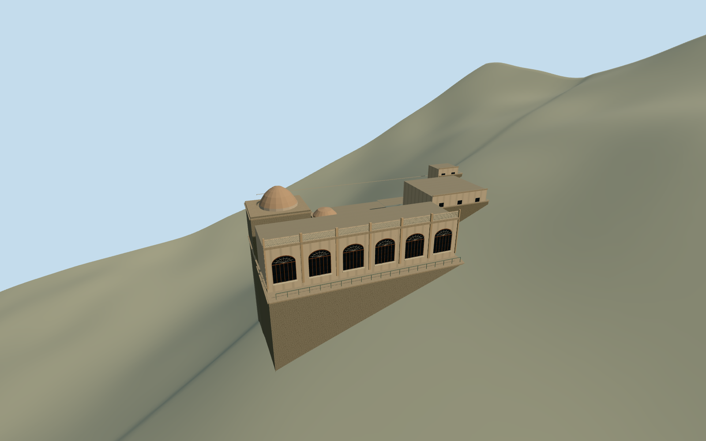

# Bibi Shahrbanu Shrine

The standing shrine of Bibi Shahrbanu at Rayy, with its six arched facade bays, pierced parapet, masonry domes and mountainside terrace.

Authoring state: **review-in-qa.json**. Current completion evidence is in [qa.json](qa.json) and the [completion ledger](../../../../qualla-structures/batches/qualla-003.PROGRESS.md).

- [Bibi Shahrbanu Shrine](https://qualla.com/bibi-shahrbanu-shrine/)

The original elevation field captures the broader rock slope. The historic enclosure, some retained terrace heights, stair widths, interior courtyard arrangement and modern masonry colors are approximate.

The cleared panorama was photographed in 2004. The principal dome’s mapped roof extents are current. The model simplifies its finish, smaller stone vaults and service enclosures. Sacred interiors and hillside approaches outside the shrine are omitted.

Build: `node content/worldgen/source/places/tn/tnk/bibi_shahrbanu_shrine/models/generate-bibi-shahrbanu-shrine.mjs`. Add `--check` to verify exact regeneration. 7584 triangles; 8 materials; no embedded photographs.
