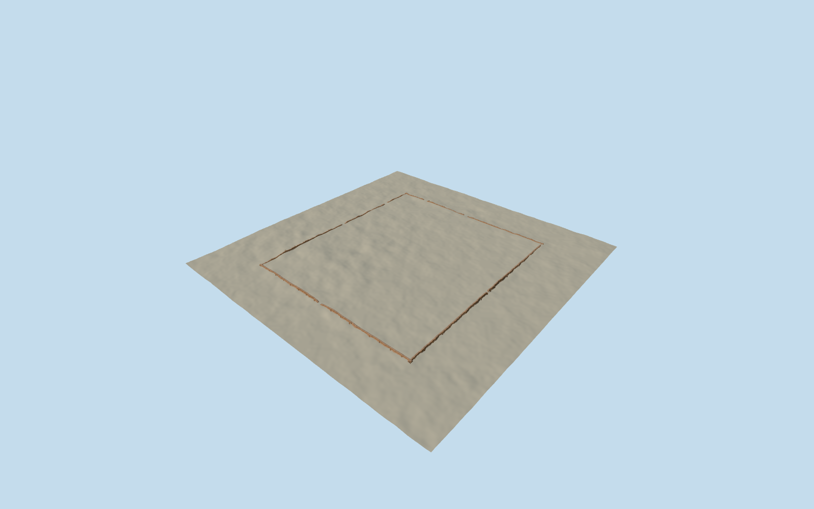

# Iraj Castle

The standing Sasanian ruin at Iraj Castle above the fields of Pishva. Eroded clay ramparts, projecting round tower remnants and the complete open enclosure.

Authoring state: **review-in-qa.json**. Current completion evidence is in [qa.json](qa.json) and the [completion ledger](../../../../qualla-structures/batches/qualla-003.PROGRESS.md).

- [Iraj Castle: The Fortress with Nothing Inside](https://qualla.com/iraj-castle/)

The current mapped corners register the complete enclosure within several metres at map scale. Individual crest positions, elevation changes, width of eroded breaches and tower remnants are estimated.

Ninara’s southwestern view covers one part of the wall. The remaining sides and the damaged gate sectors use archaeological descriptions, road crossings and the original relief. Present heights away from the photo remain approximate.

The terrain remains an unmodified Terrarium composite, including its low-resolution signal from the rampart. The wall uses nearby terrain samples for its base. Only the surviving circuit and open interior are represented.

Build: `node content/worldgen/source/places/tn/tnk/iraj_castle/models/generate-iraj-castle.mjs`. Add `--check` to verify exact regeneration. 13658 triangles; 4 materials; no embedded photographs.
