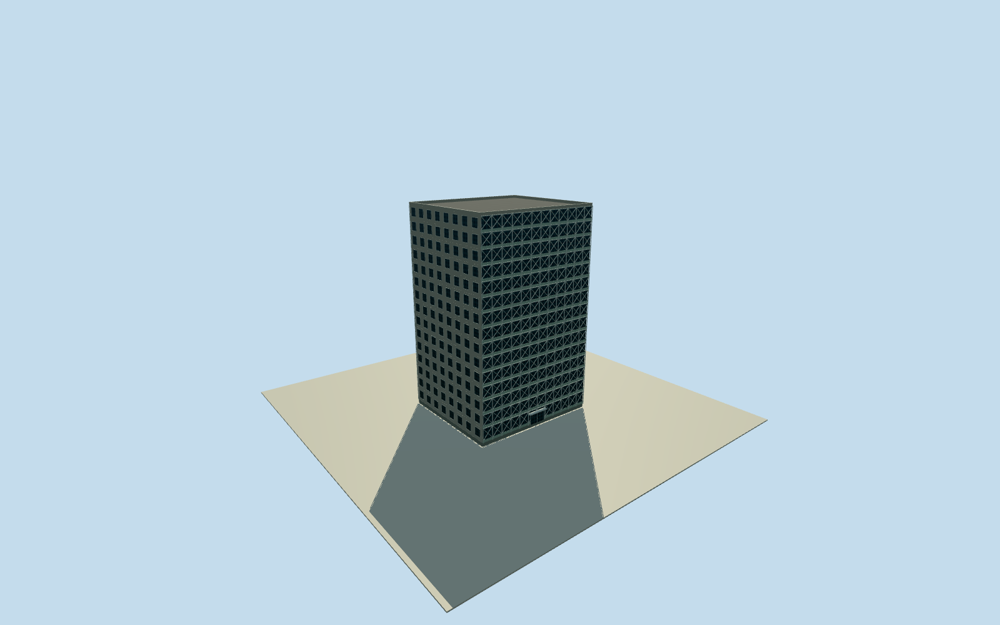

# Plasco Building — original tower, Tehran

Whole independent original1962Plasco tower in intact2016phase: original2016four-corner mapped building,15above-groundlevels/oneunexposedbasement, fullroof/parapet, cement east/west walls and open steel-brace/ceramic/glazed north/south elevations, closed south entrance/shopfront. Primary written engineering facts, no imagery. Exact height/plan discrepancy, brace/window census, sections/finish/grade are explicit estimates; independent northern mall and2021replacement excluded.

Authoring state: **review-in-qa.json**. Current completion evidence is in [qa.json](qa.json) and the [completion ledger](../../../../qualla-structures/batches/qualla-002.PROGRESS.md).

- [Plasco Building](https://qualla.com/plasco-building/)

Whole original structurally independent1962Plasco tower before2017collapse: complete original2016way211028571 four-corner envelope, all fifteen above-ground levels, south entrance/lobby/shopfront, north/south steel-brace/ceramic/window elevations, east/west cement elevations and entire roof/parapet. Separate five-storey northern shopping-centre building and2021replacement tower are independent structures and excluded; no mall/current-building proxy. Historical2016exterior; all imagery unused, exact sections/roof/brace/window details/finish/grade estimated.

Whole structurally independent original tower, not the separate northern five-storey shopping-centre building. Original2016attic namedway211028571 has four complete corners; currentreplacementway1164854772 and independentmallway1029124094 are excluded. Originalnumeric plan approximately35.57x31.22m is coarser than research29.4x31.9m structuralframe dimensions; retain original geographic envelope, no traced figure or fitted plan.

Original research describes fifteen above-ground storeys plus one basement, totalabout60mabovefoundation, and2023paper almost60mtall. Original native48mheight tag is not adopted as surveyed height. Nominal above-ground roof56m plus0.8mparapet approximates60mfromfoundation with4m-basement interpretation; detailed sections and6mheight uncertainty explicit. Groundfloor4m plus fourteen3.7moffice/workshoplevels;15rows and closedgroundshopfronts. Basements/interiors unexposed/excluded from exterior. Roof equipment not evidenced is not invented.

Original independent256m129x129field,16641values/1rawtile,datum1186.7803m/range1169.6879..1198.1131m frozen before floors or mainsections. Original fullsouthfrontedge contact, flatfloor0.2m/foundation-1m/roof56m/parapet56.8m fixed once. Coarse urban composite relief may include canopy/building/DEM artifacts and bury/expose bases. Not a2016groundsurvey or verticaldatum conversion. Original field/frame/floors/mainsections never masked, cut, flattened, refetched, reframed or fit for captures.

Written primary facts support cement east/west walls and opensteel-brace/ceramic/masonry/glazed north/south elevations. Exact diagonal pattern,12baynear facade, six/eightestimatedsidewindow bays, tileband heights, gridmember sizes, shopdoor census, trim, parapet and mutedgray/green/creamcolors are original estimates, no exact facade census. Plan/component uncertainty6m/height6m/brace ornament30percent; current originalnumeric outline roughlydates historical2016phase. All15abovegroundlevels/wholebody/roof/elevations/entrance retained at everyLOD; distant screenbays/windows coarsened.

Qualla first16families/zero conflicts, everyimageunused. Uncertain1973Ministrybook and unknownphotographercityphotos, protectedmodernphotos and researchpaperfigures/photos/diagrams unused. Primary published writtenresearch only, no image-derived geometry/texture/rightsrepair. Dated2016proposal/currentWorldEligible false; no collapse/fire/damage or replacement facade mixed into intact originalphase. Groundcontact and verticalregistration remain unverified.

Build: `node content/worldgen/source/places/tn/tnk/plasco_building/models/generate-house.mjs`. Add `--check` to verify exact regeneration. 22238 triangles; 6 materials; no embedded photographs.
