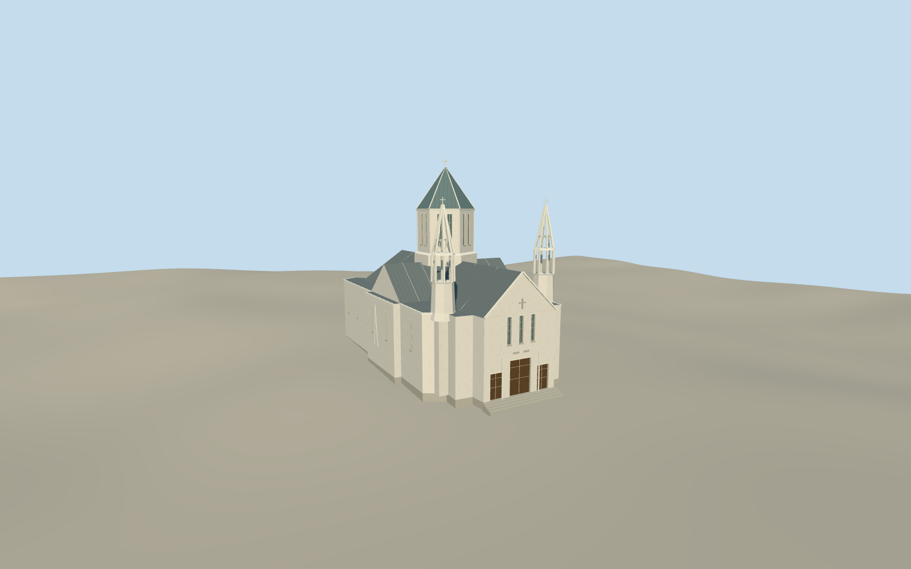

# Saint Sarkis Cathedral, Tehran

Saint Sarkis in Tehran, with a marble-clad cross-shaped nave, two western bells and a large faceted lantern over the crossing.

Authoring state: **review-in-qa.json**. Current completion evidence is in [qa.json](qa.json) and the [completion ledger](../../../../qualla-structures/batches/qualla-003.PROGRESS.md).

- [Saint Sarkis Cathedral, Tehran](https://qualla.com/saint-sarkis-cathedral-tehran/)

The model represents the standing marble-clad cathedral after the west and central glazing changes. The bell tower and dome heights, window spacing and joinery are working estimates.

The source survey records the surveyed form in writing. Exterior visual estimates include the western trim, steel-and-glass bell crowns, marble joints and main roof pitch.

The coarse source ground remains original. Site grade, stair depth and foundation registration are approximate. The detached courtyard monument, precinct wall and Prelacy offices are outside the scope.

Build: `node content/worldgen/source/places/tn/tnk/saint_sarkis_cathedral_tehran/models/generate-saint-sarkis-tehran.mjs`. Add `--check` to verify exact regeneration. 2956 triangles; 6 materials; no embedded photographs.
