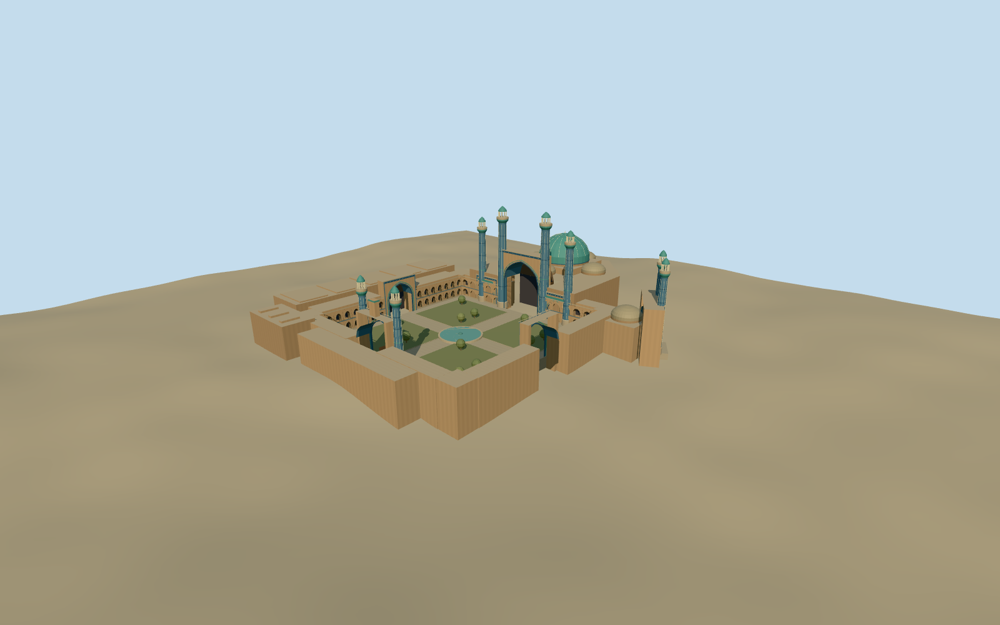

# Sepahsalar Mosque

The Sepahsalar Mosque and madrasa, with a four-iwan garden courtyard, shallow finished dome, eight tile-clad minarets and the skewed west entrance.

Authoring state: **review-in-qa.json**. Current completion evidence is in [qa.json](qa.json) and the [completion ledger](../../../../qualla-structures/batches/qualla-003.PROGRESS.md).

- [Sepahsalar Mosque](https://qualla.com/sepahsalar-mosque/)

The present courtyard and summer prayer-hall roof derive from the native map. The west gate, approximate east and north range envelopes, levels and details are inferred from written architecture and the perimeter streets.

The archive photograph depicts the building during construction. It informs surviving architectural elements. Some profiles, roof bays, rendered tile ornament and planting are approximate.

The winter hall is represented by its exterior mass. Individual winter-hall vaults, adjacent Parliament buildings, interior rooms and later secondary precinct buildings are outside the scope.

Build: `node content/worldgen/source/places/tn/tnk/sepahsalar_mosque/models/generate-sepahsalar-mosque.mjs`. Add `--check` to verify exact regeneration. 36929 triangles; 6 materials; no embedded photographs.
