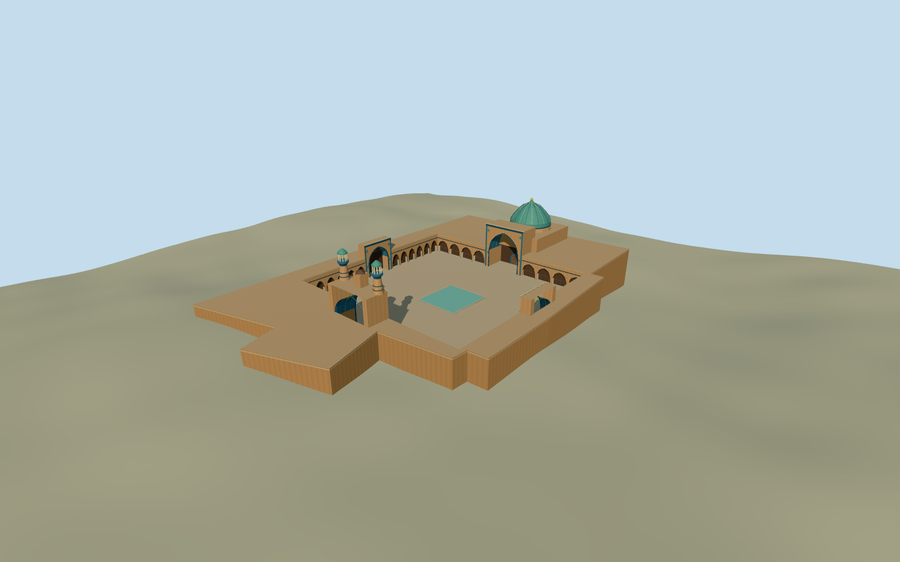

# Shah Mosque, Tehran

Tehran’s Qajar Shah Mosque with a four-iwan courtyard, rectangular basin, southern dome and two northern minarets flanking the clock.

Authoring state: **review-in-qa.json**. Current completion evidence is in [qa.json](qa.json) and the [completion ledger](../../../../qualla-structures/batches/qualla-003.PROGRESS.md).

- [Shah Mosque (Tehran)](https://qualla.com/shah-mosque-tehran/)

The outer boundary, court and basin follow native mapping. Portal and minaret heights, north clock housing, reconstructed roof levels, dome profile and tile colors are estimated from period and written evidence.

The model covers the visible mosque. The neighboring bazaar, remote approach stairs, canopies and full interiors are outside the modeled scope.

Build: `node content/worldgen/source/places/tn/tnk/shah_mosque_tehran/models/generate-shah-mosque-tehran.mjs`. Add `--check` to verify exact regeneration. 9574 triangles; 7 materials; no embedded photographs.
