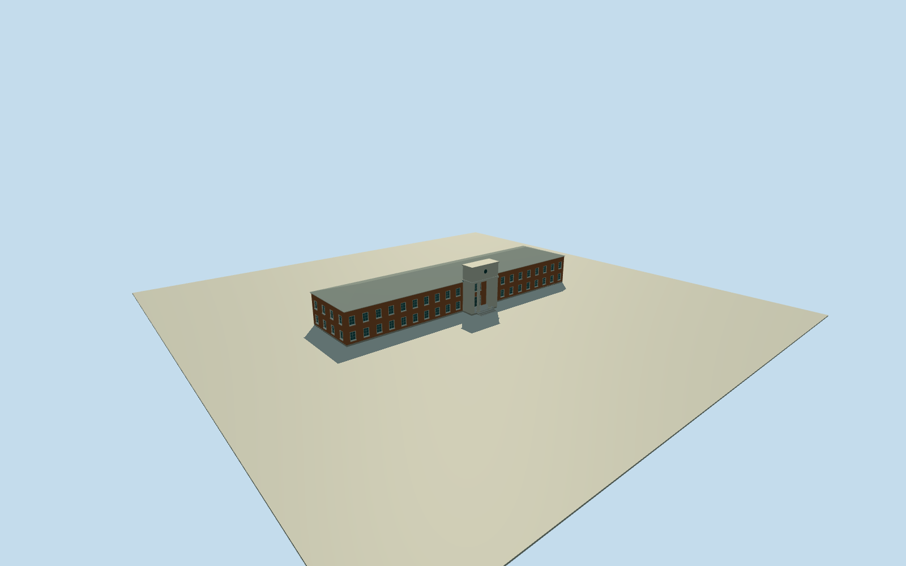

# Former United States Embassy, Tehran

Surviving long two-storey brick main1951chancery on its native plan, shallow grey hipped roof, recessed pale-framed sash rhythm, raised tall pale columned entrance portico with square attic and simplified round medallion, bounded entrance treads. Main building only; detached campus buildings, gardens/stadium, perimeter mural walls and interiors excluded.

Authoring state: **review-in-qa.json**. Current completion evidence is in [qa.json](qa.json) and the [completion ledger](../../../../qualla-structures/batches/qualla-002.PROGRESS.md).

- [Embassy of the United States, Tehran](https://qualla.com/embassy-of-the-united-states-tehran/)

Native mapped surviving main building controls approximately75m length/17m depth and northern portico projection. About8.8m eaves,11.3m ridge and13.1m entry attic are photographic estimates, not a building survey.

Only the already cleared published1950spublic-domain aerial is used. It is distant and black-and-white; brick/roof colors, exact window counts/panes, rear openings and restored current details are medium-fi interpretations. Round entry emblem is a simplified disc, not a copied photograph or detailed seal.

Main original chancery only. The old aerial is not authority to reconstruct every historical campus structure; detached structures, grounds, perimeter propaganda/mural walls, flags and interiors excluded. Surviving main-building model is not a functioning diplomatic mission.

Flat inspection floor isolates architecture. Original urban source terrain is preserved as placement evidence; exact paving/foundation and cross-provider height contact are not certified. No photographic pixels embedded.

Build: `node packages/worldgen/scripts/generate-authored-places.mjs --ids=tehran_former_us_embassy`. Add `--check` to verify exact regeneration. 11942 triangles; 4 materials; no embedded photographs.
