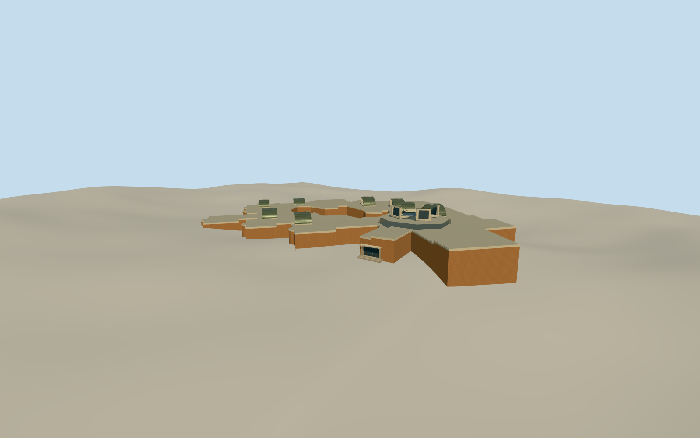

# Tehran Museum of Contemporary Art

The Tehran Museum of Contemporary Art, with the hillside galleries descending around an open sculpture court, saffron stone and copper light catchers.

Authoring state: **review-in-qa.json**. Current completion evidence is in [qa.json](qa.json) and the [completion ledger](../../../../qualla-structures/batches/qualla-003.PROGRESS.md).

- [Tehran Museum of Contemporary Art](https://qualla.com/tehran-museum-of-contemporary-art/)

OpenStreetMap supplies the exact mapped exterior outline and main door. The court shape and depth, individual roof heights and skylight dimensions and positions are reconstructed from the written architecture and footprint. They are estimates.

Independent source terrain is preserved. The foundation follows the sloping site approximately. The exterior includes the sculpture court without its art, galleries or subterranean circulation.

Build: `node content/worldgen/source/places/tn/tnk/tehran_museum_of_contemporary_art/models/generate-tehran-contemporary-art.mjs`. Add `--check` to verify exact regeneration. 5749 triangles; 6 materials; no embedded photographs.
