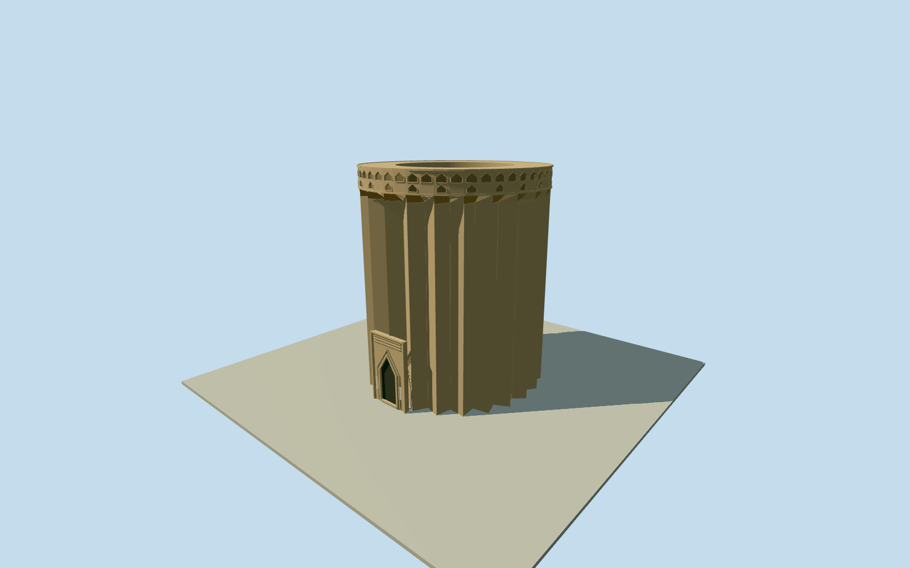

# Toghrol Tower

Surviving20mroofless brick tomb tower at the original named native envelope:24sharp angled buttresses around a thick hollow circular chamber, open top with visible inner wall/annular rim, restrained pointed entry surround and two layered rows of physical pointed niches/corbel edging at the crown. No conjectural dome, lost calligraphy or surrounding garden structures.

Authoring state: **review-in-qa.json**. Current completion evidence is in [qa.json](qa.json) and the [completion ledger](../../../../qualla-structures/batches/qualla-002.PROGRESS.md).

- [Toghrol Tower](https://qualla.com/toghrol-tower/)

Exact OSM relation8048810/Q3437688, outer way563594145and inner way563594148control the native anchor, outer envelope, hollow chamber and20mheight.24angled buttresses follow the local story and inspected historical plan;19native sampling vertices are not treated as the buttress count. Root depth, phase and portal facing are medium-fi estimates within that envelope.

Exact published Qualla Pesce/METCC0recto and1840CostePD-oldplan/details control persistent fluted shell, thick circular chamber, pointed entry and layered pointed-niche/corbel character. Native inner diameter~10.46m is consistent with the historical10.70mannotation at medium-fi precision. Sources predate later restorations: current crown and portal sections are approximate, not an exact re-creation of lostKufictext, historic erosion or either historical state.

CosteTOUR RESTAUREEconjectural dome/elevation is excluded; the surviving top/chamber is genuinely open. The similarly titled second METfile is an annotated blank verso, not a second architecture photograph, and is excluded. FlandinYezid/Rheyviews, modern attribution/share-alike photographs and supplemental imagery are unused. Brick palette is an authored warm earth tone, not a claimed true-color reading of sepia paper.

Exterior shell only: the pointed portal is a closed dark visual recess; no traversable doorway, tomb/burial furnishings, room interiors, legible historic inscriptions, adjacent graves, garden, earth piles or cultural-center reconstruction. Small marble-like entry plates are blank and approximate. Niche depth/frames, corbel courses and fine rim detail simplify with distance.

Footings extend.4m below a fixed dry point12m south of the native center. Exact local foundation and chamber floor/terrain contact remain approximate; unmodified source terrain is retained without a whole-garden platform or blanket ground opening.

Build: `node packages/worldgen/scripts/generate-authored-places.mjs --ids=toghrol_tower`. Add `--check` to verify exact regeneration. 8194 triangles; 4 materials; no embedded photographs.
