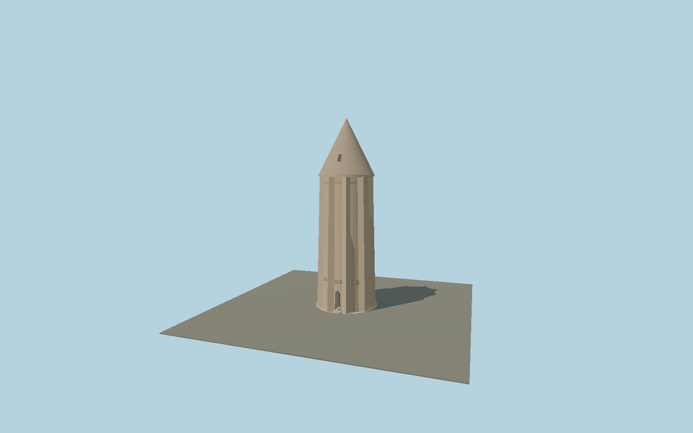

# Gonbad-e Qabus

Ten-flanged fired-brick tomb tower with a tapered star section, deep pointed entrance, two bordered inscription bands, corbelled neck and steep cone with a roof light.

## Identity and geometry

Catalog N0564, [Q606763](https://www.wikidata.org/wiki/Q606763). 2010 laser scan tables in UNESCO nomination, printed pp. 67-72, take precedence over the rounded 53 m overview and erroneous 72 m OSM height.

Tower center on the mound summit; Y=0 is the exterior tower base, excluding the 10 m mound. +Z is the entrance and roof-light side; +Y is up. The geographic proposal identifies its anchor and orientation evidence separately from remaining terrain and azimuth uncertainty.

Source facts and measured references are recorded in spec.json. References: [1](https://whc.unesco.org/en/list/1398), [2](https://whc.unesco.org/uploads/nominations/1398.pdf), [3](https://www.openstreetmap.org/way/328041889). Reference pages and images are not redistributed.

## Original source and shared materials

Geometry is authored in `packages/worldgen/scripts/heritage-tower-models.mjs`. Shared material graphs with metric repeat UV0 and original vertex tints; GLB PBR fallback remains self-contained. No per-model texture duplication. No third-party mesh or photograph is embedded.

12,469 triangles; 24,645 vertices; 4 material groups; 1,039,616 source bytes. Source hash: `sha256:36ad12c7da366d775bac623858288833659f52a56d4d5b731130a838be6ac6ef`. Geometry validation checks finite Float32 coordinates, indices, triangle area and winding before export.

Regenerate with `node packages/worldgen/scripts/generate-heritage-towers.mjs N0564`; add `--check` for reproducibility. The generator refuses to overwrite a master whose hash differs from source.json. Import uses `--no-optimize` to preserve facade recesses.

## Remaining detail and review

- Complete static medium-fi exterior; original detailed draft remains reproducible. Ten tapered right-angle flanges, pointed east entrance, two steps, recessed wood inner door, three proportional brick entrance niches, ten distinct relief-stroke panels per inscription band, corbelled neck and closed roof light remain. The 52.844 m tip follows the 2010 laser scan rather than the erroneous 72 m OSM tag. Curved bays and cone interpolate measured sections; anomalous scan-table diameters are averaged. A thin 2 cm circular pavement datum corrects the original 40 cm disc that hid the two access steps; the pavement thickness and inner spandrel/niche/door geometry are approximate, not a conservation survey. Relief strokes interpret nomination figures 67–76 individually but do not certify a readable epigraphic transcription; upper and lower bands reuse that sequence, while exact letter damage and plaster are averaged. Roof light retains the published height and base datum with approximate splayed width and reveal. Hidden roof construction and chamber are excluded from this exterior scope; the nomination itself rejects a simple assumed double-shell construction. Mound, park paths, ramps, furniture and buried foundations are separate terrain/site context. Host terrain must supply the mound summit; no fixed 10 m offset is added atop unknown terrain. Retained exact-QID OSM center is approximate. Published east entrance gives cardinal orientation with about 10 degrees uncertainty, not surveyed azimuth. Footprint replacement is disabled.

Named near/far cameras are included for lit visual review. A valid export is not maximum-fidelity certification.
