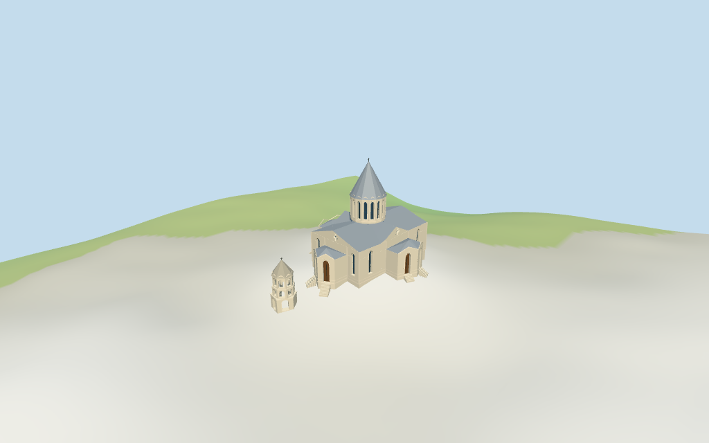

# N0366 — Ghazanchetsots Cathedral review

Reviewed 2026-10-15 against current source/runtime bytes. Accepted for the photographed2018–2019 medium-fi exterior and approximate geographic/terrain scope. Later restoration state is unverified.

## Built result

Inspected all11 current portable/source-terrain frames. Individual Ghazanchetsots Cathedral uses the photographed2018–2019 conical-roof exterior: pale ashlar main body, three projecting faceted entrance porches with paired round recessed portals, tall round-arched glazing, crossed gable lights, folded crossing roofs, narrow-window faceted drum and tall silver metal cone/cross. The separate western bell has a true open base passage, two arcaded upper stages and a pointed stone cone/cross. Corrected shallow cone proportions, shortened the excessive doorway panels and added approximate approach steps from the current terrain. Main and bell plans remain separate. Fine sculpture, reliefs/inscriptions, exact stained glass, surveyed plaza/terraces and later restoration changes are excluded or unverified.

Medium-fi exterior from three useful2018–2019 photographs and standard viewer PMTiles/DEM only. Later restoration state is explicitly unverified. Raw mapped height envelopes and plan outlines remain intact, with estimated roof/drum/belfry subdivisions, round portal/window dimensions, cross lights and ornament. Bell uses a separate local terrain datum. Short approximate entrance flights address DEM contact; surveyed/full plaza paving and terraces, exact sculpture/inscriptions/carving/stained-glass art, landscaping, full interiors and certified walking are excluded. Four shared graphs approximate historic masonry, stone cone and metal roofs. Physical laptop/phone timing pending.

## Shared materials and placement

Inspected all11 current shared-material/geographic frames. Four existing shared256-square ashlar stone, limestone, standing-seam metal and plain wood graphs serve six merged groups. Main walls and bell stone roof share ashlar with different linear tints. Silver roofs share metal; glass/accents use flat PBR colors. Metric UVs, zero embedded images, bespoke facade textures or baked shadows. Each graph reads once; unload disposes the model, leaves zero live model geometries and restores ground. Signed top view matches the separate main/bell map plans. Flat diagnostic ground masks the bell base and below-datum approaches because its local DEM datum is lower; source-terrain views show the full modeled base. Ground bands are diagnostic fixtures.

Exact-QID way292349517/Q2001493 matches current main35184664438349(height34.7m); separate western bell35184706969661 retains15m. Two raw PMTiles plans/tags and min_height absences are exact, without rescale. Anchor[46.747531266,39.758753614], heading0.09124930272510762rad follows the long southern main wall, signed by the western entry and detached bell. The retained minimum-envelope axis was distorted by projecting porches. Roof eaves10.8m/ridges14.3m, porch roofs10.1m, drum14.3..22.5m/cone33.5m/cross34.7m and bell levels3.5/6.5/10m/cone14.3m/cross15m are picture estimates within the approximate map envelopes, not stacked solids. Bell elevations use its own DEM center offset-3.987562m. No independent measured dimensions in retained facts. Only derived Boolean inputs round to0.1mm; raw controls remain untouched. Main/porch partitions and eight roof-fold sectors reproduce. All36 actual viewer footprint checks cover both controls while preserving three neighbors and a separate west-front patch across six outputs. Standard DEM datum1373.138947m, display offset0.4m; main perimeter-4.51..0.14m, bell-4.56..-3.21m. Main portal thresholds use estimated display datum+0.2m with approximate steps to local DEM+0.22m; bell passage uses local DEM+0.22m. This coarse terrain cannot certify actual plaza elevations, stairs/podium, cut-fill or walking. No road replacement or global terrain flattening.

Inspected all27 current Earth-lighting frames: Economy/High, noon/late, three distances, silhouette, six detail crops, four matched whole-model LODs and four transitions. Skyline keeps the body/three porches, crossing cone, coarse access wedges and detached bell with open base/upper arcade. District adds shared surfaces, flat glazing/doors and open middle arcade. Street adds real facade recesses, round arch surrounds, cross lights, slender drum pilasters, peaked cornices and stepped entrances. Closeup/master refine arch facets and window bars. Both complete cones/crosses and the compound fit all four matched whole-model cameras; default/detail crops show portions. Synthetic cottage neighbors and banded terrain are fixtures rather than mapped surrounding buildings or paving.

## Browser budgets

| Level | Triangles | Bytes | Draws |
| --- | ---: | ---: | ---: |
| skyline | 761 | 78400 | 1 |
| district | 2051 | 191316 | 6 |
| street | 10419 | 968856 | 6 |
| closeup | 14574 | 1381572 | 6 |

Initial skyline plus district: **269716 bytes** of geometry. Master: **1752540 bytes / 14574 triangles**. Four cached shared 256² graphs, zero embedded images. Geometry bytes exclude graph definitions/texture generation. Split POSITION/NORMAL streams with equal CPU/GPU totals. Physical device timing pending.

## Verification

- Targeted byte reproduction, source/import/LOD/input/review hashes, recipe index and source inventory/schema match.
- Six Khronos validations: zero errors/warnings/images; four browser budgets pass.
- Two raw map controls, height/min_height tags or absences, signed frame, porch/core/roof-fold partitions and standard DEM match.
- **1180 geometry probes** and **36 actual viewer footprint checks** pass.
- Shared graph read-once/unload and hash-bound placement/medium-fi reviews pass.
- Scene validation and 30-tick simulation pass: sha256:4b381685a1f2c5d23f5009665e9b573fe3fd7ccacbf9faa5685e1efeba08569b.
- Inspected **49 current frames**: 11 portable, 11 shared/placement, 27 medium-fi. Cameras/paths/hashes retained; bulk images ignored.

Source hash:sha256:0e55d1afba0d20dde1f5bc74754dbcb825c673b40a4a7d9188ceead7491697d8. Runtime hash:sha256:76cf90cbabccf55722de665a2267d127731f5ccc4091688abc317a2ab2260a2a. Input hash:sha256:5a5d05fdca0befbbc337c601eadc5c9b5f2624d4af2091d48065c8aadb298e84.

Commands: targeted generate/import/LOD/register-landmark-previews --ids=N0366; generate-additional-landmarks.mjs --ids=N0366 --check; capture-next-1000-models.mjs --ids=N0366 --reflections --antialias --fit-shadows; capture-landmark-library.mjs --ids=N0366 --reflections --adaptive-clipping --bounded-placement; capture-medium-fi.mjs --ids=n0366_ghazanchetsots_cathedral --reflections; molen validate; molen sim run --ticks 30 --hash. Routine full source checkpoint covers N0360–N0379.

## Limits

- Retained exact-QID way292349517/Q2001493 matches current main35184664438349 with height34.7m. Separate western bell35184706969661 has height15m. Raw plans/tags and missing min_height values are retained, without rescale. These approximate map envelopes are full cone/cross tips, not stacked wall solids. Picture-led main body eave10.8m/ridges14.3m, porch eave8.2m/roof10.1m, east apse roof13m, drum14.3..22.5m and metal cone22.5..33.5m/cross34.7m are estimates. Bell elevations are relative to its own standard-DEM center, not the cathedral datum. Bell base3.5m, middle6.5m, upper10m and stone cone14.3m/cross15m subdivide its envelope. The2018–2019 photographed conical-roof exterior is the explicit appearance scope; later restoration state is unverified. Boolean partitions round derived inputs to0.1mm; raw controls remain exact. Retained facts have no independent measured dimensions. Facade rhythm, porch and drum forms, reliefs and thresholds are approximate.
- Standard DEM datum 1373.138947m; display offset 0.4m, main perimeter terrain -4.51..0.14m; bell local datum offset -3.988m and perimeter -4.56..-3.21m. Foundations follow terrain; main portal thresholds use an estimated display datum+0.2m, with approximate steps connecting to local DEM+0.22m; bell-passage thresholds use local DEM+0.22m. Coarse viewer DEM does not certify absolute altitude, paved terraces, stairs, podium/cut-fill, entrance levels, interiors or walking. No global terrain flattening.
- Medium-fi exterior based on three inspected2018–2019 pictures and standard PMTiles/DEM only. Later restoration changes unverified. Exact carving/statues/inscriptions, small stained-glass designs, surveyed paved terraces/stairs, landscaping, full interiors and certified walking excluded. Physical device timing pending.
- Skyline keeps body/porches, faceted drum/cone and separate bell with open base/upper stage. District adds shared textures, flat glazing/doors and open middle arcade. Street adds true facade recesses, roof/gable trim, narrow windows/cross lights and structural bands. Closeup/master refine facets and window bars. Synthetic cottage neighbors are review fixtures.

Readiness accepts this exterior scope. The 1,000-candidate goal remains incomplete.
