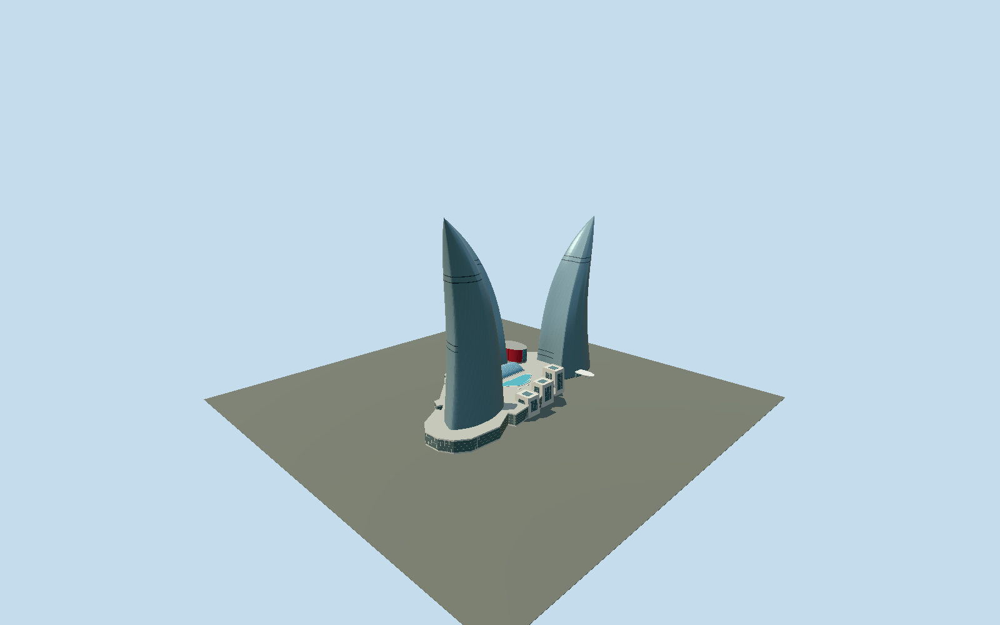

# Flame Towers

Three independent curved triangular glazed flames, with unequal heights, pointed swept crowns, unitized facade panels, dark maintenance slots, pale stepped retail pavilions and a glazed central atrium.

## Evidence and reconstruction

Published dimensions and reconstructed details are separated in spec.json. Primary references:

- [Reference](https://www.hok.com/projects/view/baku-flame-towers/)
- [Reference](https://www.wernersobek.com/de/projekte/baku-flame-towers-hochhauskomplex/)
- [Reference](https://www.skyscrapercenter.com/complex/618)
- [Reference](https://global.ctbuh.org/resources/papers/download/985-innovative-and-sustainable-high-rise-facade-systems-in-asia.pdf)
- [Reference](https://priedemann.net/en/cases/stormy-windows.html)
- [Reference](https://www.dlubal.com/en/downloads-and-information/references/customer-projects/000682)
- [Reference](https://www.openstreetmap.org/way/687226634)

No third-party geometry, photograph or bitmap texture is embedded. Shared surface graphs come from the central library; vertex tints carry model colors. Glazing uses PBR materials; transparent surfaces are declared per model.

## Model and axes

63,218 triangles; 177,862 vertices; 3 material groups; 7,163,992 bytes. Native bounds: -103.130, 0.000, -145.722 to 58.871, 182.000, 102.622. Source hash: `sha256:4200e30ee275e35afd8be5323c59170309f88f3df0d7dc50916d22e84eec2c22`.

{"up":"+Y","east":"+X","south":"+Z","front":"+X toward the eastern city frontage"}

Fresh2026-10-10 OSM API retains four independent ways253081850(south residential),253081914(north hotel),253082095(west office),687226634(shared podium), exactly matching independent original source-local geometries. HOK supplies tower-use compass identities; contradictory raw OSM hotel/commercial labels remain evidence and do not swap the towers. Cardinal heading0 gives+X east/+Z south; outward crown axes follow each mapped wing separately. Podium area centroid [49.82657160078091,40.359642187881434] remains the common anchor. Original projection uses40.3598latitude; projected mapped ring nodes agree within3mm. Towers rise from reconstructed commonY0 despite real hillside entrance offsets. Accept2m ground-envelope/1degree reconstruction allowance, excluding canopy/pavilions reconstructed from engineer aerial; no automatic footprint replacement. Unequal182/165/161m CVU heights differ from engineer140/160/170m local above-ground approximations. Terrain grading, LED media and interiors excluded.

## Reproduce

Run `node packages/worldgen/scripts/generate-signature-towers.mjs --ids=flame_towers` (or add `--check`). The generator preserves manually edited masters by checking their baseline hashes. Import through the standard authored-model workflow with optimization disabled; then capture all QA cameras, including shared-surface views.

## Pending work

- Original68737triangles/7786092byte detailed master remains exactly reproducible through unchanged buildFlame recipe. Reviewed source retains original1.36m Hermite-sampled plan and original floor datums, curved pointed crowns, paired/partial dark maintenance slots, cut common podium, three stepped picture-window pavilions, curved roof pool, red cinema, glazed barrel atrium, hotel canopy and two cylindrical doors. Continuous atrium shell and merged frame strips reduce repeated pane islands; retained canopy/roof geometry closes the exterior. Skyline uses coarse wing sections and averaged shared graph colours with a continuous podium and closed stone pavilions, omitting fine maintenance slots, pavilion windows/skylights, vents and door framing. District restores dark maintenance bands, cut podium and pavilion windows; street restores facade sampling and sparse vent/joint sampling; close-up restores original facade/ring detail and entry hardware. Canonical limestone approximates concrete; coated-metal and one opaque palette-glass group retain three near draw groups with zero embedded images. Exact NURBS control points, hillside grading, section pitch, slot elevations and pavilion/entrance dimensions remain reconstructions; no surveyed terrain or physical-device-performance claim. Finite twelve-ray comparisons at six heights per tower use4/1.5/.5/.1m skyline/district/street/close-up along-ray allowances, excluding omitted fine trim; the804triangle ensemble skyline is deliberately coarser than the separately authored single-tower skylines. This is not a global Hausdorff bound.

This bundle follows the medium-fi standard. Medium-fi appearance and geographic fit are reviewed separately. Hash-bound visual acceptance is recorded separately after capture inspection.
