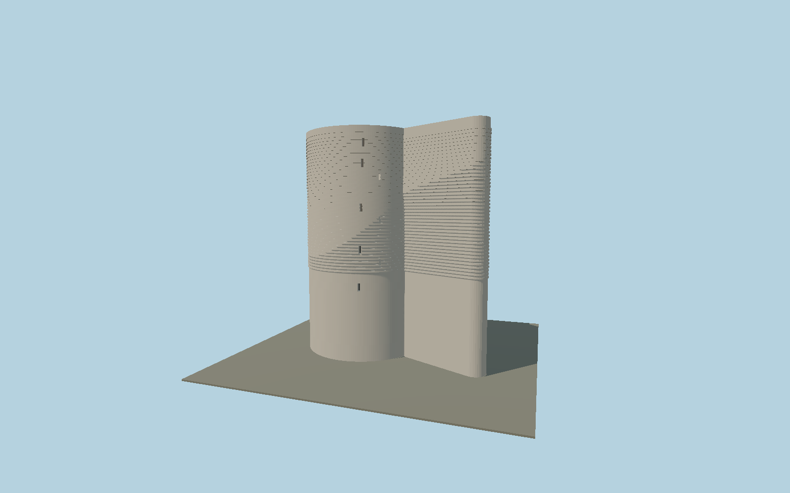

# Maiden Tower

Baku limestone tower with its asymmetric seaside buttress, rounded nose, relief masonry bands, recessed slit openings and open roof parapet.

## Identity and geometry

Catalog maiden_tower, [Q842822](https://www.wikidata.org/wiki/Q842822). Reserve administration cylinder diameter and height envelope; Presidential Library entrance and panel dimensions; OSM asymmetric buttress footprint. Nominal 31 m base-to-parapet includes the reported 3 m site-level difference.

Minimum-area OSM footprint center in X/Z; nominal lowest exterior base at Y=0. OSM-local +X points approximately east; western doorway toward -X; +Y is up. The geographic proposal identifies its anchor and orientation evidence separately from remaining terrain and azimuth uncertainty.

Source facts and measured references are recorded in spec.json. References: [1](https://icherisheher.gov.az/en/monuments/show/qiz-qalasi), [2](https://bakucity.preslib.az/en/page/7eSskpB6tX), [3](https://www.openstreetmap.org/way/299418016). Reference pages and images are not redistributed.

## Original source and shared materials

Geometry is authored in `packages/worldgen/scripts/heritage-tower-models.mjs`. Shared material graphs with metric repeat UV0 and original vertex tints; GLB PBR fallback remains self-contained. No per-model texture duplication. No third-party mesh or photograph is embedded.

85,366 triangles; 170,508 vertices; 3 material groups; 7,165,020 source bytes. Source hash: `sha256:2ed5b01856b931eec9876813ceb9633672b0e23f68b93c4a2f1157b29578d480`. Geometry validation checks finite Float32 coordinates, indices, triangle area and winding before export.

Regenerate with `node packages/worldgen/scripts/generate-heritage-towers.mjs maiden_tower`; add `--check` for reproducibility. The generator refuses to overwrite a master whose hash differs from source.json. Import uses `--no-optimize` to preserve facade recesses.

## Remaining detail and review

- Complete static medium-fi tower exterior. Original detailed heritage recipe remains byte-reproducible. Published 16.5 m cylinder, 31 m north-side height envelope, smooth lower 12 m, upper raised masonry courses, western arched doorway, eight narrow slit indications, circular open roof parapet and asymmetric rounded seaside buttress remain. The reviewed roof restores an inset buttress terrace and closed parapet instead of the draft solid top slab; a small sloping stairhead is proportionally interpreted from the reserve illustration and satellite roof context, not a measured current fitting. Forty-three course positions and slit heights are photographic estimates, not a block survey. Skyline/district average course groups into broad low-contrast tonal zones; street/closeup preserve individual physical raised bands. The original inscription panel preserves published dimensions without invented text. Museum interior, well, buried foundations and separately mapped adjoining low defensive buildings are separate scope. No private bitmap is embedded; two canonical shared material graphs supply metric limestone and painted metal. Ground0 is the lowest exterior base, not the roof, and the reported three-metre grade difference requires real terrain fitting. Flat fixtures cannot certify slope or foundation contact. Cached exact-QID OSM outline and actual north-up satellite establish the directed eastern/southeastern arm; projected roof displacement prevents surveyed placement. Native footprint is retained and replacement disabled.

Named near/far cameras are included for lit visual review. A valid export is not maximum-fidelity certification.
