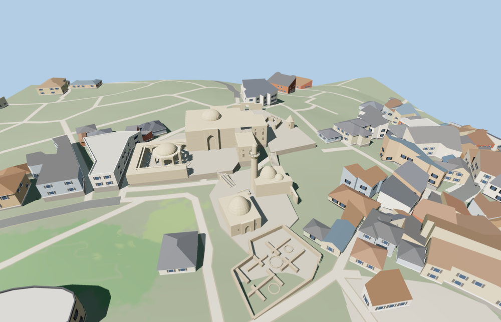

# Palace of the Shirvanshahs

The stepped Baku palace precinct pairs a limestone residence and its domed octagonal Divankhana with the lower mosque and minaret, dynastic tomb, Bakuvi tomb, Murad Gate and roofless ruins of Key-Qubad and the palace baths.

The 16,624-triangle source rebuilds byte for byte. Skyline, district, street and close-up use 936, 3,660, 7,612, 13,602 triangles. Skyline and district total 430,716 bytes. Six GLBs validated and 36 current views were inspected.

The model replaces six mapped precinct features and preserves 108 surrounding buildings and 89 transportation records. The four tiers pass checks for domes, courtyard elevations, stair grades and the open Murad Gate. All six mapped buildings return if loading fails.

PMTiles and the named precinct fix the horizontal fit. Courtyard levels, minor gate positions and elevations of untagged components are exterior photo estimates adjusted to standard Terrarium terrain. The baths and Key-Qubad mosque show above-ground ruins and open chambers. Underground rooms, museum interiors and individual carved inscriptions are outside this exterior model.

Rebuild with `node packages/worldgen/scripts/generate-shirvanshah-palace.mjs`. Append `--check` to compare exact bytes. Use `--ids=palace_of_the_shirvanshahs` for targeted import, LOD, placement and readiness.
