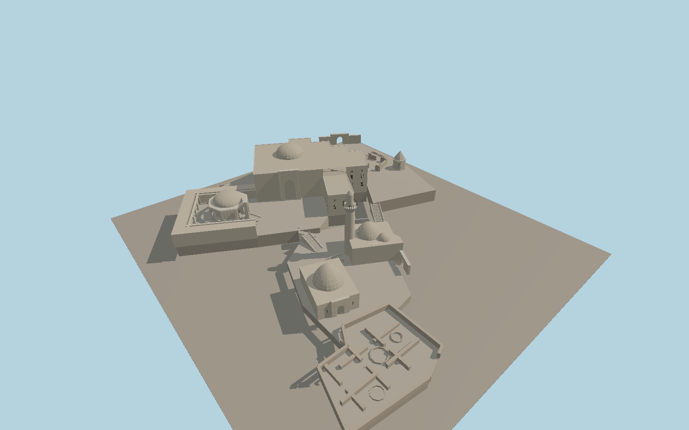

# Palace of the Shirvanshahs

The stepped Baku palace precinct pairs a limestone residence and its domed octagonal Divankhana with the lower mosque and minaret, dynastic tomb, Bakuvi tomb, Murad Gate and roofless ruins of Key-Qubad and the palace baths.

Run `node packages/worldgen/scripts/generate-shirvanshah-palace.mjs` to rebuild the source master. Append `--check` to compare the exact bytes. Use `--ids=palace_of_the_shirvanshahs` for targeted import, LOD generation and placement.

PMTiles and the named precinct fix the horizontal fit. Courtyard levels, minor gate positions and elevations of untagged components are exterior photo estimates adjusted to standard Terrarium terrain.

The baths and Key-Qubad mosque show above-ground ruins and open chambers. Underground rooms, museum interiors and individual carved inscriptions are outside this exterior model.

Original geometry follows the repository license. Map data is © OpenStreetMap contributors under ODbL-1.0 via Protomaps. Terrain samples are described in terrain-grid.json. Ordinary pictures stay local and are not redistributed or used as textures. Current acceptance is recorded in qa.json.
