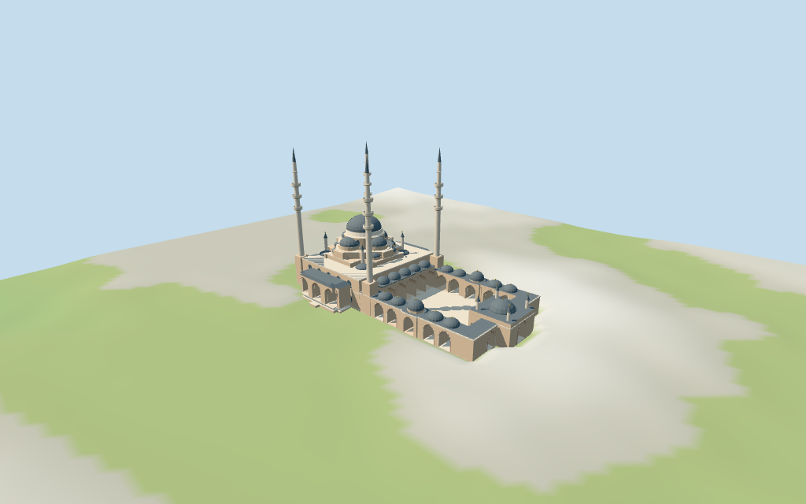

# N0454 — Akhmad Kadyrov Mosque

Reviewed 2026-10-17 for the stated medium-fi compound exterior and approximate map fit. Principal plan and height ranges follow current map data; fine architecture, exact terrain joins and physical-device timings remain limited.

## Exterior and shared materials

Inspected all 11 current portable frames including the compact summary. Four pale minarets retain three balcony bands, dark pointed caps and the mapped 60 m tips. The prayer hall carries stepped grey domes, lower caps, corner pinnacles and selected arched windows. Side porches, pale/pink pointed courtyard arcades, roof-cap rows, open paved court and domed through gate are present. Fixed gallery membranes blocking the axial gate and hall-entry passage; removed the distant central post blocking the entry axis before final captures. Fine carved capitals, calligraphy, lattice patterns, street furniture and unseen interiors remain omitted.

Inspected all 11 final shared/geographic-flat frames, including the north-up placement overlay. Six shared 256² sandstone, marble, continuous sandstone, standing-seam metal, cast bronze and wood graphs serve seven merged roles including opaque blue-grey glazing. Metric UVs and linear tints; no embedded images or unique facade atlas. Alternating original arch facets approximate the pink/cream masonry. Every graph is read once and eviction leaves zero live model geometries. The raw outline, courtyard ring and heading remain fixed. Paving occupies the court floor while its roof volume remains open. Flat placement proves transforms and replacement, not terrain-data precision.

## Browser levels

| Level | Triangles | Bytes | Draws |
| --- | ---: | ---: | ---: |
| skyline | 989 | 105328 | 1 |
| district | 3996 | 358768 | 6 |
| street | 15731 | 1502056 | 7 |
| closeup | 23881 | 2274220 | 7 |

**464,096 bytes for initial skyline plus district**, plus shared textures. Six shared 256² graphs, seven merged source roles, zero embedded images.

Inspected all 27 final medium-fi frames: Economy/High, noon/late light, three distances, untextured silhouette, six details, four matched LODs and four transitions. Also inspected the matched skyline at full size. Skyline 989 retains four triple-band minarets, stepped dome mass, side-porch roofs, open court and gate. District 3996 adds principal arcades, opaque glazing and cap rows. Street 15731 adds recesses, alternating arch wedges, smaller caps/pinnacles and solid balcony parapets; closeup 23881 refines curves. Initial skyline plus district is 464096 bytes plus shared textures, at one/six/seven draws. District omits minor gate/entry turrets and small caps; these visibly appear near. Skyline arcade arches simplify to supports. Synthetic neighborhood and coarse terrain are fixtures; physical laptop/phone timings remain pending.

## Placement and scope

Retained exact relation 6012185 / Q340549 is current viewer building 52776564145433. All 45 current outer vertices and the 19-vertex open-court ring, original anchor and heading remain unchanged. Selected principal body, dome, roof and four minaret parts retain raw polygons/properties and mapped height ranges. Positive X NNE points from the SSW prayer hall toward the open court and gate; positive Z ESE toward the eastern side porch. Two inspected pictures resolve the signed axis without rescaling. The relation has no current QID tile tag; the retained exact relation supplies identity. Tiny mapped facade/ornament parts are consolidated into shared medium-fi window/arch rhythms. Park, streets and city buildings remain host content. Normal viewer DEM datum 124.2808983117137 m; floor -0.3157523352428001 m is median of 134 outside-perimeter samples every 3 m at 1 m offset plus 0.35 m. 527 raw footprint samples span -1.417415058856875..2.2325225342034543 m. Adaptive footings follow the outer outline; preview terrain seats the compound and 1.5 m margin. The paved court is open above its floor. Ground cutout follows the full compound outline, covered by the model paving. Exact street steps, thresholds, paving grades and host terrain joins remain unverified. Independently reunited all 34 principal controls and 550 raw vertices, including the 45-vertex whole outline and 19-vertex open-court ring. The 8 m part 52776564161579 lies at a court-arcade corner and is retained as an attached eave, with its raw building_part tag and geometry preserved; it has no separate building identity. All 1608 renderer footprint checks pass: 34 selected controls covered and 234 exterior host buildings/parts preserved across six GLBs. Reproduced 527 raw footprint samples, 134 outside-perimeter samples and 519 seated preview points. The full compound ground cutout is covered by model paving. Exact paving grades, stairs, thresholds, current finish and host terrain joins remain unverified.

Individual medium-fi Akhmad Kadyrov Mosque with mapped prayer hall and open courtyard: four triple-balcony minarets, stepped central grey domes, pale stone arched facades, lower side porches, courtyard arcades and a domed through gate. Raw principal plan/height controls retained; repeated tiny map ornaments consolidated into original shared-material details. Seven merged roles, six existing 256² graphs, four budgeted browser LODs. Fine art, furnishings, park context and unseen interiors omitted. Current principal map heights guide this visualization: prayer body 13 m, lower/upper podiums 15/18 m, drum 18–23 m, neck 23.5–25 m, main dome 25–31 m and finial top 32.5 m; four minaret tips 60 m. Lower roofs and courtyard domes use their selected map height ranges. Three minaret balconies at about 34/39/44 m and collar near 50 m follow the mapped ring levels. The gate top 9.5 m and its cap top 13 m are mapped. Arch depths, repeated bays, dome curves, roof slopes, small turrets/finials, screens, finishes and exact structural profiles are picture estimates. Fine carving/calligraphy, lights, flags, furniture and unseen interiors are omitted; map heights are not surveyed measurements. Two actually inspected exterior/courtyard photographs guide the original medium-fi forms. Current map parts guide the principal height ranges; these are map claims rather than surveyed measurements. Small roof-cap count and spacing, roof curves, arch depths, facade rhythm, pinnacle heights and parapet patterns remain estimates. Tiny mapped facade parts are consolidated; no copied artwork, redistributed pictures, bespoke surveys or furnished interiors.

## Verification

49 current views inspected; 354 FrontSide geometry probes; 1,608 renderer footprint checks; six Khronos checks with zero errors, warnings or embedded images. Source, runtime, input, LOD, report, frame, shared-graph and placement hashes agree. Targeted source reproduction, placement check, scene validate/sim30, vertex layout and recipe/registration Biome pass. The N0432–N0449 full source checkpoint remains; next routine source milestone N0450–N0469.

Source: sha256:a685e941e6fadc475b875a7814c96c1772002d652d412a0fe7c4f604c6df8db5

Runtime: sha256:f17f1e44bc2243b486834be45c0dc18f86736b2cf75115adafc0616157e3af57

Input: sha256:6bb75b068500b1abaab9fb6ba4acd87fd5c1dc68cc40b3b3572d7ee0f1b8f4f8

Commands: targeted generate/import/LOD and register-landmark-previews --ids=N0454; generate/placement --check; portable reflections/antialias/fitted shadows; shared reflections/adaptive clipping/bounded placement; medium-fi reflections; selected LOD check; scene validate/sim30; recipe/registration Biome. Bulk captures remain local and ignored.

## Inspected picture references

[Саид-Эми Кайсаров — 2010-06-17](https://commons.wikimedia.org/wiki/File:Achmat-Kadyrow-Mosche,_Grosny_2.jpg). CC-BY-3.0; viewed only. Inspected complete 960×720 daylight exterior. Four slender pale minarets with three projecting balconies and dark pointed caps; pink-beige walls with pale arched trim, central grey dome over lower half-domes, corner roof turrets and rows of smaller grey roof domes. Trees, lamps, flags, street furniture and city towers remain outside the asset.

[Vyacheslav Argenberg — 2017-08-18](https://commons.wikimedia.org/wiki/File:Grozny,_Russia,_Akhmad_Kadyrov_Mosque,_Courtyard.jpg). CC-BY-4.0; viewed only. Inspected complete 960×640 courtyard view. Open paved court with pointed arcades on pale stone columns, alternating pink/cream arch wedges, grey cap domes and small gold finials. A central domed gate has a through passage, lattice side panels and slim capped corner turrets. Wet paving reflections and fine ornamental motifs are not copied into textures.
