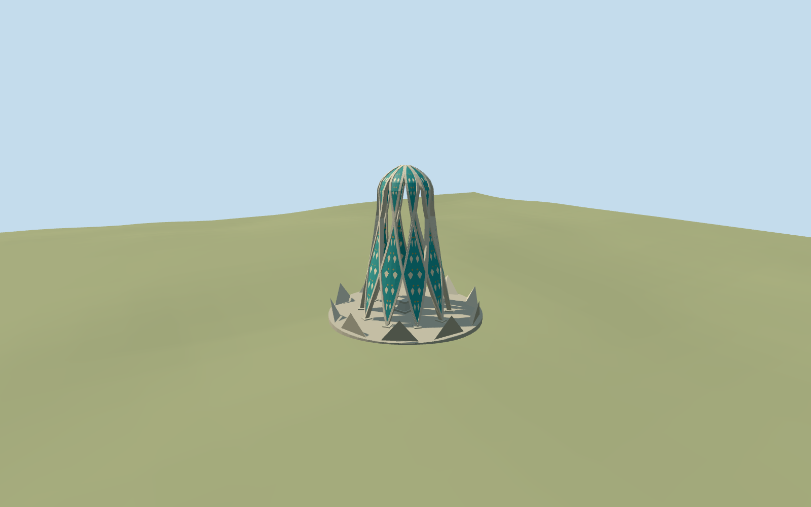

# omar_khayyam_mausoleum — Omar Khayyam Mausoleum

Reviewed 2026-10-20 in one continuous author/build/inspect/fix round.

## Appearance

Inspected all47 current views:8 source,7 shared-material,24 medium-fi and8 native-map frames. Specific ten paired curving/crossing pale stone ribbons, broad turquoise tiled lower diamonds/upper petals, genuinely open elongated gaps, rounded crown and small closed rosette are present. Low central grave marker, separate feet, bounded paving and repeated folded edge panels are visible. Three ordinary whole/close/ceiling pictures carried through one construction round; the third resolved the roof/underside coverage gap. Added the actual central underside and seated the navy ornament inset on an existing leaf facet to remove coplanar flicker before final captures. The whole views contain the entire monument; close views intentionally frame ribbons, ceiling or feet. No separate research/QA restart.

## Shared materials and browser levels

Four existing256-square shared graphs: stone_limestone_raw, tile_ceramic, stone_checker_fine and stone_marble. Body and foundation share limestone through separate semantic slots; all tiled colors/ivory leaf and navy/ochre motifs reuse the same ceramic graph with linear vertex tints. Original low-frequency geometric decoration substitutes for the pictured fine calligraphy/floral artwork; no inscription or image atlas copied. Shared graphs read once, at most five runtime draws, zero embedded images. Metric UVs/separate POSITION and NORMAL streams/equal CPU-GPU buffer accounting verified. Skyline uses averaged shared colors and simpler feet/rosette/paving facets; the principal paired ribbons and real openings remain geometry.

| Level | Triangles | Bytes | Draws |
| --- | ---: | ---: | ---: |
| skyline | 996 | 112464 | 1 |
| district | 3988 | 448552 | 5 |
| street | 10130 | 1133360 | 5 |
| closeup | 17478 | 1968344 | 5 |

Four authored levels996/3988/10130/17478 triangles fit the1k/4k/16k/64k ceilings. Skyline+district561016bytes, below3MB phone/6MB laptop initial limits. Inspected noon/late, economy/high, silhouette/details and four transition views. Skyline has coarser ribbon cross-sections and simplified lower tile-tip/foot/paving/rosette detail; district restores the fuller tapered tile fields and street/closeup add original decoration. The repeating lattice silhouette/ten feet/open gaps remain recognizable. Synthetic context establishes style/LOD continuity; separate native-map views establish geographic fit. No physical-device performance measurement claimed.

## Approximate map fit

Exact-QID OSMway857201546/PMTiles35185229290378 and named tomb point17593067583576 fix the approximately14m main envelope. Anchor58.82223871,36.165924484, heading0/native east-south axes; circle center[-.023790075,.104523011]m/mean radius7.035820m. Internal phase-.296868600746rad is a repeatable approximation: a circle supplies no directed facade, and tenfold symmetry leaves18degree/2m phase/envelope uncertainty. Only the corresponding circle shell replaced with2cm pad, zero residual. All34 independent resident building records retained from35 originals; native6m grid/paths/58.046447m2 water unchanged through every level/failure/unload. Failure restores35 originals; unload disposes all model geometry. Paving floor.836934m relative to DEM datum1178.976980m has buried retaining contacts and supported feet. No garden-wide slab, terrain flattening or ground/water cutout. Shared isolated review uses asset mode; native fixture verifies actual position/replacement.

## Limits

Map22m building height/retained2m roof tag have no qualified measurement point; use nominal paved-floor-to-crown22m and picture-led taper/crown/stone thickness. The three2008/2009/2020 photos establish the ten-base open ribbon/petal topology and tiled character; actual rib sections, intersection engineering, fine tile/repair schedule and current finish remain approximate. Lower diamonds close near14.72m and upper petals curl to the rosette; these are visual reconstruction parameters, not structural plans. Paving radius11.8m, repeated3m folded edge panels and1.6m central marker are original simplified picture-proportion estimates; their full inventory, exact arrangement and grave profile remain unverified. Coarse DEM does not resolve foundations/garden paving. No copied calligraphy/floral atlas, opaque generic tower/dome, furnishings, trees/visitor equipment or whole garden authored. Medium-fi style and browser budgets govern simplification.

## Selected checks

Six Khronos files: zero errors/warnings.210 actual mesh/material/contact checks; 47 current inspected views. Scene validation/sim30 and strict selected medium-fi audit pass. Source/runtime/LOD hashes and material bindings verified.

Rebuild: node packages/worldgen/scripts/generate-additional-landmarks.mjs --ids=omar_khayyam_mausoleum; node packages/worldgen/scripts/import-structure-models.mjs --ids=omar_khayyam_mausoleum; node packages/tooling/scripts/generate-landmark-lods.mjs --ids=omar_khayyam_mausoleum --force.

Source: sha256:32f376b2371f6260bac139ef19c58aca80467e978877345c084d862e8e9c55b4

Runtime: sha256:9d3784ef5b055d1c677b0610a0f1e32cbeb182dbb405d5dcd40ac5c1db9879fb

Input: sha256:44e5927aab962405e2603c0c51cadaa62ad8b76355c9ed28f1155a94c52b1bdc

## Viewed ordinary pictures

https://commons.wikimedia.org/wiki/File:Khayyam_tomb.jpg — Nima raevant; CC-BY-SA-4.0. Viewed only; no pixels copied.

https://commons.wikimedia.org/wiki/File:Nishapur_-_Omar_Khayyam_Mausoleum_13.JPG — Armin (آرمین); CC0-1.0. Viewed only; no pixels copied.

https://commons.wikimedia.org/wiki/File:Ceiling_of_Tomb_of_Omar_Khayyam.jpg — Vathlu; CC-BY-SA-4.0. Viewed only; no pixels copied.
