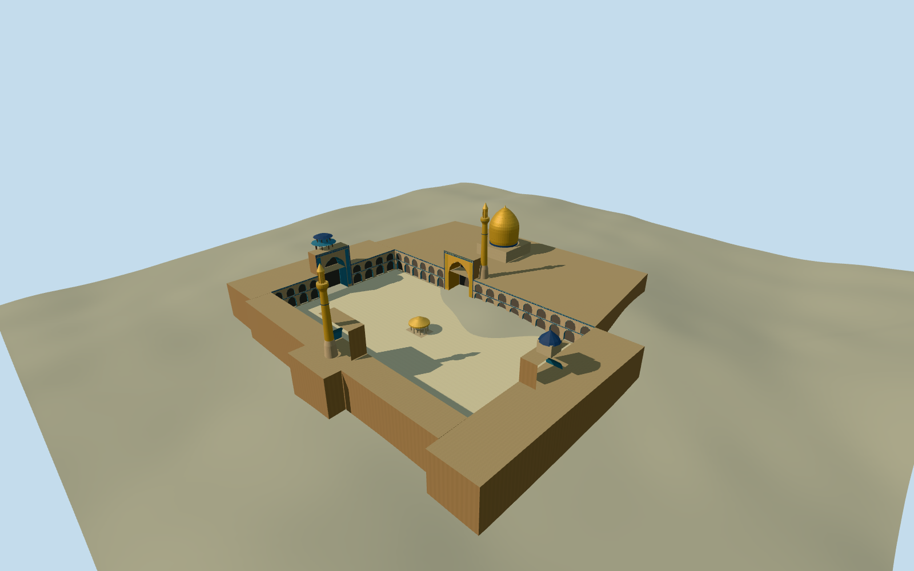

# Imam Reza Shrine

The historic Imam Reza Shrine in Mashhad, with the golden tomb dome, Old Court, paired gold minarets, four tiled iwans, clock and Naqqara Khana.

Authoring state: **review-in-qa.json**. Current completion evidence is in [qa.json](qa.json) and the [completion ledger](../../../../qualla-structures/batches/qualla-003.PROGRESS.md).

- [Imam Reza Shrine](https://qualla.com/imam-reza-shrine/)

The model represents the standing golden dome and historic Old Court exterior. Adjacent courts, teaching buildings, interiors and the extended modern complex are outside this model.

The dome and court plan are dimensioned. Subdivisions within the selected shrine mass, minaret alignments and court gate heights are estimates. Tile bands are geometric interpretations and no inscriptions or figural artworks are reproduced.

Build: `node content/worldgen/source/places/tq/tq6/imam_reza_shrine/models/generate-imam-reza-shrine.mjs`. Add `--check` to verify exact regeneration. 18886 triangles; 6 materials; no embedded photographs.
