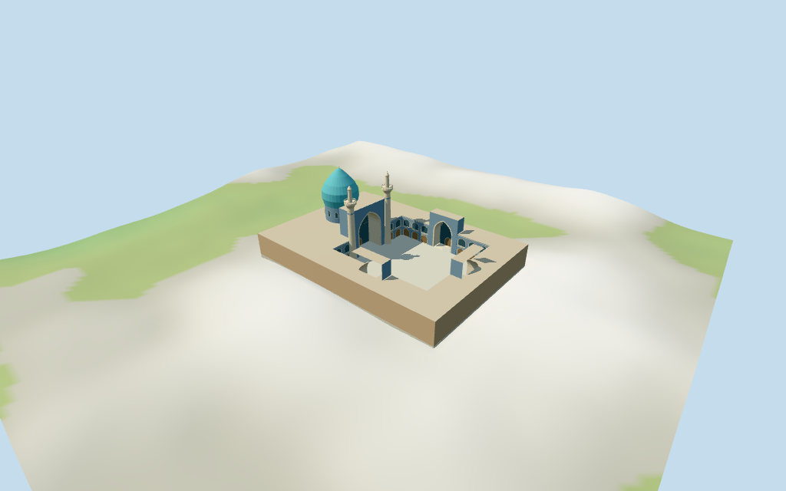

# N0465 — Goharshad Mosque

Reviewed 2026-10-18 for the declared medium-fi mosque exterior and approximate map fit. Current named courtyard and dome plan fix identity, scale and axis. The mosque campus is an explicit clipped scope inside merged shrine buildings; component heights and most internal architecture remain visualization estimates.

## Exterior and shared materials

Inspected all 11 final portable views including the curated 1024×640 preview. Individual Goharshad Mosque has a turquoise bulb dome and tiled drum, tall blue pointed Maqsura iwan with twin pale tiled minarets and projecting balconies, three lower court iwans, an open paved court and two-tier pointed gallery fields. Corrected full-width trim crossing the iwans, opened the gallery wall recesses, kept roof/soffit holes clear, removed floating small cap details, raised the estimated dome to retain its picture-visible peak behind the main iwan, moved portal tile panels 4 cm ahead of brick to stop coplanar flicker and corrected the upward winding of the balcony top annuli. Balcony rails/posts are deliberately thickened to 20 cm to clear the close-up feature threshold; this is stylization, not measured rail engineering. Fine floral/diamond tile artwork, calligraphy, exact muqarnas, fixtures, fountain, crowds and furnished interiors are omitted. The flat enclosing roof/ranges are an explicitly estimated campus scope within shared shrine outlines.

Inspected all 11 final shared-material/geographic-flat views and placement overlay. Six existing shared 256² brick, raw limestone, mosaic tile, lime plaster, marble and plain wood graphs serve seven merged roles including local opaque blue-grey panes. The cyan dome, pale minarets and blue facades share the same mosaic graph with linear vertex tints and metric UVs. No embedded images or copied photographs. Every graph is read once; unloading disposes geometry and restores host ground. Original anchor is fixed and heading follows the raw courtyard first edge. Whole-feature replacement is disabled: an explicit campus buildingCutout preserves the remainder of merged shrine parents. Flat placement verifies the pose/cutout binding, not surveyed terrain or surrounding architecture.

## Browser levels

| Level | Triangles | Bytes | Draws |
| --- | ---: | ---: | ---: |
| skyline | 416 | 44572 | 1 |
| district | 1364 | 142132 | 7 |
| street | 6292 | 603416 | 7 |
| closeup | 9908 | 946348 | 7 |

**186,704 bytes for initial skyline plus district**, plus six existing shared 256² textures. Seven merged roles; zero embedded images.

Inspected all 27 final medium-fi views, plus the matched skyline at full size: Economy/High, noon/late afternoon, three distances, untextured silhouette, six details, four matched levels and four transitions. Skyline 416 triangles retains turquoise dome, paired slender minarets and balcony silhouettes, four pointed iwans and an open court within the low ranges; gallery detail, arch trim and drum fields drop out. District 1364 restores sparse pointed fields and trim. Street 6292 restores two-tier galleries and selected facade/shaft detail. Closeup 9908 refines curves, arch profiles, recessed fields and balcony rails. Initial skyline plus district is 186704 bytes plus shared textures; one/seven draws. Coarse roof changes, gallery density and faceting are intentional distance changes. Synthetic neighbors and coarse normal DEM are fixtures; physical phone/tablet/laptop and full-city timing remain pending.

## Placement and limits

Retained Q2393680 reference anchor [59.614722222,36.2875] is unchanged. Current named Gowharshad Mosque POI 17592500373595 and Persian courtyard POI/landuse 35184757341598 support the identity. Courtyard is the exact four-vertex pedestrian polygon; dome is separate 19-vertex building part 35185137727260. The map merges surrounding ranges into larger shrine buildings 35184757341590 and 35185838521529. The authored campus is their intersection with an explicit estimated mosque envelope: courtyard limits plus 14 m ranges, extending west to the mapped dome radius plus 8 m. This clipped source scope is not an exact independent mosque way. Whole-building replacement is disabled; a buildingCutout removes only this campus from merged parents and preserves surrounding shrine geometry. Heading 0.7432519684678092 radians follows the first courtyard edge: positive X northeast along the court, positive Z southeast. Main Maqsura iwan faces positive X from the western local court edge. Tower centers flank that iwan at estimated offsets, not independent map controls. Golden Imam Reza dome, Quds courtyard/pavilion, adjacent halls, libraries, streets and other shrine structures remain host content. Normal viewer DEM datum 981.3131407720962 m; working floor 1.1899544108328428 m is the median of 134 outside-campus samples at 1 m offset plus .3 m. 1053 raw campus samples span -2.8558678939205038..5.157968103347912 m. Foundation/paving follow the clipped campus; preview terrain seats that outline and 1.5 m margin. The open raw court and four estimated iwan recesses remain clear above the paving. Exact shrine paving, thresholds, stairs, basements, drains and current grade joins remain unverified. Independently reproduced three raw building controls/97 vertices, exact four-vertex pedestrian courtyard and two named POIs. Source envelope is the intersection of two merged shrine parents with an explicit estimated campus mask, not an independent exact mosque outer way. The actual runtime clipping helper removes about 100.6 m² and 9165.5 m² from those parents while retaining about 22133.9 m² and 11114.5 m² respectively, removes the replaced dome part and leaves all ten separate neighboring features unchanged. The source tile is immutable and no mask returns the original tile. All 72 derived-footprint checks pass for the authored campus/dome and excluded neighbors. Parent footprint diagnostics demonstrate that the general heuristic can consider the larger merged parent covered; the explicit campus mask overrides it. Four additional Molen map-context renders were inspected: raw parent/dome/ten-neighbor polygons before and after clipping, in oblique and plan views. They show the court clearing while the shrine remainder stays. Gray host extrusions preserve tagged height and use an explicit 9 m fallback for untagged geometry; they are map proxies, not newly authored faithful shrine buildings. All 424 FrontSide probes pass for court paving/sky clearance, all four iwan passages/backs/intradoses, tile panels ahead of brick, both balcony tops/minaret finials, dome and gallery panes. Reproduced 1053 raw campus terrain samples, 134 perimeter samples and 962 seated preview points. Exact shrine paving, grade joins, thresholds, stairs, drains and basements remain unverified.

Individual medium-fi Goharshad Mosque: exact named courtyard and separate dome control, clipped mosque-only portion of merged shrine ranges, four pointed iwans with tall Maqsura facade and twin balcony minarets, turquoise bulb dome, two-tier blue/pale pointed courtyard fields and low flat roof ranges. Current court/dome geometry fixes scale and axis; envelope, minaret origins, component heights, bays, vault profiles and facing details remain explicit estimates. Six existing shared 256² graphs serve seven merged roles and four independent LODs. Adjacent shrine, golden dome, Quds pavilion/court, fine art and furnished interiors omitted. Retained source fact gives overall height 43 m without a component qualifier. No current mosque/dome/tower heights exist; the neighboring aggregate outline has a 9 m tag that is not assigned to this mosque. The model uses 43 m as the overall finial height of both minarets and the dome; the source does not assign that fact to one component. Picture-led estimates above working floor: paving .7 m; two-tier courtyard ranges 13 m; Maqsura iwan 28 m with a 23 m pointed opening, other iwans 21 m with 17 m openings; dome drum 15–22 m, turquoise bulb to 42 m and small finial to 43 m. Minaret shafts to 31 m, balcony around 32–34 m, narrower upper stage/cap to 43 m. These component allocations, profiles, facade bays, roof recesses and all local architectural divisions remain estimates, not surveyed engineering. Two actually inspected Commons pictures guide the Maqsura iwan, twin minarets, turquoise dome, gallery rhythm and a simplified faceted pointed soffit. The second picture is a vault detail, not a plan or height survey. Overall 43 m is retained without assigning it to a documented component; using it for both dome and minaret finials is an explicit visualization interpretation. Courtyard and separate dome plan supply scale and axis. Minaret offsets, component heights, bay counts, vault depth, roof ranges and outer campus envelope remain estimates. Golden Imam Reza dome, Quds pavilion/court, adjacent shrine halls, city and landscaping remain host content. Exact finish, fine art, hidden rooms, engineering, collision-certified/furnished interiors and physical-device timing are unverified.

## Verification

49 standard final views and four actual-map proxy context views inspected; 424 FrontSide probes; 72 footprint checks; three parent/dome clipping controls and ten untouched neighbors; six Khronos checks with zero errors/warnings. Current source/runtime/input/LOD/material/render/report/placement hashes agree. Raw controls, exact court, POIs, mask derivation, axis and required 16-bit terrain fixture reproduced. Source --check, placement --check, scene validate/sim30, selected LOD layout and recipe/registration Biome pass. Additional local context report: .artifacts/goharshad-review/context/report.json. Bulk captures stay ignored.

Source: sha256:f0c4f4823f007f00d92ccd9111ad5820f6714f657039725f4f26f391c2c5fd0f

Runtime: sha256:40cd5cfe0375bbcebb0245fe72496dfcf8c07a5786b490f6e24f9241575b6a1f

Input: sha256:e6cf2248fce9a277eff581ab21e02b764acd67395dc83337669bde48962792a1

Commands: targeted generate-additional-landmarks/import-next-1000-models/generate-landmark-lods/register-landmark-previews --ids=N0465; generator/placement --check; capture-next-1000-models --reflections --antialias --fit-shadows; capture-landmark-library --reflections --adaptive-clipping --bounded-placement; capture-medium-fi --ids=n0465_goharshad_mosque --reflections; selected LOD check; scene validate/sim30; recipe/registration Biome. Last full source checkpoint N0432–N0449, next routine batch N0450–N0469.

## Inspected picture references

[Goudarz.memar — 2017-07-26](https://commons.wikimedia.org/wiki/File:Goharshad_Mosque_Maqsura_Iwan.jpg). CC-BY-SA-4.0; viewed only. Inspected complete 960×658 exterior facing Maqsura iwan: tall blue/pale pointed facade, deep pointed vault, paired tiled cylindrical minarets with projecting polygonal balconies and smaller upper stages, turquoise dome behind; two-tier pointed courtyard fields. Fine inscriptions, floral/diamond artwork, lanterns, furniture, crowds and fountain not copied.

[Dr.rezaei 13 — 2016-09-10](https://commons.wikimedia.org/wiki/File:Goharshad-mosque-mashhad-IRAN.jpg). CC-BY-SA-4.0; viewed only. Inspected complete 960×355 detail of muqarnas/painted vault. It supports a coarse faceted pointed soffit treatment only; it is not an exterior plan or dome-height control. Fine cells, floral art and exact geometric pattern are omitted.
