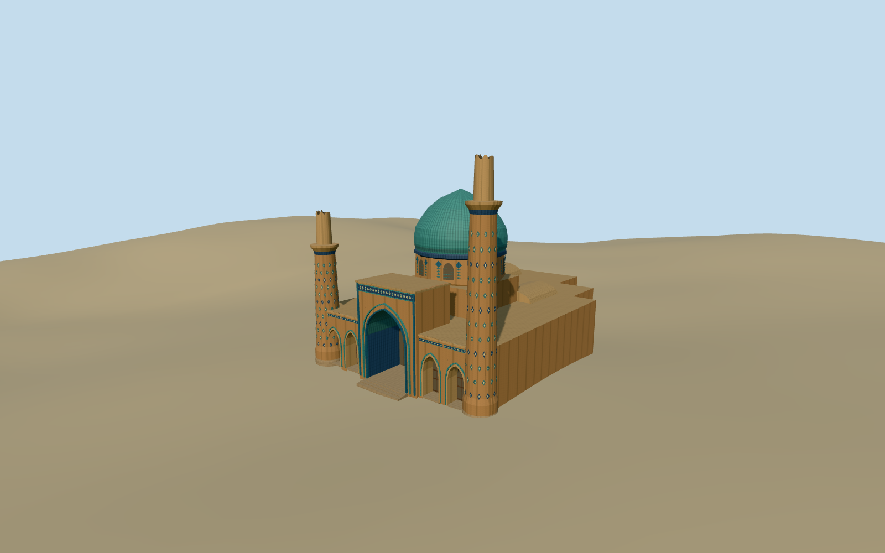

# Shah Mosque, Mashhad

Standing 15th-century tomb and mosque in Mashhad, with an open pointed north iwan, two pairs of recessed arches, strongly projecting minarets, and a turquoise bulbous double-shell dome.

Authoring state: **review-in-qa.json**. Current completion evidence is in [qa.json](qa.json) and the [completion ledger](../../../../qualla-structures/batches/qualla-003.PROGRESS.md).

- [Shah Mosque (Mashhad)](https://qualla.com/shah-mosque-mashhad/)

The model depicts the standing Timurid massing after later conservation. The historical photograph informs the architecture of the surviving entrance block and the damaged minaret shafts, and the published measurements control heights.

Finishes, the exact geometric tile pattern, window lattices, rear parapets and secondary vault heights are approximations. The bathhouse, buried tomb and later shrine complex are outside the model.

Build: `node content/worldgen/source/places/tq/tq6/shah_mosque_mashhad/models/generate-shah-mosque-mashhad.mjs`. Add `--check` to verify exact regeneration. 6178 triangles; 5 materials; no embedded photographs.
