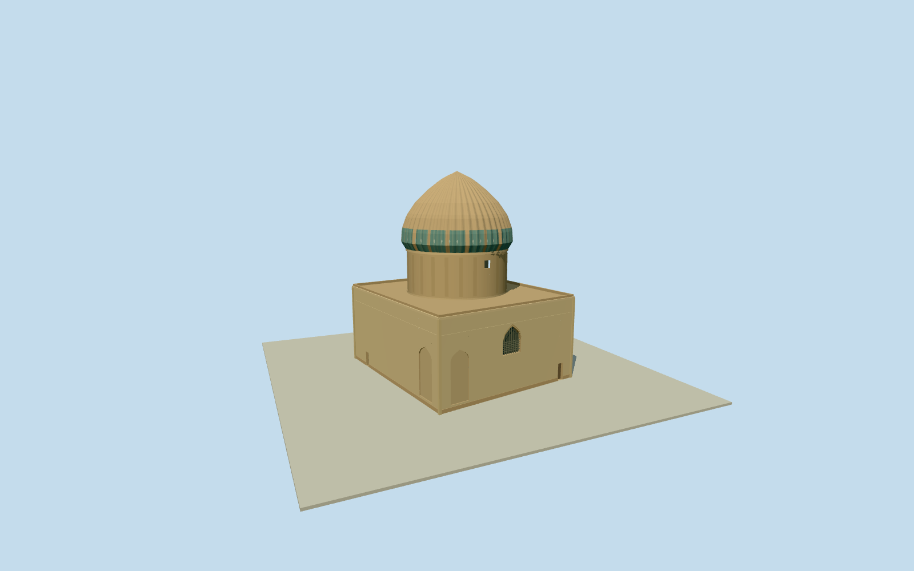

# Gawhar Shad Mausoleum

Whole surviving Gawhar Shad Mausoleum/Tomb of Baysunghur exterior on native four-corner buildingway743807289: full cubic/plastered brick chamber shell, true recessed pointed window/doorway and blind arch panels/corner piers, roof ledge/parapet, tall cylindrical panelled drum/small aperture and complete bulbous fluted outer dome with original restrained turquoise tile rhythm. Exclude separate adjacent mausoleum, all freestanding Musalla minarets/ruined madrasa/site walls/gardens/graves/city/private burial interiors; no whole-Musalla site or facade-only substitution. Surviving architecture follows clear2001 exterior/current native plan; exact current post-conservation finish/openings and unknown sections are bounded original medium-fi estimates, no copied inscription or pictorial ornament.

Authoring state: **review-in-qa.json**. Current completion evidence is in [qa.json](qa.json) and the [completion ledger](../../../../qualla-structures/batches/qualla-002.PROGRESS.md).

- [Gawhar Shad Mausoleum](https://qualla.com/gawhar-shad-mausoleum/)

Whole surviving mausoleum/actual four-corner buildingway743807289/Q85762853; nativepersonQ464986 is not building identity. Full chamber shell/pointed window-door and blind niches/pilasters/plinth/roof/parapet, tall panelled cylindrical drum/small square aperture and full fluted bulb dome. Separate small tomb/minarets/widerMusalla/graves/site/landscape/interior burial rooms excluded.

Qualla-first16families/0conflicts yielded unclear historic/art or unrelated US-government sources, all unused. Supplemental exact2435x1630 bluuurgh2001-07-15 Own/PD-self PNG/nativeSHA1matched/terminal exact rights record individually inspected. No protected UNESCO/gallery/plan pixels; conservation text only. No inscriptions/pictorial art/photo texture/borrowed mesh/generated bitmap or policy/verifier/source-body changes.

Clear exterior documents2001 tan body/drum/partly exposed fluted dome with turquoise lower fragments; later UNESCO tile conservation/reproduction means exact current coverage/finish/opening census unsurveyed. This is an original weathered architectural preview, not a verified current restoration color survey. Independent body11m/drum11.25..17.2/radius6.85/dome+10.2/radius7.45/48ribs and opposite face/door-window placement/reliefs/grille/roof/section details bounded medium-fi estimates. Abstract original muted geometric fragments only.

Independent400m/129x129/16641 heights/one raw tile/PNG frozen before geometry/floor/drum/dome unchanged. Source urban relief not a historical or construction survey and may contain canopy/building artifacts; precise source/host tomb footing/threshold contact unresolved/replacementfalse. Flat appearance views separate; no source flattening/fitting/reacquisition or whole-site pad.

Build: `node packages/worldgen/scripts/generate-authored-places.mjs --ids=gawhar_shad_mausoleum`. Add `--check` to verify exact regeneration. 16798 triangles; 6 materials; no embedded photographs.
