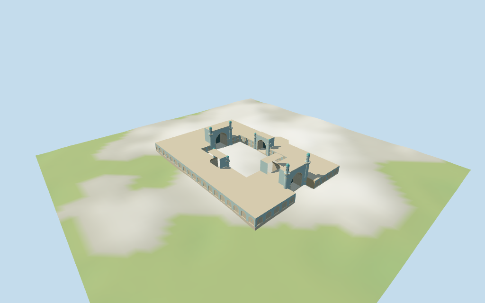

# Friday Mosque of Herat

Individual Friday Mosque of Herat: retained irregular outer envelope and open courtyard;four pointed court iwans,a recessed eastern outer entry,paired taller west/east minarets,four lower court towers,turquoise caps,low pale flat roofs,blue/cream tiled pointed niches and selected coarse geometric tile fields. Original geometric rhythm suggests tilework without copying historic motifs or inscriptions. Court ground,detached buildings,park,street furniture,planting and furnished interiors remain outside the authored model. All internal divisions and vertical dimensions are estimates.

## Evidence and reconstruction

Published dimensions and reconstructed details are separated in spec.json. Primary references:

- [Reference](https://commons.wikimedia.org/wiki/File:Friday_Mosque_of_Herat.jpg)
- [Reference](https://commons.wikimedia.org/wiki/File:Great_Mosque_of_Herat.jpg)

Six shared256² brick,raw limestone,mosaic tile,lime plaster,marble and plain wood graphs;seven merged roles including local opaque glazing. Metric UVs,linear tints,no embedded images or unique atlas. Turquoise caps and coarse original tile motifs use vertex colors;historic artwork and inscriptions are not copied.

## Model and axes

24,616 triangles; 73,848 vertices; 7 material groups; 2,958,152 bytes. Native bounds: -89.506, -3.823, -64.857 to 89.506, 34.681, 64.917. Source hash: `sha256:6ad55cdb4593b887a4bc8701707a5486b9b1ac4d900a0ef037ab19c6d4ca85ca`.

{"x":"approximately east along prayer/entry axis","y":"up","z":"approximately south"}

Standard Protomaps20261014 /Mapzen-USGS viewer extractN0475;datum 928.5131664399311 m. 1017 building-ring samples span -3.2980975838862605 to 1.4290032496760432 m. Floor -0.31888288261684467 m is the median of 311 outer/court-edge samples plus0.3 m. Footings sample edges at<=3 m. 16 triangulated ring masks preserve the entire retained courtyard hole;preview seating uses the same masks. Courtyard ground,park,roads and neighboring buildings stay host content. Exact thresholds,stairs and grade joins are unverified.

## Reproduce

Run `node packages/worldgen/scripts/generate-additional-landmarks.mjs --ids=N0475` (or add `--check`). The generator preserves manually edited masters by checking their baseline hashes. Import through the standard authored-model workflow with optimization disabled; then capture all QA cameras, including shared-surface views.

## Pending work

- Retained Q1291612 /relation5873573 mosque identity,anchor,undirected axis and12-vertex outer footprint with a four-vertex courtyard hole remain unchanged. Current named mosque POI and buildings multipolygon share id52776564006821. Only this mosque envelope is selected;detached buildings,roads,park and courtyard objects remain host content. Internal range/portal/dome/minaret positions and all heights require picture-guided estimates. Retained courtyard hole is not filled or replaced. Current main ring has15 outer and6 hole vertices,including quantized tile-seam points. Western prayer iwan faces positive X;the recessed outer entry faces east along positive X. Four courtyard iwans,one outer entry,eight tower positions and roof partitions are visualization estimates.
- No retained dimensional facts or current PMTiles height tags are available. All vertical dimensions are estimates: low ranges9.5 m;western prayer iwan27 m;other court iwans21–22 m;eastern outer entry25 m;paired western minarets33 m,eastern entry minarets35 m,and four smaller court towers22 m including turquoise caps. No large hall dome is added without a picture/map control. Fine tile art,calligraphy and vault decoration are abstracted.
- Standard Protomaps20261014 /Mapzen-USGS viewer extractN0475;datum 928.5131664399311 m. 1017 building-ring samples span -3.2980975838862605 to 1.4290032496760432 m. Floor -0.31888288261684467 m is the median of 311 outer/court-edge samples plus0.3 m. Footings sample edges at<=3 m. 16 triangulated ring masks preserve the entire retained courtyard hole;preview seating uses the same masks. Courtyard ground,park,roads and neighboring buildings stay host content. Exact thresholds,stairs and grade joins are unverified.
- Two inspected pictures guide the exterior entry and deep pointed iwan vocabulary. The retained outer/court rings control horizontal scope. Internal masses,four court iwans,outer entry,tower count/positions/heights and tiled niche arrangement remain estimates. The court stays open to host ground. No large hall dome is added without a control. Fine muqarnas,calligraphy,murals,exact ornament,paving,fixtures,furnished interiors,current whole-site condition and engineering are unverified. Physical-device/full-city timing remains pending.

This bundle follows the medium-fi standard. Medium-fi appearance and geographic fit are reviewed separately. Hash-bound visual acceptance is recorded separately after capture inspection.

## Additional geographic data

©OpenStreetMap contributors;Protomaps;Mapzen/USGS terrain.
