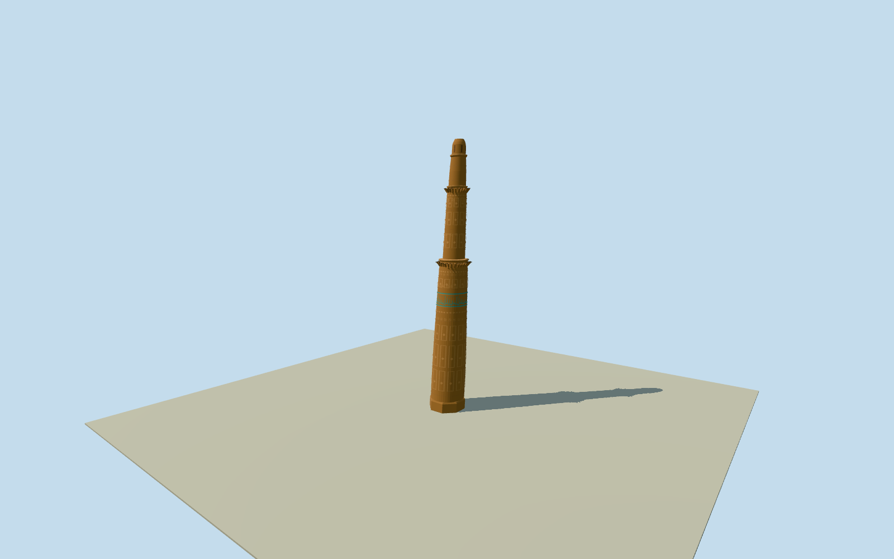

# Minaret of Jam, Ghor

Leaning medieval brick minaret with an octagonal base, four tapering shafts, geometric relief and a turquoise tile register.

Authoring state: **review-in-qa.json**. Current completion evidence is in [qa.json](qa.json) and the [completion ledger](../../../../qualla-structures/batches/qualla-003.PROGRESS.md).

- [Minaret of Jam](https://qualla.com/minaret-of-jam/)

The three exact 2006 Qualla photographs establish the taper, alternating relief bands, turquoise register, broken balcony supports and crown. The exact positions and individual motifs are interpreted from those views.

UNESCO supplies the 9 m base diameter and 65 m height. The survey reports a north-northeast inclination. Tier positions, azimuth of the octagon and individual faces are approximate. Ornament uses original geometric patterns without transcribing the inscription.

The original 128 m elevation field is preserved. The unmasked field includes the river bend and valley slope. Local footing depth and water or retaining edges are not surveyed.

The exterior represents the photographed tower only. Nearby archaeological remains, footbridges, protective walls and the river surface are outside the asset.

Build: `node content/worldgen/source/places/tq/tqj/minaret_of_jam/models/generate-house.mjs`. Add `--check` to verify exact regeneration. 9226 triangles; 6 materials; no embedded photographs.
