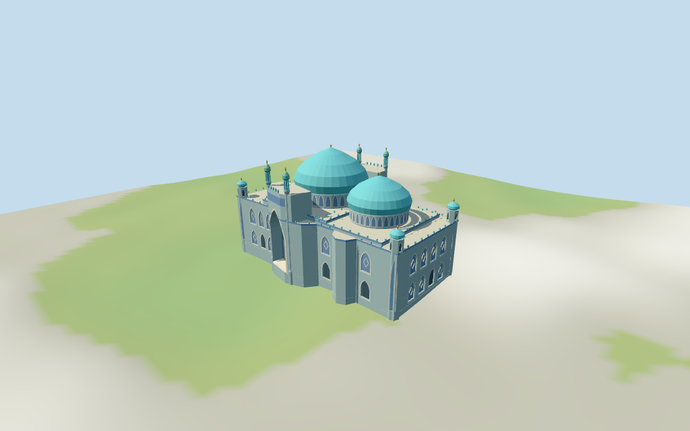

# Blue Mosque (Mazar-i-Sharif)

Individual medium-fi Blue Mosque / Shrine of Hazrat Ali in Mazar-i-Sharif:two unequal turquoise pointed domes/tall decorated drums,large pointed opposite central portal pockets,selected paired slender minarets/onion lantern crowns,octagonal capped corner turrets,connected tiled low ranges and two-tier pointed facade rhythm. Current27-point footprint retained;raised masses/portal roof voids clipped to it. Five existing shared256² graphs,seven merged groups/eight authored roles,four authored browser levels. Tilework uses shared mosaic and broad original frames rather than copied murals/calligraphy. All heights,unseen roofs/current finish,doorway handedness and precise ground joins remain estimates or unverified.

## Evidence and reconstruction

Published dimensions and reconstructed details are separated in spec.json. Primary references:

- [Reference](https://commons.wikimedia.org/wiki/File:Main_mosque-Mazar-2012.jpg)
- [Reference](https://commons.wikimedia.org/wiki/File:Blue_Mosque_in_Mazar-e-Sharif.jpg)
- [Reference](https://commons.wikimedia.org/wiki/File:Blue_Mosque_(general_view),_Mazar-i_Sharif,_Afghanistan.jpg)

Five existing shared256² mosaic,limestone,lime plaster,plain wood and cast bronze graphs;seven merged groups/eight authored roles with metric UVs and linear tints. Turquoise domes/light blue walls/blue blind fields reuse one mosaic graph;glazing is local blue-grey. Broad original pointed frames/diamonds and plain blue inscription bands replace fine tilework/text. Zero embedded pictures,unique atlases,baked lighting or copied calligraphy.

## Model and axes

20,750 triangles; 62,250 vertices; 7 material groups; 2,494,240 bytes. Native bounds: -29.022, -1.884, -19.765 to 29.073, 32.262, 19.680. Source hash: `sha256:949ca2dab9273559c81f6daf0df79f8d6c299b929b4de62f500907be274dbb83`.

{"x":"retained longest map axis,larger chamber near x-5.2 and smaller near x14","y":"up","z":"retained cross axis;opposite projecting central portals;doorway-picture correspondence unverified"}

Standard viewer DEM datum 361.442559 m. Working floor 1.862 m is maximum whole-footprint bilinear sample at1 m spacing plus0.25 m,not surveyed paving. Relative footprint DEM -1.63..1.61 m. Raw DEM retained without cutout/flattening;footings adapt below it and cross Y=0. Exact plaza/threshold/terrace/terrain contacts and walking unverified.

## Reproduce

Run `node packages/worldgen/scripts/generate-additional-landmarks.mjs --ids=N0437` (or add `--check`). The generator preserves manually edited masters by checking their baseline hashes. Import through the standard authored-model workflow with optimization disabled; then capture all QA cameras, including shared-surface views.

## Pending work

- Retained exact way/633376524 / Q138388 matches current whole35185005465356 (2*2^44+633376524) and named Blue Mosque POI on the same encoded way. Original anchor[67.110913037,36.708960274] and heading-1.38091036602 rad unchanged. Current27-point outline closely matches the retained27-point closed source control;no horizontal rescale or courtyard parcel. Main and secondary chamber forms follow the two projecting portions of the plan. Two opposite central portal faces follow selected current polygon edges;which doorway corresponds to each picture and precise handedness remain approximate. The tall foreground clock tower,other mosque ranges,plaza fences/garden/pavilions and surrounding buildings are separate context,not part of this footprint.
- Retained height/width/length fact arrays are empty,and the current whole has no height/min_height tags. All vertical dimensions are picture-based visualization estimates:low wings14.2 m,larger chamber15.2 m/drum19.2 m/dome29.5 m/finial30.4 m,smaller chamber14.8 m/drum18.2 m/dome25.5 m/finial26.4 m,central portal crest21.2 m,selected slender portal minarets27.8 m and octagonal corner turrets20.1 m. Relative roof/dome/tower shapes follow three inspected pictures;absolute heights,counts/subdivisions and facade handedness are approximate within about3 m. Heading retains the mapped undirected axis;doorway correspondence remains ambiguous by180 degrees. Unseen roofs/interiors/current finish and precise access/terrain joins unverified.
- Standard viewer DEM datum 361.442559 m. Working floor 1.862 m is maximum whole-footprint bilinear sample at1 m spacing plus0.25 m,not surveyed paving. Relative footprint DEM -1.63..1.61 m. Raw DEM retained without cutout/flattening;footings adapt below it and cross Y=0. Exact plaza/threshold/terrace/terrain contacts and walking unverified.
- Three inspected pictures guide two unequal pointed turquoise domes/tall drums,opposite projecting pointed portal pockets,selected slender minarets/slotted lanterns/striped onion crowns,octagonal capped corner turrets and two-tier pointed tiled facade rhythm. Main low roofs/raised room volumes are approximate and clipped to the mapped outline. Portal pockets close on blue wood doors/mosaic backs;facade/corner fields close on shallow backing and lantern slots look into small dark cores. No navigable rooms/stairs. Skyline retains both domes,portals and selected tower profiles;district uses flat facade/corner/lantern proxies and coarse crowns;near adds selected framed fields,abstract diamonds/trim and denser lantern slots. Intricate mosaic patterns/calligraphy,flags/loudspeakers,temporary objects,exact material/current finish,unseen roofs/rooms and exact thresholds/terrain joins unverified or omitted. Foreground clock tower and surrounding ranges/plaza/fences/garden remain separate context. All heights/doorway handedness and physical-device timing unverified.

This bundle follows the medium-fi standard. Medium-fi appearance and geographic fit are reviewed separately. Hash-bound visual acceptance is recorded separately after capture inspection.

## Additional geographic data

©OpenStreetMap contributors;Protomaps;Mapzen/USGS terrain tiles.
