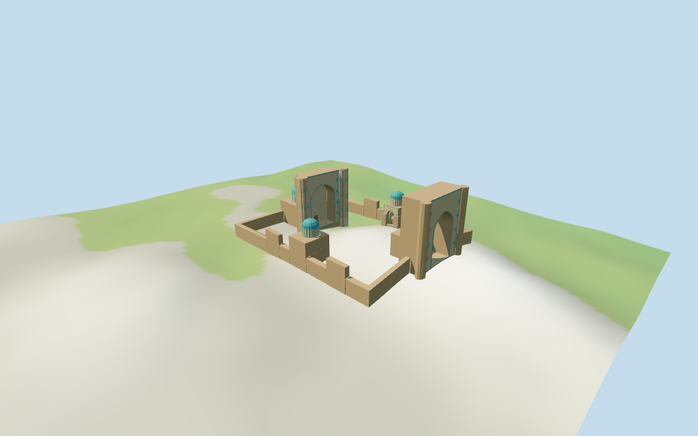

# bibi_khanym_mosque — Bibi-Khanym Mosque

Reviewed2026-10-17 against current bytes. Accepted for the stated medium-fi compound exterior and approximate map fit. Identification uses name/location/layout;no exact current map Wikidata tag is claimed. Exact condition,unseen interiors,thresholds and terrain joins remain approximate or unverified.

## Exterior and shared surfaces

Actually inspected all11 current portable frames,including the1024×640 summary. Mapped open courtyard,monumental eastern passage with low porch,deep western prayer iwan and paired tall tiled pylons,smooth turquoise western dome,two ribbed blue side domes,and low walls/four raised piers. Corrected a residual low-envelope block across the northern pavilion entrance;both pavilion approaches are now cleared without changing raw map controls. Portal passage reveals follow the actual footprint,and roof holes match each active dome ring. Fine decoration,unseen backs,current condition and exact thresholds remain approximate.

Actually inspected all11 current shared/geographic-flat frames. Five existing256² graphs:brick,tile_mosaic,stone_limestone,clay_fired,wood_plain. Six merged surface roles,metric UVs and linear tints;zero embedded images,unique atlases,copied tile artwork or baked lighting. Every graph read once;unload zero live model geometries. The heading and compound controls align in the north-up geographic-flat fixture. Portable/medium-fi views retain unflattened standard DEM;the shared fixture is flat. Detail cameras intentionally crop adjacent forms;whole views show the entire compound.

## Browser levels

| Level | Triangles | Bytes | Draws |
| --- | ---: | ---: | ---: |
| skyline | 982 | 100,132 | 1 |
| district | 1,746 | 170,768 | 6 |
| street | 3,146 | 309,488 | 6 |
| closeup | 3,380 | 335,844 | 6 |

Initial skyline plus district: **270,900 bytes**. Master **423,828 bytes /3,500 triangles**;runtime **423,264 bytes**. Five existing shared256² graphs,six merged surface roles,zero embedded images;shared textures are additional.

Actually inspected all27 current medium-fi frames:Economy/High,noon/late,three distances,silhouette,six details,four matched browser levels and four transitions. Whole skyline also inspected full size. Skyline982 preserves the open court,two portals,two western pylons and three domes with simplified curves and untrimmed pointed openings. District1746 adds blue/cream portal fields and12-sided dome rings;street3146/close3380 add ribbed side domes,finer arches,drum panels and sparse original geometric ornaments. Shared tile/brick surfaces remain restrained. Initial270900 bytes plus shared textures;one/six draws,separate attribute streams and equal CPU/GPU reservations. Street context crops the eastern gateway and emphasizes the court;whole/detail views cover it. Synthetic surroundings and physical-device timing remain unverified.

## Placement and scope

The retained Q679218 record was reference-only,with no resolved exact-QID map footprint. Its reference anchor[66.979722222,39.660555555] is retained as model origin. Current named Bibi Khanym POI17604215984649,nearby reference point and distinctive three-dome/two-portal compound identify the selected outline by name/location/layout;no exact current map Wikidata tag is claimed. Current relation17797143 /52776575930391 supplies the24-point outer and49-point open-courtyard boundary,with a duplicate9m part and16 independent height-tagged parts. Heading0.118363603193 rad follows the longest straight enclosure edge,positiveX toward the eastern entry;western prayer hall and paired towers establish the hand. Accepted as an approximate named-place fit with15-degree visual orientation allowance,not a surveyed doorway or exact-QID geometry match. Current tags retained:low compound part9m,eastern and western screens40m,paired western towers41m,western hall15m with nested11m inner volume,main dome30m,two side pavilions15m/domes25m,entry porch12m and four wall piers15m. The nested11m part is recorded as an inner-hall control rather than drawn as a duplicate external shell. Dome subdivisions,portal recess depth,arch shapes,small doorways,wall condition and decoration are visualization estimates. Retained200m length/160m width facts have no qualifiers or reference URLs;they are preserved without scaling the current mapped outline to them. The current compound is about137×103m in the chosen frame;the older claims may describe a different historical scope,which is not verified. Current height tags are map controls,not independently surveyed measurements. Standard viewer DEM datum 715.593602 m. The raw compound-footprint samples range -7.314..8.231m;one global maximum would raise the western buildings above their local terrain. West/east/north/south and wall-pier working planes use their own maximum2m footprint sample plus0.25m,with floors west:0.517, east:8.481, north:1.169, south:3.931, pier-0:-4.958, pier-1:0.748, pier-2:0.411, pier-3:1.561m. The low connecting walls follow the retained DEM with0.25m clearance. Terrain is unflattened and footings extend below it. Exact archaeological ground,terraces,thresholds and walking remain unverified. All438 viewer-footprint checks cover18 selected map controls,preserve52 separately mapped buildings,and keep three courtyard samples unfilled across six files. All309 raw points/properties independently reunited from current PMTiles. Eight local working planes reproduce their2m maximum-plus0.25m terrain samples;low walls follow DEM instead of raising the western hall to eastern ground. Accepted as an approximate name/location/layout fit,not an exact current map QID match or surveyed entrance bearing.

Individual medium-fi Bibi-Khanym compound exterior:open mapped courtyard,monumental eastern gateway and deep western prayer iwan,paired tall western tiled pylons,smooth turquoise main dome,two ribbed blue side domes,low brick walls and four mapped raised wall piers. Five shared graphs,six merged surface roles,four authored browser levels. Heights and footprints retain current tags;small doorways,ornament,unseen backs and exact damage remain approximate. Named-place location/layout match,not a claimed exact-QID map match. No copied calligraphy,interior reconstruction or courtyard slab. Low wall residuals are cleared in front of the two pavilion iwan mouths;the current raw map courtyard and pavilion controls are preserved unchanged. Exact entry thresholds remain approximate. Current tags retained:low compound part9m,eastern and western screens40m,paired western towers41m,western hall15m with nested11m inner volume,main dome30m,two side pavilions15m/domes25m,entry porch12m and four wall piers15m. The nested11m part is recorded as an inner-hall control rather than drawn as a duplicate external shell. Dome subdivisions,portal recess depth,arch shapes,small doorways,wall condition and decoration are visualization estimates. Retained200m length/160m width facts have no qualifiers or reference URLs;they are preserved without scaling the current mapped outline to them. The current compound is about137×103m in the chosen frame;the older claims may describe a different historical scope,which is not verified. Current height tags are map controls,not independently surveyed measurements. Standard viewer DEM datum 715.593602 m. The raw compound-footprint samples range -7.314..8.231m;one global maximum would raise the western buildings above their local terrain. West/east/north/south and wall-pier working planes use their own maximum2m footprint sample plus0.25m,with floors west:0.517, east:8.481, north:1.169, south:3.931, pier-0:-4.958, pier-1:0.748, pier-2:0.411, pier-3:1.561m. The low connecting walls follow the retained DEM with0.25m clearance. Terrain is unflattened and footings extend below it. Exact archaeological ground,terraces,thresholds and walking remain unverified. The current model represents the mapped compound at about137×103m. Retained200m length/160m width claims have no qualifiers or reference URLs;they are preserved without overriding current outlines. Raw nested11m inner-hall control remains source evidence rather than a duplicated outer shell. Deep iwan backings,small closed wooden doors,pavilion approach clearances,arch curves and sparse geometric tile panels are visualization estimates. No copied calligraphy,interior reconstruction,courtyard slab,terrain flattening or bespoke research. Exact restored condition,unseen back elevations,door arrangements,archaeological terraces,thresholds and walking clearance remain unverified. Three inspected exterior pictures establish the recognizable forms;no pixels redistributed.

## Verification

**49 current views inspected;408 geometry probes;438 footprint checks.** Six Khronos validations:zero errors/warnings/images. Targeted byte reproduction,scene validate/sim30,recipe-only Biome and current recipe/input/model/LOD/report/capture/material bindings pass. Five graphs read once;unload zero live model geometry. Current builds reused;next full source checkpoint great_mosque_of_aleppo–great_mosque_of_xi_an.

Source: sha256:ca651f8685a56013a8a19b58ae867f714cbcb46874c3c1c0feddbe9bf2c84862

Runtime: sha256:dc86af08f4a3860ecfbf33510165f5af1e9a0dc0108b8be3dfbc3dc409fa4063

Input: sha256:8cee0d5e4505546738a32052cca79d862e24c59d158068edaf52ac91b415c151

Simulation: sha256:ebdbfeacc23c0cc06099ec2264eae8ccbdd2c3e53a9b28d4be9186a8b4f58e6b

Commands:targeted generate/import/LOD/register --ids=bibi_khanym_mosque;generate --check;portable reflections/antialias/fitted shadows;shared reflections/adaptive clipping/bounded placement;medium-fi reflections;scene validate/sim30;recipe-only Biome. Bulk captures remain ignored.

## Inspected pictures

[Bgag / Bernard Gagnon — 2023-09-30](https://commons.wikimedia.org/wiki/File:Bibi-Khanym_Mosque,_Samarkand.jpg). CC0-1.0. Actually viewed courtyard panorama:two ribbed blue domes on decorated cylindrical drums,brick walls with sparse pointed blind fields,large tiled portal/tower fabric,open courtyard and low archaeological remains. The panorama supplies the compound character and ribbed side-dome treatment;unseen courtyard foundations and exact conservation state remain unverified.

[Bgag / Bernard Gagnon — 2023-09-30](https://commons.wikimedia.org/wiki/File:Western_dome_of_Bibi-Khanym_Mosque.jpg). CC0-1.0. Actually viewed western dome:a broad smooth turquoise cap over a decorated cylindrical drum,blue/pale bands and a lower arcade/frieze. The model distinguishes this smooth main cap from the ribbed side domes. Original sparse geometric bands abstract the colors;no photographed tile art or calligraphy is copied.

[Tim Adams — 2024-10-06](https://commons.wikimedia.org/wiki/File:Exterior_of_Bibi-Khanym_Mosque_in_Samarkand_Uzbekistan.jpg). CC-BY-4.0. Actually viewed monumental prayer portal obliquely:paired very tall cylindrical tiled pylons,deep pointed iwan,recessed decorated backing,pale stone plinths and blue/cream geometric tile fields. Main western screen/towers follow this treatment. Eastern passage,unseen backs and exact damage/door arrangements remain approximate.
