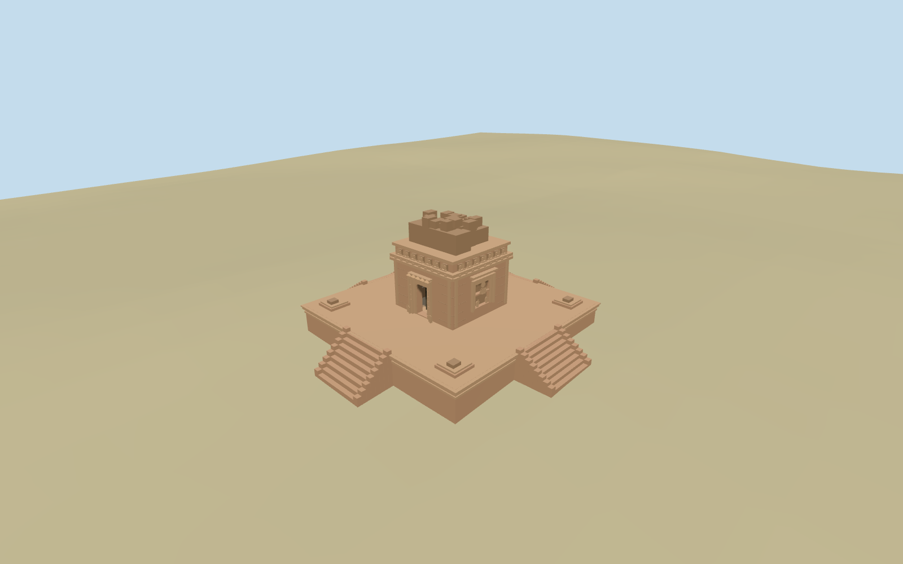

# N0544 — Dashavatara Temple, Deogarh

Reviewed 2026-10-19 in one continuous author/build/inspect/fix round.

## Appearance

Inspected48 current source/shared/medium-fi/native/fallback views in one continuous ordinary-picture/map/construction/review round. Specific standing square Deogarh sanctuary, real recessed west entrance with nested carved jambs/lintel and original simplified upright/scroll figures. Three framed recessed side relief compositions, moulded cornice/dentils and miniature-aedicule rhythm. Uneven surviving upper stone fragments, raised occupied moulded plinth, four approximate local stairs/cheeks and low corner remnants. First renders showed an overly regular upper crown; corrected to discontinuous surviving masonry. No restored complete shikhara or copied deity/story/text atlas.

## Shared materials and browser levels

Three existing256-square graphs: stone_sandstone_raw for warm masonry/broken fragments, stone_limestone_raw for carved trim and metal_painted for tinted dark entrance. Four roles/at most four draws, graph read once each, metric UVs/linear tints and zero embedded images. Separate GPU streams and matching CPU/GPU accounting. LODs960/3896/6560/6760triangles, initial449380bytes. Eviction releases all model geometry.

| Level | Triangles | Bytes | Draws |
| --- | ---: | ---: | ---: |
| skyline | 960 | 98132 | 1 |
| district | 3896 | 351248 | 3 |
| street | 6560 | 595728 | 3 |
| closeup | 6760 | 620076 | 3 |

Inspected noon/late/economy/high/context, silhouette, all four levels/transitions and three detail angles. Skyline retains broken crown, recessed west door/side niches, occupied plinth and four sparse stair approaches. District restores denser steps/mouldings and miniature niches; street/close add original simplified figures, jamb carving and more broken blocks. Some detail crops omit the crown/plinth edges; whole views cover them. Bright shared views are pale in Earth sun lighting; other-angle/native views retain depth judgment. Placement frame shows the much larger archaeological-site boundary, explicitly not a model footprint. Green native ground and sparse surrounding map features remain host context.

## Approximate map fit

Reference coordinate78.24,24.52694444 lies inside retained exact-QID archaeological-site boundaryway718980905. Boundary is not the temple footprint. Standard PMTiles contains nearby road/woods/water but no sanctuary building or site POI; model dimensions/center within site are explicit picture/reference-point approximations. Heading0, internal-.0872664626rad, entrance approximately west/local-x. No native building removal. All source ground/water retained; zero native buildings in this fixture. Failed load leaves original empty terrain/map features, unload frees geometry. Only occupied plinth has level top/buried bottom and short local stairs; no broad site slab, flattening or ground/water cutout.

## Limits

Accepted medium-fi from three inspected ordinary panel-side, doorway and west/side photographs plus standard PMTiles/Mapzen and retained archaeological-site boundary. Third picture covered broken crown and doorway together. Height ratios,6.4m body/16.8m occupied plinth dimensions, precise center/facing, four stair/corner-remnant allocation, actual sculpture inventory, hidden chamber and individual broken blocks remain explicit approximations. First photo filename says front but visible relief face was not used to infer west entrance. Coarse wooded DEM cannot resolve paving, exact terrace/threshold levels or the absent sanctuary footprint. No full ritual interior, complete tower restoration or copied narrative/deity/text imagery. Physical-device/dense-city timings pending.

## Selected checks

Six Khronos files: zero errors/warnings.108 actual mesh/contact probes; 48 current inspected views. Scene validation/sim30 and strict selected medium-fi audit pass. Source and runtime hashes/material bindings/LOD caps verified.

Rebuild: node packages/worldgen/scripts/generate-additional-landmarks.mjs --ids=N0544; node packages/worldgen/scripts/import-next-1000-models.mjs --ids=N0544; node packages/tooling/scripts/generate-landmark-lods.mjs --ids=N0544 --force.

Source: sha256:8f629b6ce7dd12db38e02067ed519fcc1c46cbb21b6d4d02a1f6f1284731486e

Runtime: sha256:6c2982389ff85a8b931bb60e67f0b2f23ce8e14d3682208ec16a7097b734b539

Input: sha256:c61a8724e234be3bdbfcce17a91e917fdd9a265b4dfd9bbedbb1ee1477e49432

## Viewed ordinary pictures

https://commons.wikimedia.org/wiki/File:Front_side_of_the_Dashavatara_Temple_in_Deogarh.jpg — Work2win; CC-BY-SA-4.0. Viewed only; no pixels copied.

https://commons.wikimedia.org/wiki/File:Entrance_of_the_worship_in_Dashavatara_Temple_in_Deogarh.jpg — Work2win; CC-BY-SA-4.0. Viewed only; no pixels copied.

https://commons.wikimedia.org/wiki/File:Deogarh01.jpg — byron aihara; CC-BY-SA-2.0. Viewed only; no pixels copied.
