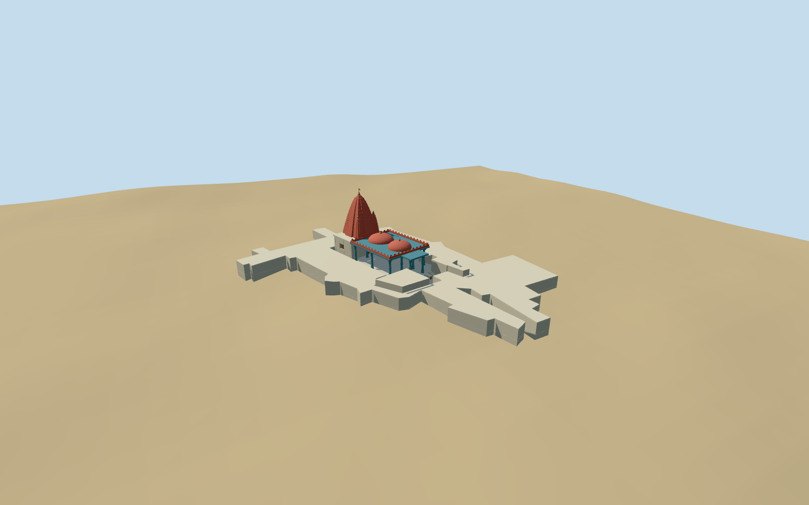

# Brahma Temple, Pushkar

Specific Brahma Temple Pushkar exterior: red curvilinear ribbed shikhara with stepped attached minor spires/finial, pale closed rear shrine/door behind open blue-column mandapa, two shallow red domes and red lobed parapets. Molded blue supports/original cream-gold-green petal bands, projecting blue front canopy, broad actual treads/pale cheek blocks and occupied checked platform. Map-shaped pale low entrance-side annexes retain the full temple footprint; unseen roof/door detail remains simplified. The mapped adjoining pale courtyard gallery is included as a low flat-topped envelope with original simple court arches; unseen outer rooms remain simplified. Independent market/court buildings, trees, people/festival covers/signs and furnished ritual interior are not authored.

## Evidence and reconstruction

Published dimensions and reconstructed details are separated in spec.json. Primary references:

- [Reference](https://commons.wikimedia.org/wiki/File:Brahma_Temple,_Pushkar.jpg)
- [Reference](https://commons.wikimedia.org/wiki/File:The_Brahma_Temple_at_Pushkar,_Rajasthan.jpg)

Specific Brahma Temple Pushkar exterior: red curvilinear ribbed shikhara with stepped attached minor spires/finial, pale closed rear shrine/door behind open blue-column mandapa, two shallow red domes and red lobed parapets. Molded blue supports/original cream-gold-green petal bands, projecting blue front canopy, broad actual treads/pale cheek blocks and occupied checked platform. Map-shaped pale low entrance-side annexes retain the full temple footprint; unseen roof/door detail remains simplified. The mapped adjoining pale courtyard gallery is included as a low flat-topped envelope with original simple court arches; unseen outer rooms remain simplified. Independent market/court buildings, trees, people/festival covers/signs and furnished ritual interior are not authored.

## Model and axes

27,889 triangles; 83,667 vertices; 5 material groups; 3,350,112 bytes. Native bounds: -30.763, -2.177, -34.018 to 50.478, 20.636, 38.137. Source hash: `sha256:0cc0b7e78d59926547547e58bfd53c57584e6a4e24983257c79ed768db93f1b6`.

{"x":"east","y":"up","z":"south"}

The geographic proposal uses exact-QID OpenStreetMap evidence. Map-derived orientation and estimated architectural details require real-site visual review; preview eligibility is distinct from geographic/fidelity approval. Map attribution: © OpenStreetMap contributors, ODbL-1.0.

## Reproduce

Run `node packages/worldgen/scripts/generate-additional-landmarks.mjs --ids=N0559` (or add `--check`). The generator preserves manually edited masters by checking their baseline hashes. Import through the standard authored-model workflow with optimization disabled; then capture all QA cameras, including shared-surface views.

## Pending work

- Specific Brahma Temple Pushkar exterior: red curvilinear ribbed shikhara with stepped attached minor spires/finial, pale closed rear shrine/door behind open blue-column mandapa, two shallow red domes and red lobed parapets. Molded blue supports/original cream-gold-green petal bands, projecting blue front canopy, broad actual treads/pale cheek blocks and occupied checked platform. Map-shaped pale low entrance-side annexes retain the full temple footprint; unseen roof/door detail remains simplified. The mapped adjoining pale courtyard gallery is included as a low flat-topped envelope with original simple court arches; unseen outer rooms remain simplified. Independent market/court buildings, trees, people/festival covers/signs and furnished ritual interior are not authored.
- Named PMTilesbuilding/templePOI35184810382324 (encoded OSMway438293492) covers the temple main body and eastern appendages near retainedQ4955510 reference74.54887778,26.48732778. Independent named node17599792637901 lies within the main body. Measured long edge gives ENE axis-0.2644885496056613rad; anchor is original reference, heading0/native east-south. The eastern mapped appendages/approach and pictured shrine-behind-open-hall relationship support an approximate east-facing portico. Internal tower/dome/support/door layout, front/back sign and annex allocation remain picture/map estimates, retaining roughly5m/30degree facing uncertainty rather than a surveyed plan. Adjoining wrapping footprint35184809402181 is included as the pictured low pale courtyard gallery after generic multi-storey procedural extrusion obscured the hall during construction inspection. Its temple-complex association, outer room inventory and low roof height are approximate photo/topology allocations; all other buildings stay independent.
- Picture/map estimates: occupied hall platform1.05m above the local court floor; molded blue supports5.2m/canopy5.6m, red lobed parapets about6.7m/two shallow domes about8m; curvilinear red shikhara from5.8m to17.4m, gold crown/finial and static flag to19.4m. Pale rear shrine about8x13m, mandapa about17x14.6m plus projecting front canopy, main body/annex envelope follows the mapped40x25m shape. Exact hidden support/room inventory, subsidiary spires, original painted ornament and current paint/roof state are simplified exterior estimates from dated2006/2007 pictures.
- Retain the standard6m Mapzen DEM/native paths/water and every independent building. Only the named temple shell and its mapped wrapping courtyard gallery are cut with2cm numeric pad minus independent footprints+1mm protection. The occupied temple footprint uses buried contact sides/court cap and a separate raised hall platform, narrow local steps; no whole-precinct slab, flattening or ground/water cutout. Coarse DEM does not resolve courtyard/podium/foundation sections. Levels and entry engineering are explicit visualization fit estimates.
- Two useful2006/2007 pictures establish the blue mandapa, red paired domes/curved tower and raised checked platform. Standard PMTiles controls the specific temple footprint. Internal inventory, subsidiary spires, annex detail, paint/current restoration and approximate eastern facing remain explicit estimates. No copied deity/inscription atlas or festival coverings.

This bundle follows the medium-fi standard. Medium-fi appearance and geographic fit are reviewed separately. Hash-bound visual acceptance is recorded separately after capture inspection.

## Additional geographic data

©OpenStreetMap contributors; Protomaps; Mapzen/USGS terrain.
