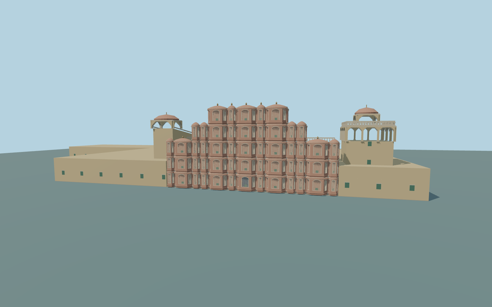

# Hawa Mahal

Complete individual Hawa Mahal exterior: native connected L-shaped palace andboth open courts, five retreating tiers ofpink projecting/recessed window bays andcurved hoods, deep cream scalloped courtyard arcades/closed backs, upper openrear gallery, northern open chhatri, southern inclined ramp andlow extended ranges. Native city/market buildings remain independent. Original exterior geometry andsimplified lattice/ornaments; no interiors,copied floral art orsignage.

Rebuild: `node packages/worldgen/scripts/generate-hawa-mahal.mjs`;append `--check` for exact source bytes. Select import/LOD/placement with `--ids=hawa_mahal`. Detailed source and four browser tiers are separate ignored GLB outputs.

Complete individual Hawa Mahal exterior: native connected L-shaped palace andboth open courts, five retreating tiers ofpink projecting/recessed window bays andcurved hoods, deep cream scalloped courtyard arcades/closed backs, upper openrear gallery, northern open chhatri, southern inclined ramp andlow extended ranges. Native city/market buildings remain independent. Original exterior geometry andsimplified lattice/ornaments; no interiors,copied floral art orsignage.

Picture-guided relative heights on an approximate443m standard global Terrarium reference; palace/court floor444m. Native composite height5m describes lowranges,not the photographed five-tier street crown. Original screen rises about17m above thefloor; northern openchhatri about17m. Window/hood/ramp inventories andhistoric thresholds are approximate. Bounded occupied foundations/courtyard paving andwest entrance transition meet theunchanged coarse field; no outside city/road flattening.

Original interpretations ofscreen proportions,concealed joins,lattice patterns,ornaments andrelative heights. No claim to theexact953-window inventory, survey-grade placement orcomplete furnished interiors. The modelincludes both actual courtyard ranges andlow southwest extension. Physical-device timings andnumerical LOD errors remain unmeasured.

Six existing shared256px plaster,limestone,granite,painted-metal,painted-wood andwindow-grid graphs; metric UVs andlinear colors. Skyline preserves thewholecompound,both courts,five retreating crown blocks andopenchhatris; district uses simplified closed oriel panes;street adds recessed simplified lattice andscalloped court arcades;close-up adds balustrades/corbel/hood profiles;source retains finer lattice/curves. Thedefault basin isdry asintheviewed rooftop picture. No exact window inventory,artwork,inscriptions oroutside landscape. Numerical LOD error estimates3/1.5/.7/.25m andphysical timings areunmeasured.

Original geometry:repository license. Map:© OpenStreetMap contributors,ODbL-1.0;Protomaps. Standard terrain:terrain-grid.json. Ordinary pictures stay local and are not redistributed or used as textures. Current acceptance:qa.json.
