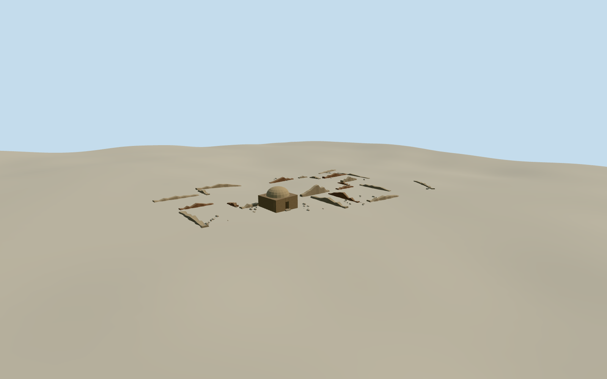

# Palace of Sultan Mas'ud III

Earth-colored, discontinuous Ghaznavid wall remnants around an open court and the damaged later domed shrine in the 2010 view.

Authoring state: **review-in-qa.json**. Current completion evidence is in [qa.json](qa.json) and the [completion ledger](../../../../qualla-structures/batches/qualla-003.PROGRESS.md).

- [Palace of Sultan Mas'ud III](https://qualla.com/palace-of-sultan-mas-ud-iii/)

The dated model represents the archaeological remains in the June 2010 photograph. Parts of the excavation plan were already lost or buried and the palace vaults, walls and roofs are absent.

The exact Qualla images are two crops of one distant federal photograph. The shrine dimensions, fragmented wall paths, masonry, doorway and rubble heights are approximate. The central open court proportions follow the excavators’ description.

Mapped outlines are archaeological-area boundaries. Wall edges, grades and minor remains were estimated within them. Unmodified independent Terrarium terrain is used for local ground contact.

The two Ghazni minarets lie outside this archaeological site. The ziyara is a later shrine traditionally associated with Ibrahim.

Build: `node content/worldgen/source/places/tt/ttb/palace_of_sultan_mas_ud_iii/models/generate-masud-palace.mjs`. Add `--check` to verify exact regeneration. 2350 triangles; 3 materials; no embedded photographs.
