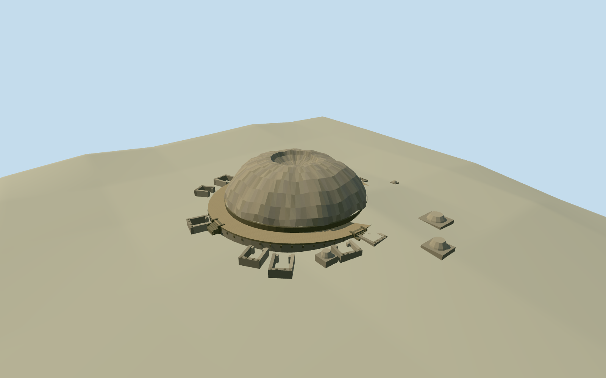

# Dharmarajika Stupa

Surviving Dharmarajika Stupa at Taxila with its broken limestone drum, processional terrace, radial stairs and surrounding chapel foundations.

Authoring state: **review-in-qa.json**. Current completion evidence is in [qa.json](qa.json) and the [completion ledger](../../../../qualla-structures/batches/qualla-004.PROGRESS.md).

- [Dharmarajika Stupa](https://qualla.com/dharmarajika-stupa/)

Draft exterior: approximate photographic proportions and simplified ornament. It is not a survey, photogrammetric reconstruction or approved current geographic replacement.

Plates IV and IX of the 1918 guide establish the ground plan and rough damaged limestone drum and immediate masonry. The Taxila Museum specifies the 131 ft drum diameter and 45 ft surviving height.

Terrain sampling/contact, geographic alignment and site activation remain pending. Runtime LODs are produced by the registered after-import pipeline and require visual review.

Reference photos remain in the local Qualla corpus; only provenance, paths and hashes are retained here.

Build: `node content/worldgen/source/places/tt/ttg/dharmarajika_stupa/models/generate-dharmarajika-stupa.mjs`. Add `--check` to verify exact regeneration. 6129 triangles; 4 materials; no embedded photographs.
