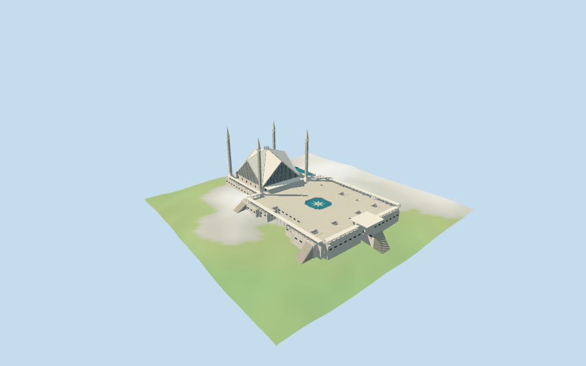

# N0425 — Faisal Mosque

Reviewed2026-10-16 against current bytes. Accepted for the stated medium-fi exterior and approximate horizontal fit. Nominal heights/estimated roof folds/platform datum,current finish and exact terrain/pool/threshold joins retain explicit limits.

## Exterior and shared surfaces

Inspected all11 current portable views,including the1024×640 summary. Eight sharply folded white roof planes/triangular rib-and-slit gables/central angular crown and gold crescent,four footprint-aligned pencil minarets/flared bases/long recessed shaft panels/open upper collars/pyramidal tips. Raised mapped platform with seven lightwells and octagonal star-accented basin,separate rear reflecting pool,flat open colonnades,entry awning/triangular braces,east canopy and three approximate stairs. Corrected missing canopy/awning/colonnade undersides,shifted tip centers/tiny rib overrun,and stairs beginning inside the podium. Coarse slope/podium/site joins remain approximate.

Inspected all11 current shared/geographic views. Four existing256² concrete,marble,wood and bronze graphs;six merged groups. Plain concrete is shared by shafts/fins/platform walls;marble by folded roof/paving/trim;bronze by crescent and wood by closed doors. Glass and blue-green water use local vertex colors. Metric UVs,zero embedded images,baked lighting or bespoke facade textures. Graphs read once;unload leaves zero live model geometries. Geographic fixture uses flat terrain;portable/medium-fi retain the original standard viewer DEM without cutout or flattening. Flat-terrain capture does not prove exact altitude or ground contact.

## Browser levels

| Level | Triangles | Bytes | Draws |
| --- | ---: | ---: | ---: |
| skyline | 974 | 93,704 | 1 |
| district | 3,238 | 250,620 | 6 |
| street | 13,147 | 1,027,456 | 6 |
| closeup | 38,432 | 3,172,392 | 6 |

Initial skyline plus district: **344,324 bytes**. Master **4,776,844 bytes /39,776 triangles**;runtime **4,776,280 bytes**. Four shared256² graphs,six groups,zero embedded images;shared runtime textures are additional.

Inspected all27 current medium-fi views:Economy/High,noon/late,three distances,silhouette,six details,four matched levels and four transitions. Skyline974 retains eight folds/solid triangular gables/four pencil tips,open sparse colonnades,canopy/awning,podium and separate basins with continuous coarse stair ramps;small lightwells,screen/glass details and crescent omitted. District3238 adds coarse gable fins/applied closed entry and shaft panels,lightwells,star basin and coarse stair treads. Street13147 adds recessed lower hall/shaft fields,open tower collars,more gable ribs/braces/rails and finer stairs. Close38432/master39776 add denser fin/screen abstractions,second colonnade row/ceiling beams,soffit accents,shaft panel joints/tip edge ribs and finer stairs. Synthetic South Asian context and physical-device timing unverified.

## Placement and scope

Retained exact relation/12715128 /Q500983 identifies Faisal Mosque. Current whole52776570848376 and24 separately mapped parts retain all raw rings/holes/properties and fragment counts. The main platform has62 outer points and eight holes;four90m minaret controls,four broader50m tower controls,four60m central crest controls and twelve55m roof/fold controls retained. Split fragments are reunited independently by ID. Pool8381863032 reunites two raw fragments;fountain8381904390 component1 follows the octagonal court hole;the remote component0 remains separate. Anchor[73.038055921,33.729879546] and heading0.257094798389rad unchanged,no horizontal rescale. Native−X west tent prayer hall,+X east court/main approach,+Z south. Four inspected pictures resolve facing within about3°. Roof footprint/minaret centers/lightwells/pools follow map controls. Eight folded surfaces,wall fins,awning,column cadence,crest and east entrance canopy are picture-led estimates with about3m horizontal working uncertainty. Trees,lawns,roads,hills,outer fountain and adjacent campus buildings remain host content. Retained Wikidata90m nominal height has no linked reference URL. Preserve whole8m and part50/55/60/90m tags verbatim. Working minaret tips90m above declared platform plane,upper slit collar70–73m/pyramidal tip73–90m;flared feet0–7m/slender shafts7–70m. Main tent folds rise from8m corner eaves to42m mid-edge gables and55m central peak;angular crest/crescent60m. These fold/gable partitions are picture estimates informed by55/60m tags,not surveyed elevations or a verified altitude datum. Platform court is about8m above representative perimeter DEM;low flat colonnades5.5m/entry awning6.5m/east canopy10m and lower sidecar facade partitions are estimates. Fine profiles,current finish,unseen faces/interiors and exact ground/platform/door/street/pool joins unverified. Standard viewer DEM datum601.695316m;whole perimeter-10.79 to4.48m relative to anchor. Platform plane8.000m is representative median perimeter sample plus nominal8m podium height. Foundations crossY=0 and extend below retained ground;flat court/lightwell floors/pool water levels and exterior landings are working estimates. Raw DEM retained without cutout/flattening. Coarse slope/building contamination can expose tall footings or bury margins. Exact altitude,terrain/platform/pool/threshold/street joins and walking unverified;no road replacement. All150 viewer-footprint checks cover the25 selected building controls across source,runtime and four browser levels. No separate mapped buildings occur in this bounded replacement fixture,so it is not evidence for broader neighborhood suppression behavior. Raw building fragments/properties independently reunited;rear pool fragments independently reunited and central basin matched to component1 and the mapped platform hole. Remote fountain component0 excluded. Approximate horizontal fit accepted;nominal90m height and working roof/platform partitions remain distinct from surveyed altitude/site contact.

Individual medium-fi exterior from four actually inspected2014/2017/2021 front,entry,court and aerial pictures plus standard viewer PMTiles/DEM. Exact relation/12715128 /Q500983 and25 current controls/211 raw building ring-hole points/properties retained,including62 platform outer points/eight holes. Anchor/heading unchanged;about3° facing and3m architectural-subplan uncertainty. Twelve55m fold controls,four60m crest controls,four90m minaret controls and four broader50m tower controls remain verbatim. Working folds rise from8m corners to42m mid-edge gables/55m center;angular crest/crescent about60m. Tower tips90m above declared court plane are nominal,not a surveyed absolute altitude. The8m court plane uses representative perimeter DEM plus nominal podium height;perimeter varies about15.3m,so exposed lower foundations and exact terrain joins remain approximate. Rear pool follows two reassembled raw fragments;central octagonal basin is the original independent MultiPolygon component1,not a link to the remote fountain. Seven other platform holes are lightwells at an estimated4m depth. East canopy subplan,flat gallery cadence,fin/screen counts,brace/soffit/crescent details,stairs and water levels are estimates. Fine geometric artwork,carved screens/calligraphy,interiors,fixtures,unseen faces/current finish and precise pool/door/street contacts omitted or simplified. Gable/lower hall fields close;court,collars,galleries and canopy are exterior open spaces,no enclosed interior/free traversal claim. Original DEM retained without ground cutout/flattening/road replacement. Trees,lawns,roads,hills,remote fountain and adjacent campus assets excluded. Exact altitude,base/threshold/stair/pool/street contact,walking and physical-device timing unverified. No bespoke surveys or redistributed reference photographs.

## Verification

**49 current frames inspected;792 geometry probes;150 footprint checks.** Six Khronos validations:zero errors/warnings/images. Targeted source byte reproduction,scene validation,30-tick simulation and current input/recipe/model/LOD/capture/report/material bindings pass. Shared graphs read once;unload leaves zero live model geometries. Full source checkpoint remainsN0410–N0427.

Source: sha256:b055d187b53e390eff67c7171e0994821036f951d41adaaace3c60e0224fd0fe

Runtime: sha256:467cc9f782d17fa11aa3029f5b91fcec79df27f5bb8360aa7b06f3be0d7ecc04

Input: sha256:8004a4ddb82b679aef3810e1cc67eeb7c60db77fa9f4cd43931bdbb61b70593c

Simulation: sha256:892c71927a0bd4c2a84e3917fd51322fb7a304fd30a8d0aa0731ba09087dccb8

Commands:targeted generate/import/LOD/register --ids=N0425;generate --check;portable reflections/antialias/fitted shadows;shared reflections/adaptive clipping/bounded placement;medium-fi reflections;scene validate/sim30. Bulk captures remain ignored.

## Inspected pictures

[King Eliot — 2017-04-05](https://commons.wikimedia.org/wiki/File:Faisal_Masjid_front_view.jpg). CC-BY-SA-4.0. Inspected960×720 front/lawn picture:four tall narrow angular pencil minarets with flared feet,inset long vertical panels,small open collar below pyramidal tips. Tent hall has white folded sloping planes,deep triangular gable filled with repeated pale vertical fins/dark slit windows,sharp rim and high central multi-prong crest. Low flat colonnade extends sideways;lawns/people/trees remain host content.

[Muhammad Rizwan Tarbela — 2014-03-31](https://commons.wikimedia.org/wiki/File:Faisal_Mosque_Islamabad_exterior_view_of_main_hall_pic-02.jpg). CC-BY-SA-3.0. Inspected960×720 low hall-entry picture:white triangular gable with tall narrow ribs and repeated small screen fields,low glass door row under broad projecting flat canopy with deep triangular underslung braces. Sharp roof-edge band and dark narrow seam along folded roof. Central angular crown has gold crescent;minarets have rectangular slit panels/open upper collar. Exact screen artwork/carving/calligraphy omitted.

[ClicksByMohammadOmer — 2014-09-06](https://commons.wikimedia.org/wiki/File:Faisal_Mosque_External_Courtyard.jpg). CC-BY-SA-3.0. Inspected960×579 court picture:large flat pale canopy on four broad rectangular piers,upturned corner fins,open air underneath and low pale balustrade. Fine geometric soffit decoration is omitted. Flat open pergola/colonnade continues on both sides;small pointed opening beyond. Working east entrance pavilion is picture-estimated;photo does not establish an exact surveyed subplan.

[Mhtoori — 2021-07-31](https://commons.wikimedia.org/wiki/File:Aerial_View_of_Grand_Faisal_Mosque.jpg). CC-BY-SA-4.0. Inspected960×640 aerial oblique:compact folded square tent hall with four corner pencil minarets and central crown,wide low entry awning,open colonnades along terrace edges. Large flat platform court has small square lightwell openings and an octagonal turquoise basin with star-like center and low surrounding rail;pool behind main hall. Lower two-story platform fascia/glazing under court. Adjacent lawns,trees/roads/hills remain separate host assets.
