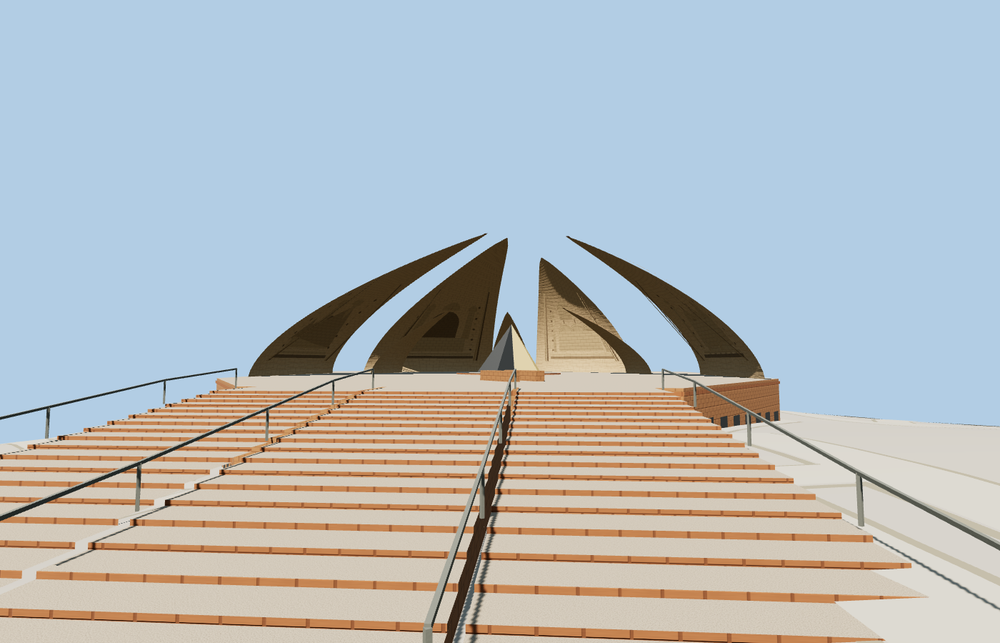

# Pakistan Monument

Seven independent curved petal shells above a faceted sandstone podium. The open interior has a tapered star and crescent, carved relief panels and broad divided stairs. Approach pillars, planted terraces, a barrel-roofed museum and a circular overlook complete the hilltop complex.

The 27,390-triangle source master rebuilds from the editable geometry. The four runtime levels have 638, 3,664, 7,963, 16,790 triangles. Skyline and district total 398,480 bytes. All six GLBs validate with zero errors, warnings or embedded images.

The viewer replaces nine records for the four large petals, four approach pillars and museum. It preserves two independent buildings, 68 road records, terrain, water and land cover. Every level preserves the seven shells, circular plaza, main stair and lower overlook. District through close-up include the museum entry and raised skylight. A failed load retains all nine footprints. Eviction releases model geometry.

Inspected 26 geographic and 12 standalone views. PMTiles places the large petal bases, pillars, approach, lookout and museum footprint on the standard terrain. Shell heights, relief likenesses, smaller petals and architectural details are estimated from photos. Museum interiors and readable inscriptions are outside the modeled scope. The native land-cover overlay visually flattens parts of the planted terraces. Physical-device timings remain unmeasured.

Run `node packages/worldgen/scripts/generate-pakistan-monument.mjs --check --ids=pakistan_monument` to confirm the source rebuild.
